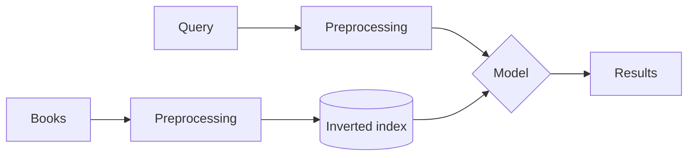

# Retrieval Catalog

A mini search engine for a small book catalog, built with Python and Streamlit for the
**Information Retrieval Systems** course (*Sistem Temu Kembali Informasi*, STKI), Session 1:
Introduction to Information Retrieval.

You type a query, choose a retrieval model, and the app shows the ranked results together
with every step behind them: how the query is preprocessed, which posting lists are read
from the inverted index, and how each book's score is calculated.

## Features

- **Three retrieval models:** Boolean (`AND`, `OR`, `NOT`), TF-IDF + Cosine Similarity, and BM25.
- **Score breakdown:** each result shows how much every query term contributed to its score.
- **Adjustable BM25:** sliders for `k₁` (tf saturation) and `b` (length normalization).
- **Query processing view:** case folding, tokenization, and stopword removal, step by step.
- **Inverted index view:** df, idf, and posting list for each query term, plus the full index.
- **Model comparison:** rankings from all three models side by side for the same query.
- **Add books:** new books are indexed immediately, so df, idf, and avgdl update live.

## Quick start

Requires Python 3.10 or newer.

```bash
pip install -r requirements.txt
streamlit run app.py
```

The app opens at `http://localhost:8501`.

The search engine can also be used without the interface:

```bash
python ir_engine.py "search engine ranking"
python ir_engine.py "programming AND NOT java" --model boolean
```

## Deploying to Streamlit Community Cloud

1. Push this folder to a GitHub repository (include `data/` and `.streamlit/`).
2. Open [share.streamlit.io](https://share.streamlit.io), choose **Create app**, and select the repository.
3. Set **Main file path** to `app.py` and click **Deploy**.

Every push to GitHub updates the app automatically.

## Project structure

```
.
├── app.py                 # Streamlit interface
├── ir_engine.py           # Retrieval engine (no Streamlit dependency)
├── data/books.json        # 18 sample books
├── requirements.txt
└── .streamlit/config.toml # Theme settings
```

The retrieval logic lives in `ir_engine.py` and is kept separate from the interface, so it
can be read on its own, reused in a notebook, or tested from the terminal.

## Data

`data/books.json` holds 18 sample books. Each one is a document:

| Field | Type | Use |
|---|---|---|
| `title`, `description` | Unstructured text | Preprocessed and indexed |
| `id`, `call_number`, `author` | Metadata | Shown on the result card |

Call numbers follow the Dewey Decimal style used on library catalog cards. Most books are
about information retrieval, programming, and machine learning; a few unrelated ones
(cooking, apple farming, mathematics) are included so that not every book matches every
query. The descriptions were written for this exercise and are not real library data.

## How it works



**1. Preprocessing.** Text is lowercased, split into words (`c++` is kept whole), and common
English stopwords (`the`, `of`, `in`, `how`, ...) are removed. No stemming is applied.

**2. Inverted index.** Every term maps to a posting list of the books that contain it and how
often (tf), for example `programming → B05:1 → B06:1 → B07:1 → B16:1`. The index is built once,
so a search only reads the posting lists of the query terms instead of scanning every book.

**3. Boolean model.** `AND` intersects posting lists, `OR` takes their union, `NOT` takes the
complement. A book either matches or it doesn't, so results are not ranked. Queries are read
left to right without parentheses; terms with no operator between them are joined with `AND`.

**4. TF-IDF + Cosine Similarity.** Books and the query become weighted vectors and are
compared by the angle between them:

$$w(t,d) = (1 + \log_{10} tf) \times \log_{10}\frac{N}{df} \qquad \cos(q,d) = \frac{\vec q \cdot \vec d}{|q|\,|d|}$$

Rare terms get a higher idf, so they count more.

**5. BM25.** A probabilistic model that is still a standard baseline today:

$$\text{score}(q,d) = \sum_{t \in q} idf(t) \cdot \frac{tf\,(k_1+1)}{tf + k_1\left(1 - b + b\,\frac{|d|}{avgdl}\right)}$$

`k₁` stops a repeated word from counting too much, and `b` keeps long documents from having an
advantage just because they are long.

## Example: "search engine ranking" with BM25

| Term | df | idf (BM25) |
|---|---:|---:|
| search | 5 | 1.2397 |
| engine | 1 | 2.5390 |
| ranking | 1 | 2.5390 |

| Rank | Book | Score |
|---:|---|---:|
| 1 | Search Engines: Information Retrieval in Practice | 4.1006 |
| 2 | Information Retrieval: Implementing and Evaluating Search Engines | 4.1006 |
| 3 | Dense Retrieval and Semantic Search | 2.0058 |
| 4 | Evaluating Retrieval Systems | 1.3004 |
| 5 | Introduction to Information Retrieval | 0.9614 |

- `engine` and `ranking` appear in only one book each, so they weigh about twice as much as `search`.
- The top two books both contain `search` three times, yet it adds only 1.90, not three times
  a single occurrence. This is tf saturation.
- Books 4 and 5 both contain `search` once, but book 5 is longer, so it scores lower.
- Book 1's title says *Search Engines*, but without stemming `engines` does not match `engine`.

## Queries worth trying

| Query | Model | What it shows |
|---|---|---|
| `programming AND object` | Boolean | Intersection of two posting lists |
| `java OR c++` | Boolean | Union of two posting lists |
| `programming AND NOT java` | Boolean | Complement |
| `document search evaluation` | TF-IDF | How idf weights each term |
| `apple` | BM25 | **Ambiguity:** returns the apple-farming book and the iPhone book |
| `places to eat in semarang` | BM25 | **Synonyms:** `eat` doesn't match `restaurants`; only `semarang` does |

The last two show the main weakness of keyword search, and the reason semantic search and
dense retrieval were developed later.

## Adding books

Add an object to `data/books.json` with a unique `id`:

```json
{"id": "B19", "call_number": "006.312 ABC i", "title": "Introduction to Data Mining", "author": "Author Name", "description": "One or two sentences about the book."}
```

The index is rebuilt when the app starts. Books added through the sidebar form are kept only
for the current browser session.

## Limitations

- Small sample collection (18 books), so scores illustrate the models rather than measure them.
- No stemming: `engine` and `engines` are different terms.
- Boolean queries don't support parentheses.
- All three models match words, not meaning.

## References

- Manning, C. D., Raghavan, P., & Schütze, H. (2008). *Introduction to Information Retrieval*. Cambridge University Press.
- Robertson, S., & Zaragoza, H. (2009). The Probabilistic Relevance Framework: BM25 and Beyond. *Foundations and Trends in Information Retrieval*, 3(4).
- STKI Session 1 lecture slides, Faculty of Computer Science, Universitas Dian Nuswantoro.

---

Rizqi Aditya, Informatics Engineering, Universitas Dian Nuswantoro.
