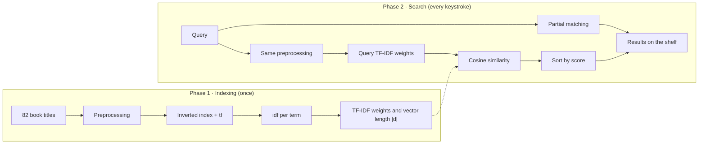

# 📚 Bookshelf: Book Title Search Engine

A book title search engine built on **Information Retrieval** principles, using the
**Vector Space Model (TF-IDF + Cosine Similarity)**, written in Python with Streamlit.
Type a letter or a word from a book title and the matching books appear on the shelf,
ordered by relevance. Click a book to see its cover and details.

This project was built for the **Information Retrieval Systems** course
(*Sistem Temu Kembali Informasi*, STKI).

🔗 **Live demo:** https://information-retrieval-system-kzqtwhfxy6mnmgcp8ns7el.streamlit.app/

## Table of contents

- [Features](#features)
- [Screenshots](#screenshots)
- [Data](#data)
- [How it works](#how-it-works)
- [Worked example](#worked-example)
- [Project structure](#project-structure)
- [Running locally](#running-locally)
- [Deploying to Streamlit Community Cloud](#deploying-to-streamlit-community-cloud)
- [Adding books and covers](#adding-books-and-covers)
- [Limitations](#limitations)
- [References](#references)


## Features

- **Search as you type.** Results update on every keystroke, no need to press Enter.
  Typing `l` immediately shows every title that starts with L.
- **Match words anywhere in a title.** Typing `merah` finds *Marmut Merah Jambu*.
- **Partial-word search.** Part of a word is enough: `asu` and even `uha` find
  *Salah Asuhan*, and `kara` finds *The Brothers Karamazov*. The matched part is
  highlighted on the book spine.
- **Relevance ranking.** Results are ordered by cosine similarity score, highest first
  (leftmost on the shelf = rank 1), and the rank number is shown on the shelf plank.
- **Indonesian stemming.** `menceritakan` and `bercerita` are both reduced to the root
  word `cerita` ("story").
- **English title support.** English stopwords, plural forms (`brothers` → `brother`),
  and accented letters (`Misérables` → `miserables`).
- **Book details.** Click a book spine to see its cover, title, author, genre, year of
  publication, publisher, rank, and cosine score.
- **Transparent process.** Every retrieval step for the current query is shown on the
  page, from preprocessing through score calculation.
- **Inverted index viewer.** The full index (term, df, idf, and the titles containing
  each term) can be browsed inside the app.
- **Responsive.** Works on both desktop and mobile.

## Screenshots

| Search results | Book details |
|---|---|
|  | 

<details>
  
<summary><b>Retrieval steps shown in the app</b></summary>


</details>

## Data

The corpus contains **82 books**, stored in [`books.json`](books.json). Most titles are in
Indonesian, and the rest are in English:

| Group | Count | Examples |
|---|---:|---|
| Indonesian novels | 44 | *Laskar Pelangi*, *Bumi Manusia*, *Laut Bercerita*, *Siti Nurbaya* |
| World classics | 20 | *The Brothers Karamazov*, *Crime and Punishment*, *1984*, *The Little Prince* |
| Japanese literature | 6 | *No Longer Human*, *Rashomon*, *Kokoro*, *Norwegian Wood* |
| Manga | 12 | *Berserk*, *Vagabond*, *Slam Dunk*, *Monster* |

Each book is one **document** with the following fields:

| Field | Data type | Role in the system |
|---|---|---|
| `title` | **Unstructured** (natural-language text) | Processed and indexed by the retrieval engine |
| `author`, `genre`, `year`, `publisher` | Structured (metadata) | Displayed as book information |
| `cover` | Image file name | Cover image shown in the book details |

**The unstructured data is the text of the book titles.** Titles have no fixed format:
they vary in length and contain punctuation (*Dilan: Dia adalah Dilanku Tahun 1990*),
numbers (*Negeri 5 Menara*), affixed words (*Laut Bercerita*), accented letters
(*Les Misérables*), and a mix of Indonesian and English. For that reason, title text
must be preprocessed before it can be indexed and searched.

> For translated works, the year and publisher listed are those of the original first
> edition. For manga, the year is when serialization began.

## How it works

The system runs in two phases. **Indexing** runs once when the app starts, and
**searching** runs every time the user types.



### 1. Preprocessing

| Step | Description | Example |
|---|---|---|
| Case folding | Convert to lowercase and strip accents | `Les Misérables` → `les miserables` |
| Tokenization | Split text into words and drop punctuation | `dilan: dia adalah...` → `dilan`, `dia`, `adalah`, ... |
| Stopword removal | Remove common Indonesian and English words | `yang`, `dan`, `di`, `the`, `of` |
| Stemming | Strip affixes using a simplified Nazief–Adriani algorithm with a root-word dictionary | `menceritakan` → `cerita`, `pemimpi` → `mimpi`, `brothers` → `brother` |

The stemmer only removes an affix when the result is in the root-word dictionary, so
words such as `menara` or `pelangi` are not cut incorrectly.

### 2. Inverted index

Each term is recorded along with the documents it appears in and its frequency (tf).
The result is **143 terms** across 82 titles. During a search, only documents that
contain at least one query term are scored.

### 3. TF-IDF weighting

$$idf(t) = \log_{10}\frac{N}{df(t)} \qquad w(t,d) = tf(t,d) \times idf(t)$$

Rare terms get higher weights because they distinguish one title from the others better.

### 4. Cosine similarity

$$\cos(q,d) = \frac{\sum_t w(t,q)\cdot w(t,d)}{|q| \times |d|}$$

Documents are sorted by score, highest first. The leftmost book on the shelf is rank 1.

### 5. Partial matching

Cosine similarity only matches whole words, so titles that **contain** the typed text are
also shown. This makes results appear from the very first letter typed and lets users find
a book from part of a word. There are three kinds of partial match, each active from a
minimum query length:

| Kind | Active from | Example |
|---|---|---|
| Start of the title | 1 character | `l` → *Laskar Pelangi*, *Laut Bercerita*, ... |
| Start of any word | 2 characters | `asu` → *Salah **Asu**han* |
| Inside a word | 3 characters | `uha` → *Salah As**uha**n* |

The minimum lengths keep very short queries focused: typing `l` shows only titles that
start with L, rather than every title containing the letter l.

Partial matches are placed after the cosine results, grouped in the order of the table
above and sorted alphabetically within each group. They have no score. This is a
string-matching feature, not part of the Vector Space Model.

## Worked example

Query: **"Hujan bulan yang menceritakan"** ("Rain, moon, that tells a story"), N = 82

| Step | Result |
|---|---|
| Case folding | `hujan bulan yang menceritakan` |
| Tokenization | `hujan` · `bulan` · `yang` · `menceritakan` |
| Stopword removal | `yang` removed |
| Stemming | `menceritakan` → `cerita` |

**Query weights:**

| Term | tf | df | idf = log₁₀(82/df) | w(q) |
|---|---:|---:|---:|---:|
| hujan | 1 | 2 | 1.6128 | 1.6128 |
| bulan | 1 | 2 | 1.6128 | 1.6128 |
| cerita | 1 | 1 | 1.9138 | 1.9138 |

Query vector length |q| = 2.9774

**Ranking:**

| Rank | Title | Σ w(q)·w(d) | \|d\| | Cosine |
|---:|---|---:|---:|---:|
| 1 | Hujan Bulan Juni | 5.2021 | 2.9774 | **0.5868** |
| 2 | Bulan | 2.6011 | 1.6128 | **0.5417** |
| 3 | Hujan | 2.6011 | 1.6128 | **0.5417** |
| 4 | Laut Bercerita | 3.6627 | 2.7065 | **0.4545** |

*Hujan Bulan Juni* ranks first because it matches two query terms. *Laut Bercerita*
matches only `cerita`, but it is still found because stemming reduces both
`menceritakan` and `bercerita` to the same root word.

## Project structure

```
.
├── pencarian_buku.py        # Streamlit app (user interface)
├── ir.py                    # Retrieval engine: preprocessing, stemming,
│                            #   inverted index, TF-IDF, cosine similarity
├── books.json               # Corpus: 82 books
├── covers/                  # Book cover images (optional)
├── docs/                    # Images used in this README
├── requirements.txt         # Python dependencies
└── .streamlit/config.toml   # App color theme
```

The retrieval engine (`ir.py`) is separate from the interface and does not depend on
Streamlit, so it can be tested directly from the terminal:

```bash
python ir.py "hujan bulan yang menceritakan"
```

## Running locally

Requires Python 3.10 or newer.

```bash
git clone https://github.com/USERNAME/REPO-NAME.git
cd REPO-NAME
pip install -r requirements.txt
streamlit run pencarian_buku.py
```

The app opens in your browser at `http://localhost:8501`.

## Deploying to Streamlit Community Cloud

1. Push all files to a GitHub repository, including the `.streamlit` folder.
2. Go to [share.streamlit.io](https://share.streamlit.io), choose **Create app**, and
   select this repository.
3. Set **Main file path** to `pencarian_buku.py`, then click **Deploy**.

The app updates automatically whenever changes are pushed to GitHub.

## Adding books and covers

**Add a book:** append a new object to `books.json` using the same format:

```json
{"title": "Book Title", "author": "Author Name", "genre": ["Novel", "Drama"], "year": 2020, "publisher": "Publisher Name", "cover": "book_title.jpg"}
```

The index is rebuilt automatically when the app starts.

**Add a cover:** save the image in the `covers/` folder using the file name given in the
`cover` field, for example `covers/laskar_pelangi.jpg`. If the image is missing, the app
shows a simple generated cover with the title and author name.

## Limitations

- Only **book titles** are indexed. Titles are very short (1–6 words), so tf is
  almost always 1.
- The stemmer uses a root-word dictionary built specifically for this collection.
  Words outside the dictionary are not stemmed.
- Partial matching is plain string matching: it does not use stemming and does not
  affect cosine scores. Matches inside a word require at least 2 characters.
- Retrieval quality has not yet been evaluated with metrics such as precision, recall,
  or MAP.

## References

- Manning, C. D., Raghavan, P., & Schütze, H. (2008). *Introduction to Information Retrieval*.
  Cambridge University Press.
- Nazief, B., & Adriani, M. (1996). *Confix-Stripping: Approach to Stemming Algorithm for
  Bahasa Indonesia*. Faculty of Computer Science, Universitas Indonesia.

---

Built by **Rizqi Aditya**, Informatics Engineering, Universitas Dian Nuswantoro,
for the Information Retrieval Systems course.
