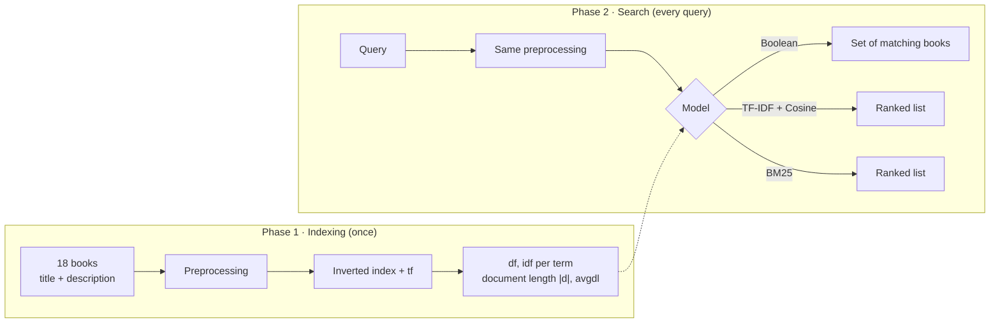

# 📇 Retrieval Catalog: Mini Search Engine Lab

A mini search engine for a sample book catalog, built on **Information Retrieval** principles
and written in Python with Streamlit. Type a query and the matching books appear as library
catalog cards, ranked by relevance. Switch between **three retrieval models** (Boolean,
TF-IDF + Cosine Similarity, and BM25) and watch every step behind the search box: query
preprocessing, inverted index lookup, and score calculation.

This project was built for **Session 1: Introduction to Information Retrieval** of the
**Information Retrieval Systems** course (*Sistem Temu Kembali Informasi*, STKI).

🔗 **Live demo:**


## Table of contents

- [Features](#features)
- [Screenshots](#screenshots)
- [Data](#data)
- [How it works](#how-it-works)
- [Worked example](#worked-example)
- [Example queries and what they show](#example-queries-and-what-they-show)
- [Project structure](#project-structure)
- [Running locally](#running-locally)
- [Deploying to Streamlit Community Cloud](#deploying-to-streamlit-community-cloud)
- [Adding books](#adding-books)
- [Limitations](#limitations)
- [References](#references)

## Features

- **Three retrieval models.** Boolean (`AND`, `OR`, `NOT`), TF-IDF + Cosine Similarity, and
  BM25, selectable from the sidebar.
- **Relevance ranking.** Ranked models sort results by score, highest first, and show the
  score on a "library stamp" on each card.
- **Score breakdown.** Each result card lists how much every query term contributed to its
  score, so you can see *why* a book ranks where it does.
- **Highlighted matches.** Query terms are highlighted in the title and description.
- **Interactive BM25 parameters.** Sliders for `k₁` (tf saturation) and `b` (document length
  normalization) re-rank the results instantly.
- **Transparent query processing.** The *Query processing* tab shows case folding,
  tokenization, and stopword removal for the current query.
- **Inverted index viewer.** The *Inverted index* tab shows df, idf, and the posting list of
  every query term, and the full index can be browsed.
- **Model comparison.** The *Model comparison* tab puts the rankings of all three models side
  by side for the same query.
- **Add your own books.** New books are indexed immediately, so df, idf, and avgdl update live.
- **Stopword toggle.** See how stopword removal changes the index and the results.

## Screenshots

| Search results | Inverted index |
|---|---|
|  | 

</details>

## Data

The corpus contains **18 sample books**, stored in [`data/books.json`](data/books.json). Each
book has a Dewey Decimal Classification (DDC) style call number, the same kind used on real
library catalog cards:

| DDC group | Count | Examples |
|---|---:|---|
| 025 · Information science & retrieval | 4 | *Introduction to Information Retrieval*, *Search Engines: Information Retrieval in Practice* |
| 005 · Programming & software | 6 | *Introduction to Java*, *Design Patterns*, *Relational Databases* |
| 006 · Machine learning & NLP | 4 | *Machine Learning for Text*, *Retrieval-Augmented Generation* |
| Other subjects | 4 | *Discrete Mathematics*, *Growing Apples in Malang*, *Indonesian Cuisine* |

The "other subjects" group is there on purpose: it gives the search engine documents that
should **not** match most queries, and it sets up the ambiguity example (`apple`) below.

Each book is one **document** with the following fields:

| Field | Data type | Role in the system |
|---|---|---|
| `title`, `description` | **Unstructured** (natural-language text) | Preprocessed and indexed by the retrieval engine |
| `id`, `call_number`, `author` | Structured (metadata) | Displayed on the catalog card |

**The unstructured data is the text of the title and description.** It has no fixed format:
it varies in length and contains punctuation, hyphenated words (*object-oriented*), symbols
(*C++*), and plural forms. For that reason the text must be preprocessed before it can be
indexed and searched.

> The descriptions were written for this exercise. Titles and authors are illustrative and
> the collection is not real library data.

## How it works

The system runs in two phases. **Indexing** runs once when the app starts (and again when a
book is added), and **searching** runs every time the query or settings change.



This follows the components of an IR system covered in the lecture:
*document collection → indexing → query processing → matching → ranking*.

### 1. Preprocessing

| Step | Description | Example |
|---|---|---|
| Case folding | Convert to lowercase | `Search Engines` → `search engines` |
| Tokenization | Split text into words, drop punctuation, keep `+` so `c++` stays whole | `object-oriented programming` → `object`, `oriented`, `programming` |
| Stopword removal | Remove common English words | `how`, `do`, `the`, `of`, `in`, `to` |

No stemming is applied, so `engine` and `engines` are different terms. The worked example
below shows the effect of this.

### 2. Inverted index

Each term is mapped to a **posting list**: the books that contain it and its frequency (tf).

```
programming → B05:1 → B06:1 → B07:1 → B16:1
```

The result is **162 terms** across 18 books (average document length **13.39** tokens after
stopword removal). The index is built once; a search then only opens the posting lists of
the query terms instead of scanning every book (linear search).

### 3. Boolean model

$$R(q,d) = \begin{cases}1 & \text{if } d \text{ satisfies the query expression}\\ 0 & \text{otherwise}\end{cases}$$

`AND` intersects posting lists, `OR` takes their union, and `NOT` takes the complement. The
query is read left to right without parentheses, and terms written without an operator
between them are joined with `AND`. Results are **unranked**: every matching book is treated
as equally relevant.

### 4. TF-IDF weighting + Cosine similarity

$$idf(t) = \log_{10}\frac{N}{df(t)} \qquad w(t,d) = \left(1 + \log_{10} tf(t,d)\right) \times idf(t)$$

$$\cos(q,d) = \frac{\sum_t w(t,q)\cdot w(t,d)}{|q| \times |d|}$$

Rare terms get higher weights because they distinguish one document from the others better.
Dividing by the vector lengths keeps long descriptions from winning just because they
contain more words.

### 5. BM25

$$\text{score}(q,d) = \sum_{t \in q} idf(t) \cdot \frac{tf(t,d)\,(k_1+1)}{tf(t,d) + k_1\left(1 - b + b \cdot \frac{|d|}{avgdl}\right)}
\qquad idf(t) = \ln\left(1 + \frac{N - df(t) + 0.5}{df(t) + 0.5}\right)$$

- **k₁** (default 1.5) controls **saturation**: a term that appears 3 times does not count
  3 times as much as one that appears once.
- **b** (default 0.75) controls **length normalization**: longer documents are penalized
  slightly.
- **avgdl** is the average document length in the collection.

## Worked example

Query: **"search engine ranking"**, model BM25, N = 18, avgdl = 13.39, k₁ = 1.5, b = 0.75

| Step | Result |
|---|---|
| Case folding | `search engine ranking` |
| Tokenization | `search` · `engine` · `ranking` |
| Stopword removal | nothing removed |
| Terms looked up | `search`, `engine`, `ranking` |

**Term statistics:**

| Term | df | idf (BM25) | idf = log₁₀(18/df) | Posting list |
|---|---:|---:|---:|---|
| search | 5 | 1.2397 | 0.5563 | B01:1 → B02:3 → B03:3 → B12:3 → B13:1 |
| engine | 1 | 2.5390 | 1.2553 | B03:1 |
| ranking | 1 | 2.5390 | 1.2553 | B02:1 |

**BM25 ranking:**

| Rank | Book | Length \|d\| (tokens) | tf (search, engine, ranking) | Contributions | Score |
|---:|---|---:|---|---|---:|
| 1 | B02 *Search Engines: Information Retrieval in Practice* | 18 | 3, 0, 1 | search 1.9024 + ranking 2.1983 | **4.1006** |
| 2 | B03 *Information Retrieval: Implementing and Evaluating Search Engines* | 18 | 3, 1, 0 | search 1.9024 + engine 2.1983 | **4.1006** |
| 3 | B12 *Dense Retrieval and Semantic Search* | 15 | 3, 0, 0 | search 2.0058 | **2.0058** |
| 4 | B13 *Evaluating Retrieval Systems* | 12 | 1, 0, 0 | search 1.3004 | **1.3004** |
| 5 | B01 *Introduction to Information Retrieval* | 22 | 1, 0, 0 | search 0.9614 | **0.9614** |

What this example shows:

- **Rare terms matter more.** `engine` and `ranking` each appear in only one book, so their
  idf (2.5390) is about twice that of `search` (1.2397).
- **tf saturates.** In B02, `search` appears 3 times but contributes only 1.9024, not three
  times the single-occurrence value. Compare B13, where one occurrence gives 1.3004.
- **Length normalization.** B13 and B01 both contain `search` once, but B01 is longer
  (22 tokens vs 12), so its contribution drops from 1.3004 to 0.9614.
- **No stemming.** B02's title says *Search **Engines***, but without stemming
  `engines` ≠ `engine`, so B02 gets no credit for `engine` (tf = 0). It matches `ranking`
  instead, while B03 matches `engine` in its description (*text search engine*). Both rare
  terms have the same idf and both books have the same length, so they tie at 4.1006.
- **Different models, different order.** With TF-IDF + Cosine, B03 (0.2711) ranks ahead of
  B02 (0.2536) because B03's vector is shorter (|d| = 4.0302 vs 4.3091).

## Example queries and what they show

The app has buttons for these queries:

| Query | Model | What to look at |
|---|---|---|
| `search engine ranking` | BM25 | The worked example above |
| `programming AND object` | Boolean | Intersection of two posting lists → B05, B07 |
| `java OR c++` | Boolean | Union of two posting lists → B05, B06 |
| `programming AND NOT java` | Boolean | Complement: programming books other than Java → B06, B07, B16 |
| `document search evaluation` | TF-IDF | How idf weights each term |
| `apple` | BM25 | **Ambiguity:** returns both the apple-growing book and the iPhone book (Apple the company) |
| `places to eat in semarang` | BM25 | **Synonyms:** the cuisine book is found only through `semarang`; `eat` does not match `restaurants` |
| `text classification` | BM25 | A focused query with one clear winner |

The two keyword-search problems above (ambiguity and synonyms) are the reason **semantic
search** and **dense retrieval** were developed, covered later in the course under Neural IR.

## Project structure

```
.
├── app.py                   # Streamlit app (user interface)
├── ir_engine.py             # Retrieval engine: preprocessing, inverted index,
│                            #   Boolean, TF-IDF + cosine, BM25
├── data/
│   └── books.json           # Corpus: 18 sample books
├── docs/                    # Images used in this README
├── requirements.txt         # Python dependencies
└── .streamlit/config.toml   # App color theme
```

The retrieval engine (`ir_engine.py`) is separate from the interface and does not depend on
Streamlit, so it can be tested directly from the terminal:

```bash
python ir_engine.py "search engine ranking"
python ir_engine.py "programming AND NOT java" --model boolean
python ir_engine.py "document search evaluation" --model tfidf
```

## Running locally

Requires Python 3.10 or newer.

```bash
git clone https://github.com/USERNAME/REPO-NAME.git
cd REPO-NAME
pip install -r requirements.txt
streamlit run app.py
```

The app opens in your browser at `http://localhost:8501`.

## Deploying to Streamlit Community Cloud

1. Push all files to a GitHub repository, including the `data` and `.streamlit` folders.
2. Go to [share.streamlit.io](https://share.streamlit.io), choose **Create app**, and select
   this repository.
3. Set **Main file path** to `app.py`, then click **Deploy**.

The app updates automatically whenever changes are pushed to GitHub.

## Adding books

**Permanently:** append a new object to `data/books.json` using the same format:

```json
{"id": "B19", "call_number": "006.312 ABC i", "title": "Introduction to Data Mining", "author": "Author Name", "description": "One or two sentences about the book."}
```

Make sure the `id` is unique. The index is rebuilt automatically when the app starts. The
indexed text is the `title` plus the `description`.

**Temporarily:** use the *Add a book to the collection* form in the sidebar. The book is
indexed right away, but it is kept only for the current browser session.

## Limitations

- The collection is small (**18 books**) and written for practice, so the scores illustrate
  how the models work rather than how they perform on real data.
- No stemming: `engine` / `engines` and `apple` / `apples` are treated as different words.
- Boolean queries are evaluated left to right and do not support parentheses.
- All three models are lexical (keyword-based), so they do not understand meaning.
- Retrieval quality has not yet been evaluated with metrics such as precision, recall,
  or nDCG.

## References

- Manning, C. D., Raghavan, P., & Schütze, H. (2008). *Introduction to Information Retrieval*.
  Cambridge University Press.
- Croft, W. B., Metzler, D., & Strohman, T. (2010). *Search Engines: Information Retrieval in
  Practice*. Addison-Wesley.
- Robertson, S., & Zaragoza, H. (2009). The Probabilistic Relevance Framework: BM25 and Beyond.
  *Foundations and Trends in Information Retrieval*, 3(4), 333–389.
- Lecture slides, Session 1: Introduction to Information Retrieval, STKI Lecturer Team,
  Faculty of Computer Science, Universitas Dian Nuswantoro.

---

Built by **Rizqi Aditya**, Informatics Engineering, Universitas Dian Nuswantoro,
for the Information Retrieval Systems course.
