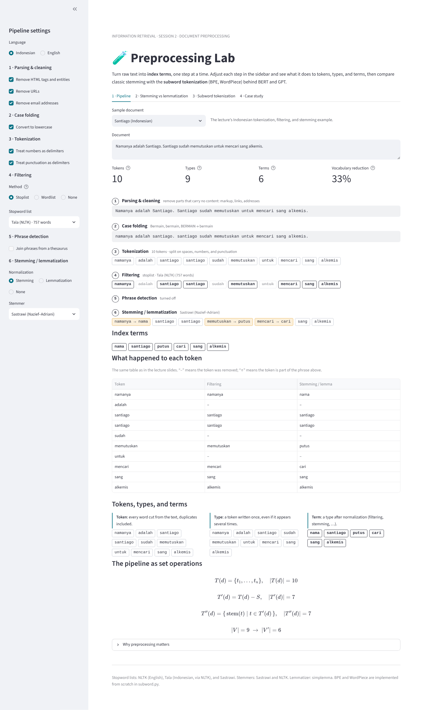
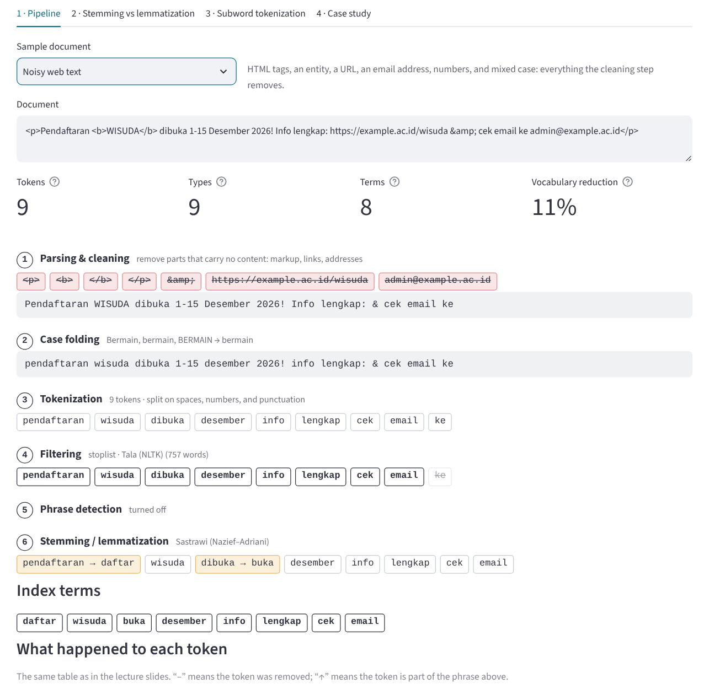
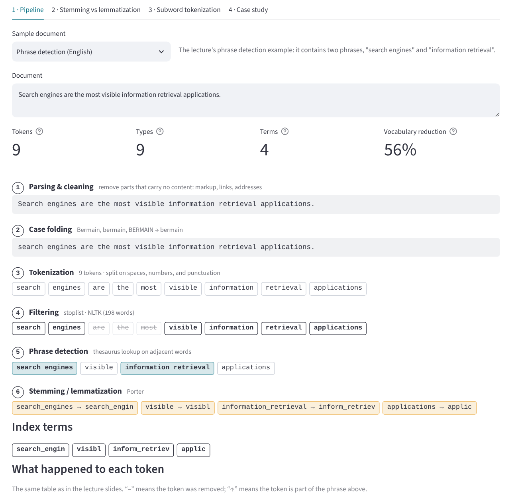
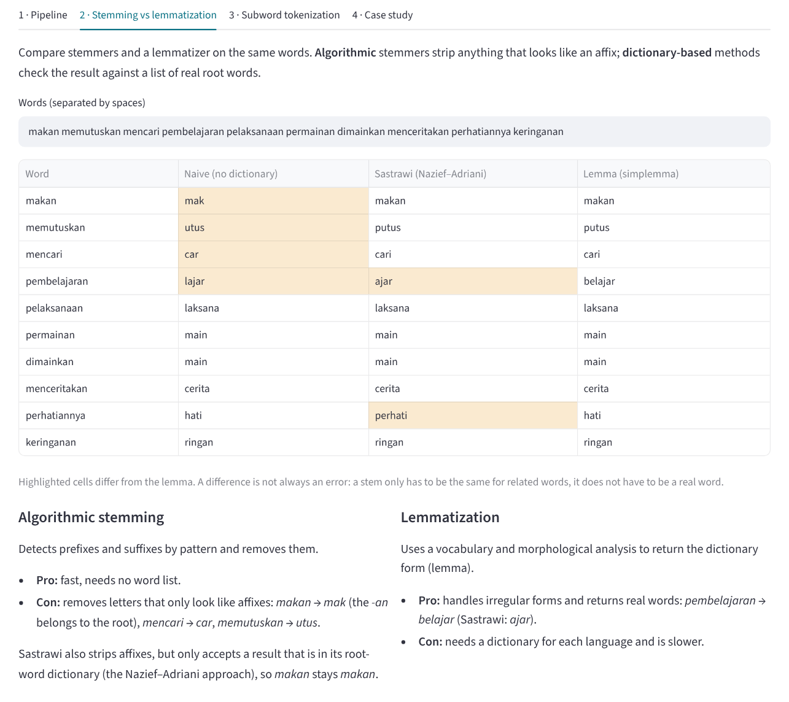
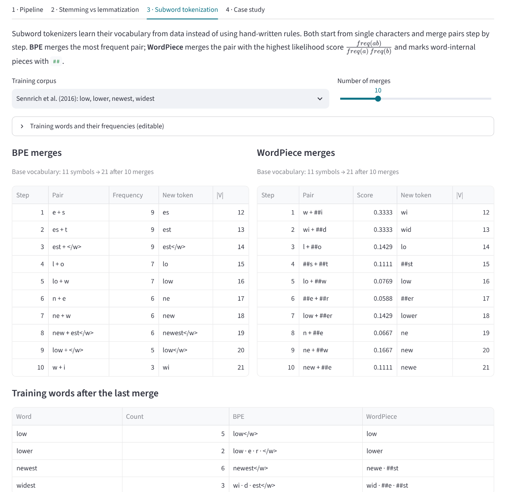
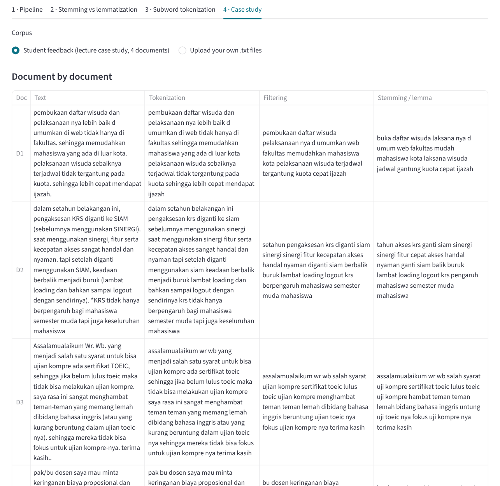
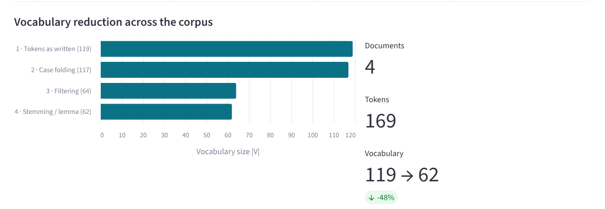
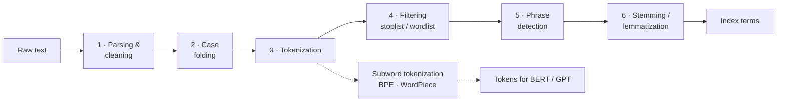

# 🧪 Preprocessing Lab: From Raw Text to Index Terms

An interactive lab for **document preprocessing**, the step that turns raw, unstructured text
into the index terms a search engine works with. Built with Python and Streamlit. Paste any
text and watch it go through the classic pipeline (cleaning, case folding, tokenization,
stopword removal, phrase detection, stemming) one step at a time, then compare rule-based
stemming with the **subword tokenization** (BPE, WordPiece) used by BERT and GPT.

This project was built for **Session 2: Document Preprocessing** of the **Information
Retrieval Systems** course (*Sistem Temu Kembali Informasi*, STKI). It follows
*Retrieval Catalog* from Session 1, which uses the output of this step to build an
inverted index.

🔗 **Live demo:** *add the Streamlit link here after deploying*

## View

The full interface: every pipeline step can be switched on, off, or changed in the sidebar;
the main area shows the document, the counts of tokens, types, and terms, and the output of
each step.



## Table of contents

- [View](#view)
- [Features](#features)
- [Screenshots](#screenshots)
- [How it works](#how-it-works)
- [Worked examples](#worked-examples)
- [Subword tokenization](#subword-tokenization)
- [Case study](#case-study)
- [Data and resources](#data-and-resources)
- [Project structure](#project-structure)
- [Running locally](#running-locally)
- [Deploying to Streamlit Community Cloud](#deploying-to-streamlit-community-cloud)
- [Customizing](#customizing)
- [Limitations](#limitations)
- [References](#references)

---

## Features

- **Step-by-step pipeline.** Each of the six steps shows its own output, so you can see exactly
  what it changes. Removed tokens are struck through and changed tokens are highlighted.
- **Every step is adjustable.** Turn cleaning rules, case folding, filtering, phrase detection,
  and normalization on or off from the sidebar and watch the counts change.
- **Indonesian and English.** Language-specific stopword lists, stemmers, and lemmatizers.
- **Two filtering methods.** *Stoplist* (remove listed non-descriptive words, with the Tala or
  Sastrawi list) and *wordlist* (keep only listed descriptive words).
- **Phrase detection.** Joins adjacent words found in an editable thesaurus, such as
  *search engines* or *information retrieval*.
- **Tokens, types, and terms.** Counted and listed side by side, with the vocabulary reduction
  written as the set operations from the lecture: T(d), T'(d) = T(d) − S, T''(d), |V| → |V'|.
- **Stemmer comparison.** Naive affix stripping vs Sastrawi (Nazief–Adriani) vs lemmatization
  for Indonesian; Porter vs Snowball vs Lancaster vs lemmatization for English.
- **BPE and WordPiece from scratch.** Train both on a corpus, step through every merge, and
  tokenize unseen words to see how subwords solve the out-of-vocabulary problem.
- **Pretrained tokenizers.** Optionally compare with the real BERT, GPT-2, and IndoBERT
  tokenizers from the Hugging Face Hub.
- **Case study.** Process the lecture's four student-feedback documents (or your own `.txt`
  files), see the vocabulary shrink stage by stage, and download the resulting terms as CSV.

## Screenshots

**Pipeline on noisy web text.** Cleaning removes HTML tags, an entity, a URL, and an email
address; tokenization drops the numbers; filtering removes *ke*; stemming turns
*pendaftaran* into *daftar* and *dibuka* into *buka*.



**Phrase detection.** *search engines* and *information retrieval* are kept together as single
terms instead of four separate words.



**Stemming vs lemmatization.** Highlighted cells differ from the dictionary form. The naive
stemmer cuts *makan* to *mak* and *mencari* to *car*; Sastrawi avoids both by checking its
root-word dictionary.



**Subword tokenization.** BPE and WordPiece trained on the corpus from Sennrich et al. (2016),
merge by merge.



<details>
<summary><b>Case study: lecture documents and vocabulary reduction</b></summary>





</details>

## How it works



The solid path is the classic pipeline used with TF-IDF and BM25. The dotted path is the
modern alternative: subword tokenizers replace stopword removal and stemming for neural models.

| Step | What it does | Example |
|---|---|---|
| 1 · Parsing & cleaning | Removes parts that carry no content: HTML tags and entities, URLs, email addresses | `<b>WISUDA</b>` → `WISUDA` |
| 2 · Case folding | Converts every letter to lowercase | `Bermain`, `BERMAIN` → `bermain` |
| 3 · Tokenization | Splits text into tokens; numbers and punctuation act as delimiters | `1-15 Desember 2026!` → `desember` |
| 4 · Filtering | **Stoplist:** removes words on a stopword list. **Wordlist:** keeps only words on a list | `adalah`, `sudah`, `untuk` removed |
| 5 · Phrase detection | Joins adjacent words that form a phrase in the thesaurus | `information retrieval` → one term |
| 6 · Stemming / lemmatization | Reduces each word to its root (stem) or dictionary form (lemma) | `memutuskan` → `putus` |

**Tokens, types, and terms** (from the lecture):

- **Token**: every word cut from the text, duplicates included.
- **Type**: a token written once, even if it appears several times.
- **Term**: a type after normalization (filtering, stemming, …). These are the index terms.

As set operations, where S is the stopword set:

```
T(d)   = {t1, t2, ..., tn}            tokens of document d
T'(d)  = T(d) − S                     after stopword removal
T''(d) = {stem(t) | t ∈ T'(d)}        after stemming
|V'| << |V|                           the vocabulary shrinks
```

**Stemming methods:**

| Method | How | Strength | Weakness |
|---|---|---|---|
| Algorithmic (naive affix stripping, Porter) | Removes anything that looks like an affix | Fast, no dictionary | Over-stems: `makan` → `mak` |
| Dictionary-based (Sastrawi, Nazief–Adriani) | Strips affixes, accepts the result only if it is a root word | Accurate for Indonesian | Needs a root-word dictionary |
| Lemmatization (simplemma) | Looks up the dictionary form | Handles irregular forms: `saw` → `see` | Needs a dictionary per language, slower |

## Worked examples

**Indonesian:** *"Namanya adalah Santiago. Santiago sudah memutuskan untuk mencari sang alkemis."*
(Tala stoplist, Sastrawi stemmer)

| Token | Filtering | Stemming |
|---|---|---|
| namanya | namanya | nama |
| adalah | – | – |
| santiago | santiago | santiago |
| santiago | santiago | santiago |
| sudah | – | – |
| memutuskan | memutuskan | putus |
| untuk | – | – |
| mencari | mencari | cari |
| sang | sang | sang |
| alkemis | alkemis | alkemis |

10 tokens → 9 types → **6 terms**: `nama`, `santiago`, `putus`, `cari`, `sang`, `alkemis`.

The lecture slide also removes *sang*. The Tala list does not contain it, which shows that
the result of filtering depends on the stopword list you choose.

**English:** *"They are applied to the words in the texts."* (NLTK stoplist)

| Stemmer | Terms |
|---|---|
| Porter | `appli`, `word`, `text` |
| Snowball | `appli`, `word`, `text` |
| Lancaster | `apply`, `word`, `text` |
| Lemmatization | `apply`, `word`, `text` |

Porter turns *applied* into *appli*. That is not a word, but it is still a valid stem: *apply*,
*applied*, and *applies* all map to the same stem, which is all a search engine needs.

**Code example from the lecture:** *"Pembelajaran mesin digunakan untuk klasifikasi dokumen"*
gives `ajar`, `mesin`, `klasifikasi`, `dokumen`. The slide's output also contains `guna`
(from *digunakan*), but both stopword lists bundled here list *digunakan* as a stopword, so it
is removed before stemming.

## Subword tokenization

Both algorithms start from single characters and merge one pair per step:

- **BPE** (Sennrich et al., 2016) merges the most **frequent** adjacent pair. Used by GPT-2,
  GPT-3, GPT-4, and RoBERTa.
- **WordPiece** merges the pair with the highest **likelihood** score
  freq(ab) / (freq(a) × freq(b)) and marks word-internal pieces with `##`. Used by BERT,
  DistilBERT, and mBERT.

First merges on the corpus from the BPE paper (*low* ×5, *lower* ×2, *newest* ×6, *widest* ×3):

| Step | BPE merge | Frequency | WordPiece merge | Score |
|---:|---|---:|---|---:|
| 1 | e + s → es | 9 | w + ##i → wi | 0.3333 |
| 2 | es + t → est | 9 | wi + ##d → wid | 0.3333 |
| 3 | est + `</w>` → est`</w>` | 9 | l + ##o → lo | 0.1429 |
| 4 | l + o → lo | 7 | ##s + ##t → ##st | 0.1111 |
| 5 | lo + w → low | 7 | lo + ##w → low | 0.0769 |

Steps 4 and 5 are the `l o w` → `lo w` → `low` example from the lecture.

After 10 merges, words that never appeared in training:

| Word | Word-level | BPE | WordPiece |
|---|---|---|---|
| lowest | `[UNK]` | low · est`</w>` | low · ##e · ##st |
| wider | `[UNK]` | wi · d · e · r · `</w>` | wid · ##er |
| slow | `[UNK]` | s · low`</w>` | `[UNK]` |

A word-level vocabulary has no entry for any of them (the OOV problem). The subword
tokenizers build them from known pieces. WordPiece still gives `[UNK]` for *slow* because the
letter *s* never started a word in training.

| Classic (NLTK, Sastrawi) | Modern (subword) |
|---|---|
| Word-level tokenization | Subword tokenization |
| Rule-based stemming | Learned from data |
| Manual stopword list | No explicit stopwords |
| Language-specific | Works across languages |
| Suits TF-IDF and BM25 | Required by BERT and GPT |

## Case study

The four student-feedback documents from the lecture (about graduation registration, the KRS
system, the TOEIC requirement, and tuition fees), processed with the default settings:

| Stage | Vocabulary size \|V\| |
|---|---:|
| 1 · Tokens as written | 119 |
| 2 · Case folding | 117 |
| 3 · Filtering (Tala stoplist) | 64 |
| 4 · Stemming (Sastrawi) | 62 |

169 tokens become **62 distinct terms**, a 48% smaller vocabulary. Filtering does most of
the work here. Stemming changes many words (*pelaksanaan* → *laksana*, *ujian* → *uji*) but
only merges two pairs of distinct words in this small corpus: *kecepatan* and *cepat* → *cepat*,
*pengaksesan* and *akses* → *akses*. The most frequent terms are *uji* (4), *kompre*,
*mahasiswa*, and *toeic* (3 each).

## Data and resources

| Resource | Source | Size |
|---|---|---:|
| `data/stopwords/id_tala.txt` | Tala (2003) Indonesian stopword list, as distributed in NLTK | 757 words |
| `data/stopwords/id_sastrawi.txt` | Stopword list bundled with the Sastrawi library | 809 words |
| `data/stopwords/en_nltk.txt` | NLTK English stopword list | 198 words |
| `data/samples.json` | Sample documents, the case-study corpus, default thesaurus and wordlists | |
| Sastrawi | Indonesian stemmer based on Nazief–Adriani | |
| NLTK | Porter, Snowball, and Lancaster stemmers | |
| simplemma | Dictionary-based lemmatizer for Indonesian and English (works offline) | |

The sample documents and the case-study corpus come from the lecture slides.

## Project structure

```
.
├── app.py                   # Streamlit app (user interface)
├── preprocessing.py         # Classic pipeline: cleaning, case folding, tokenization,
│                            #   filtering, phrase detection, stemming, lemmatization
├── subword.py               # BPE and WordPiece from scratch, pretrained tokenizer loader
├── data/
│   ├── samples.json         # Sample documents, case-study corpus, thesaurus, wordlists
│   └── stopwords/           # Stopword lists (one word per line)
├── docs/                    # Images used in this README
├── requirements.txt         # Python dependencies
└── .streamlit/config.toml   # App color theme
```

`preprocessing.py` and `subword.py` do not depend on Streamlit, so they can be tested from the
terminal:

```bash
python preprocessing.py "Pembelajaran mesin digunakan untuk klasifikasi dokumen"
python preprocessing.py "They are applied to the words in the texts." --lang en
python preprocessing.py "She saw the mice" --lang en --lemma
python subword.py
```

## Running locally

Requires Python 3.10 or newer.

```bash
git clone https://github.com/USERNAME/REPO-NAME.git
cd REPO-NAME
pip install -r requirements.txt
streamlit run app.py
```

The app opens in your browser at `http://localhost:8501`.

## Deploying to Streamlit Community Cloud

1. Push all files to a GitHub repository, including the `data` and `.streamlit` folders.
   Use folder names **without spaces** (for example `preprocessing-lab`): Streamlit cannot
   install dependencies from a path that contains a space.
2. Go to [share.streamlit.io](https://share.streamlit.io), choose **Create app**, and select
   this repository.
3. Set **Main file path** to `app.py` (or `preprocessing-lab/app.py` if the app is in a subfolder).
4. Under **Advanced settings**, choose Python 3.12, then click **Deploy**.

The app updates automatically whenever changes are pushed to GitHub.

## Customizing

- **Stopword lists:** edit the files in `data/stopwords/` (one word per line; lines starting
  with `#` are comments). To add a new list, save it as `<lang>_<name>.txt` and register it in
  `STOPLISTS` in `preprocessing.py`.
- **Sample documents, thesaurus, and wordlists:** edit `data/samples.json`.
- **Phrases and wordlists** can also be edited live in the sidebar.
- **Your own corpus:** in the *Case study* tab, upload one or more `.txt` files (for example
  articles from the lecture's practice dataset). Each file is one document, or tick
  *Treat each line as a separate document*.

## Limitations

- Tokenization splits on hyphens, so *toeic-nya* and the typo *pelaksanaan nya* leave a separate
  token *nya*, which then appears as a term. A clitic-aware tokenizer would attach it to the
  previous word.
- The naive Indonesian stemmer is deliberately simple. It exists to show the errors of
  dictionary-free stemming, not to be used.
- Phrase detection only finds phrases listed in the thesaurus; it does not learn new ones from
  frequent word pairs.
- The BPE and WordPiece implementations are character-based and meant for small teaching
  corpora. Production tokenizers work on bytes and train on millions of words.
- Pretrained tokenizers are downloaded from the Hugging Face Hub, so that section needs an
  internet connection. The rest of the app works offline.

## References

- Manning, C. D., Raghavan, P., & Schütze, H. (2008). *Introduction to Information Retrieval*,
  Chapter 2. Cambridge University Press.
- Sennrich, R., Haddow, B., & Birch, A. (2016). Neural Machine Translation of Rare Words with
  Subword Units. *ACL*.
- Kudo, T., & Richardson, J. (2018). SentencePiece: A simple and language independent subword
  tokenizer and detokenizer for Neural Text Processing. *EMNLP*.
- Asian, J. (2007). *Effective Techniques for Indonesian Text Retrieval*. PhD thesis, RMIT University.
- Nazief, B., & Adriani, M. (1996). *Confix-Stripping: Approach to Stemming Algorithm for
  Bahasa Indonesia*. Faculty of Computer Science, Universitas Indonesia.
- Tala, F. Z. (2003). *A Study of Stemming Effects on Information Retrieval in Bahasa Indonesia*.
  MSc thesis, Universiteit van Amsterdam.
- Porter, M. F. (1980). An algorithm for suffix stripping. *Program*, 14(3), 130–137.
- Lecture slides, Session 2: Document Preprocessing, STKI Lecturer Team, Faculty of Computer
  Science, Universitas Dian Nuswantoro.

---

Built by **Rizqi Aditya**, Informatics Engineering, Universitas Dian Nuswantoro,
for the Information Retrieval Systems course.
