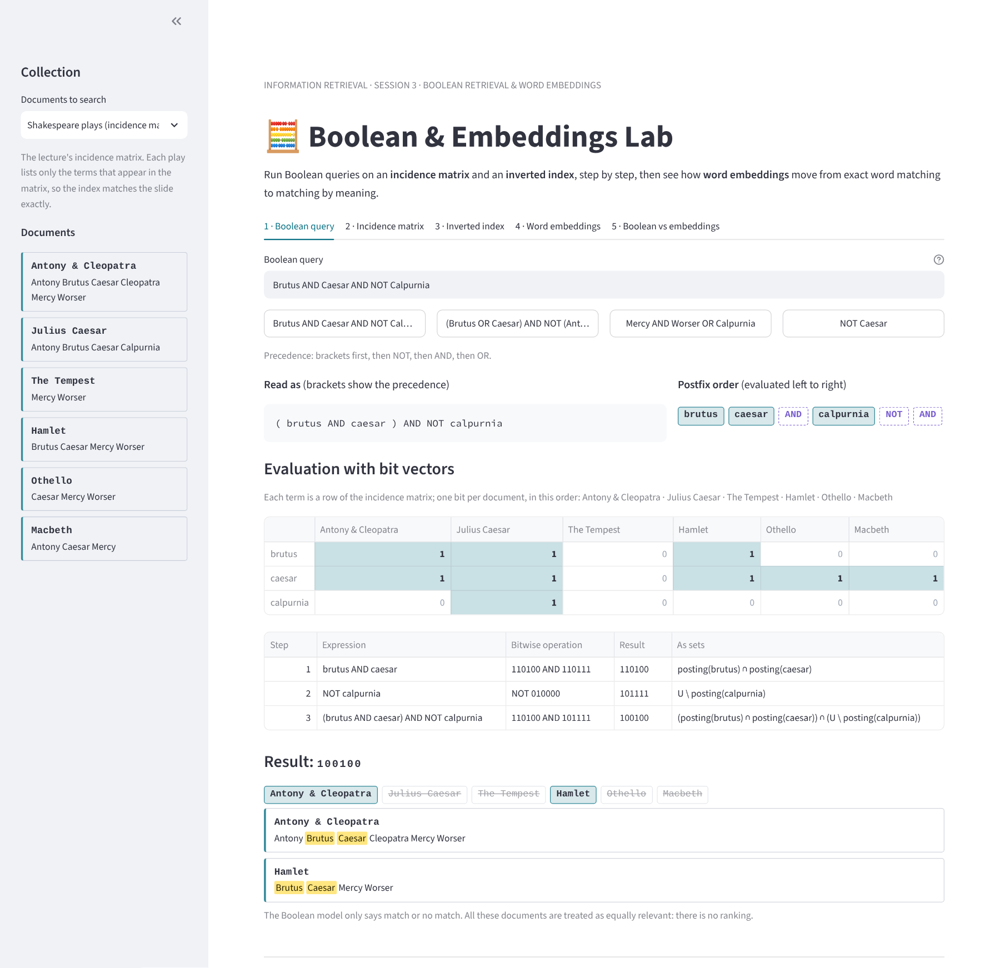
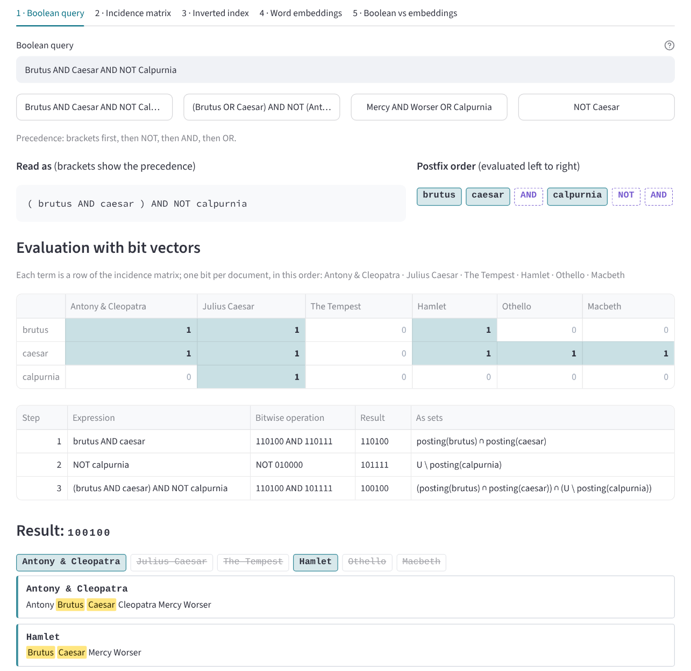
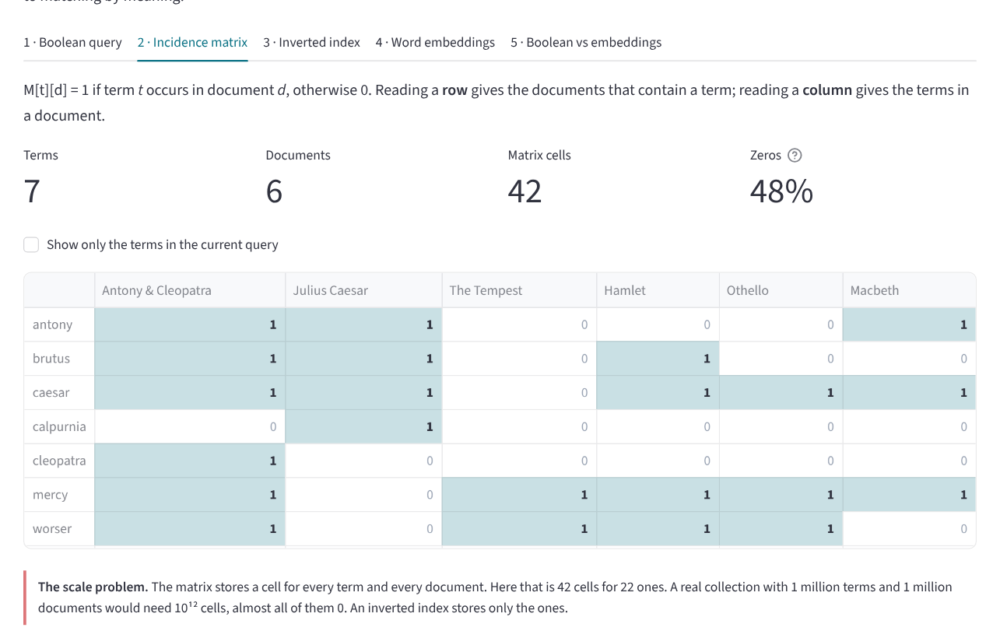
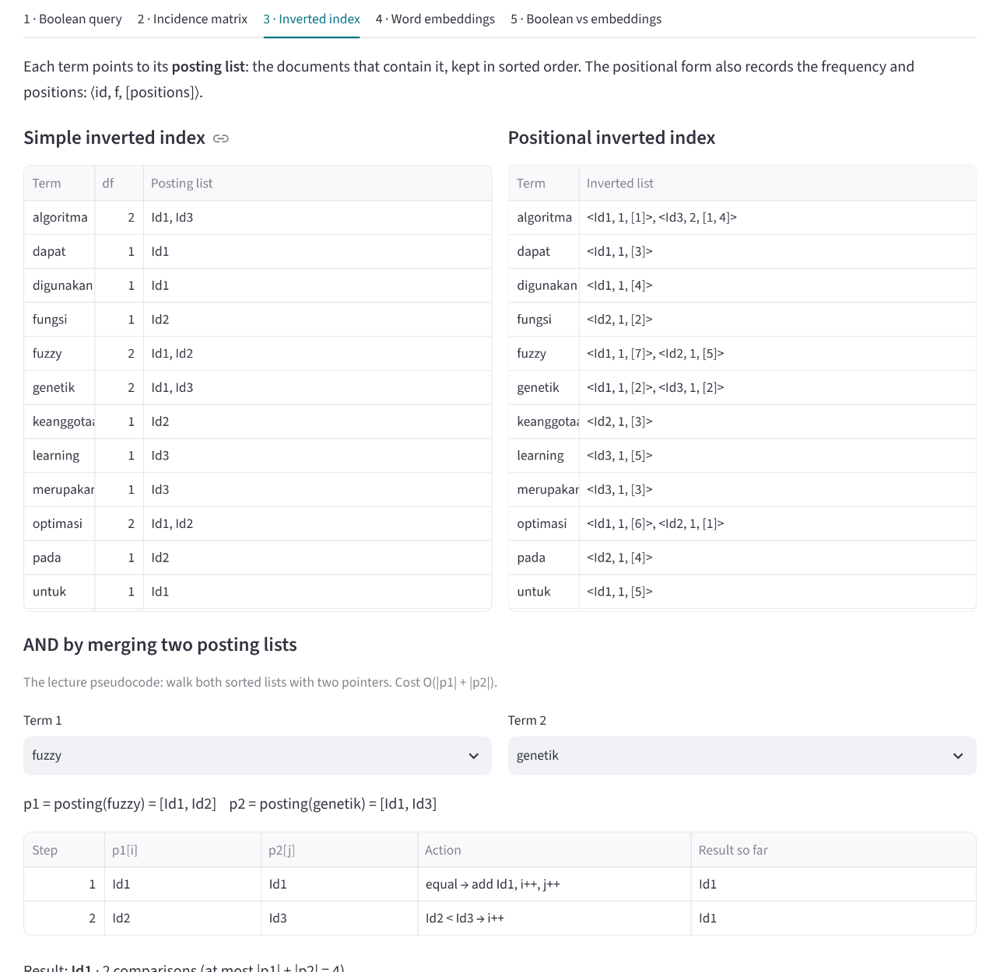
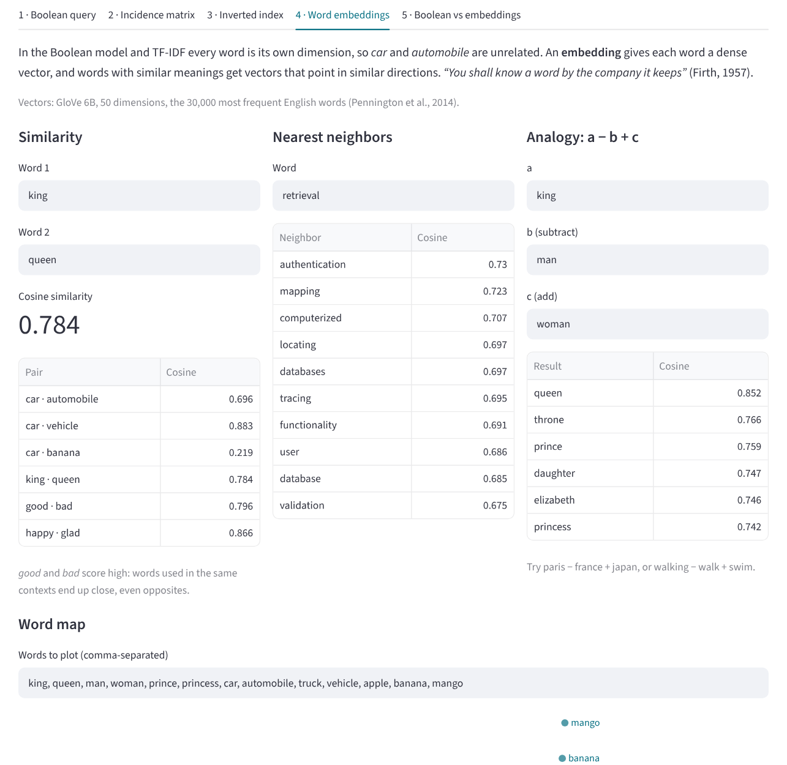
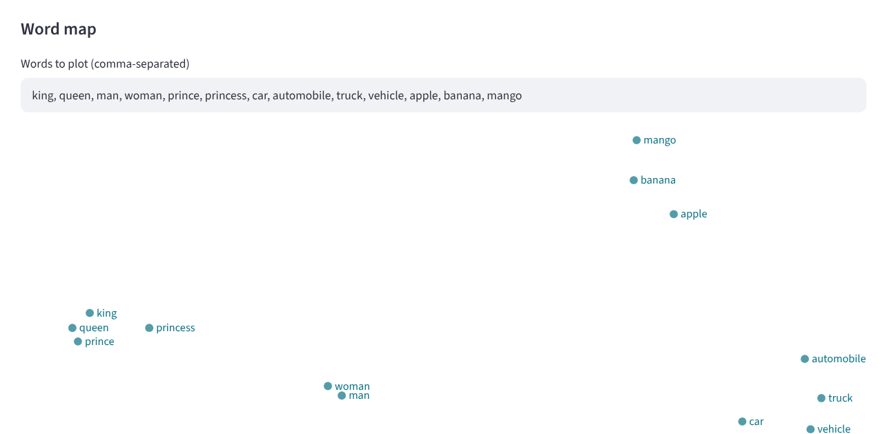
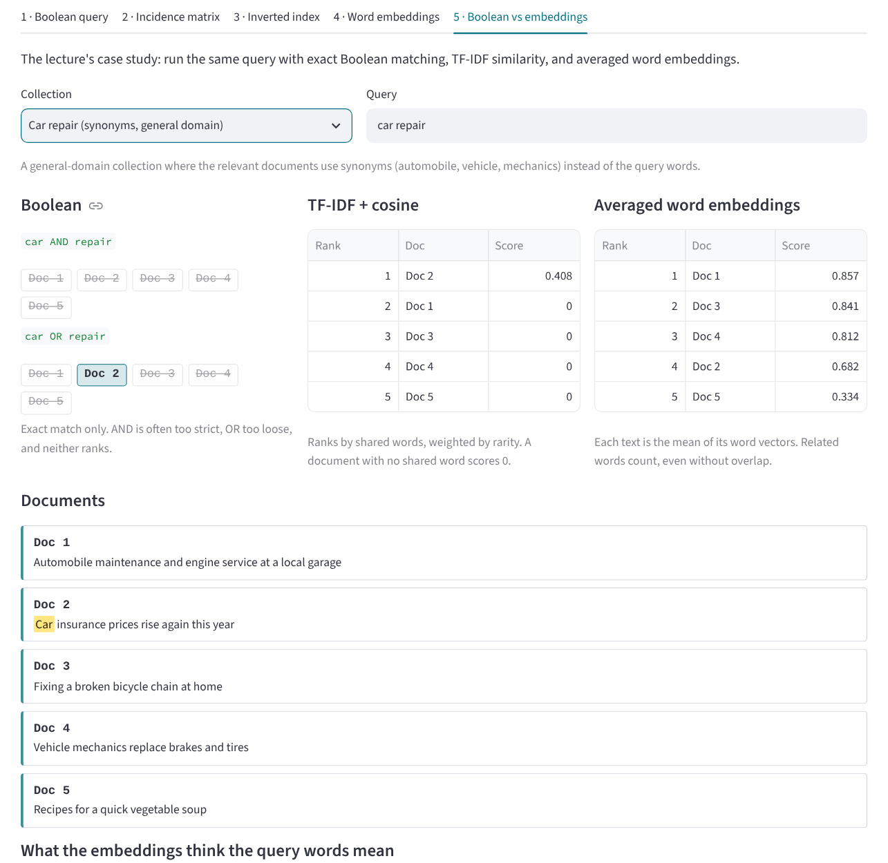
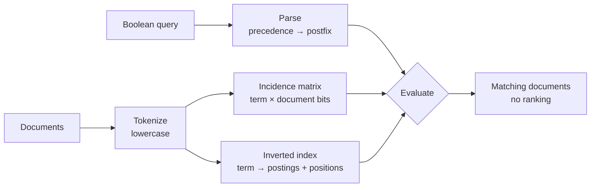

# 🧮 Boolean & Embeddings Lab: From Exact Match to Meaning

An interactive lab for two ways of representing documents and queries, built with Python and
Streamlit. The first half is the **Boolean retrieval model**: write a query with `AND`, `OR`,
`NOT`, and brackets, and watch it being evaluated step by step on an **incidence matrix** (as bit
vectors) and on an **inverted index** (as posting lists). The second half is **word embeddings**:
explore similarity, nearest neighbors, and analogies with pretrained GloVe vectors, then compare
Boolean, TF-IDF, and embedding search on the same query.

This project was built for **Session 3: Boolean Retrieval & Word Embeddings** of the
**Information Retrieval Systems** course (*Sistem Temu Kembali Informasi*, STKI).

🔗 **Live demo:** *add the Streamlit link here after deploying*

## View

The full interface: the collection and its documents in the sidebar; the query, its precedence,
the bit-vector evaluation, and the matching documents in the main area.



## Table of contents

- [View](#view)
- [Features](#features)
- [Screenshots](#screenshots)
- [Collections](#collections)
- [How it works](#how-it-works)
- [Worked examples](#worked-examples)
- [Case study: Boolean vs embeddings](#case-study-boolean-vs-embeddings)
- [Project structure](#project-structure)
- [Running locally](#running-locally)
- [Deploying to Streamlit Community Cloud](#deploying-to-streamlit-community-cloud)
- [Customizing](#customizing)
- [Limitations](#limitations)
- [References](#references)

---

## Features

**Boolean retrieval**

- **Full query language.** `AND`, `OR`, `NOT`, and brackets, with the precedence from the lecture:
  brackets, then `NOT`, then `AND`, then `OR`. Words written next to each other are joined with `AND`.
- **Step-by-step evaluation.** The query is shown with explicit brackets and in postfix order, then
  evaluated one operation at a time as bit vectors (`110100 AND 110111 = 110100`) and as set
  operations (`posting(brutus) ∩ posting(caesar)`).
- **Clear errors.** A query with a missing bracket or operand gets a message that says what is wrong.
- **Incidence matrix.** The full term × document matrix, with the share of zeros and the scale problem.
- **Inverted index.** Simple form (term → posting list) and positional form `<id, f, [positions]>`.
- **Merge algorithm trace.** The lecture's two-pointer AND, one comparison per row.
- **Query optimization.** For `t1 AND t2 AND …`, terms are processed from the shortest posting list up.
- **Phrase queries.** Uses positions to find words that appear next to each other.

**Word embeddings**

- **Similarity, nearest neighbors, and analogies** (`king − man + woman ≈ queen`) with GloVe vectors.
- **Word map.** Any set of words projected to 2D with PCA.
- **Sparse vs dense.** A one-hot vector with 30,000 dimensions and one non-zero value, next to a
  dense 50-dimensional embedding.
- **Out-of-vocabulary words.** Shown with the character n-grams FastText would use instead.
- **Case study.** The same query run with Boolean matching, TF-IDF + cosine, and averaged word
  embeddings, side by side.

## Screenshots

**Boolean query.** `Brutus AND Caesar AND NOT Calpurnia`, evaluated exactly as on the lecture slide:
`110100 AND 110111 AND 101111 = 100100`.



**Incidence matrix.** The lecture's Shakespeare matrix. Even this tiny example is 48% zeros.



**Inverted index.** The lecture's Case Study B in simple and positional form, and the merge
algorithm intersecting two posting lists.



**Word embeddings.** Similarity, nearest neighbors, and the `king − man + woman` analogy.



<details>
<summary><b>Word map and case study</b></summary>





</details>

## Collections

| Collection | Documents | From the lecture | Used for |
|---|---:|---|---|
| Shakespeare plays | 6 | Case Study A (incidence matrix) | Bit-vector evaluation |
| Genetic algorithms (Indonesian) | 3 | Case Study B (inverted index) | Positional index, `Fuzzy OR NOT (Genetik AND Learning)` |
| Home sales | 4 | The quiz at the end of the lecture | Practice queries |
| Machine learning abstracts | 5 | The Boolean vs embedding case study | Query *neural network text processing* |
| Car repair | 5 | Added for this lab | Synonyms: *car*, *automobile*, *vehicle* |
| Custom collection | any | | Type your own documents in the sidebar |

The Shakespeare documents contain only the terms from the lecture's matrix, so the index matches the
slide exactly. The machine learning and car repair documents were written for this lab.

## How it works



### Boolean model

A document either satisfies the query or it does not:

```
q = t1 AND t2  →  D(q) = posting(t1) ∩ posting(t2)     (intersection)
q = t1 OR  t2  →  D(q) = posting(t1) ∪ posting(t2)     (union)
q = NOT t1     →  D(q) = U \ posting(t1)               (complement)
```

**Precedence.** `()` → `NOT` → `AND` → `OR`. The parser uses the shunting-yard algorithm to turn the
query into postfix order, so `Mercy AND Worser OR Calpurnia` is read as
`(mercy AND worser) OR calpurnia`.

### Incidence matrix

`M[t][d] = 1` if term *t* occurs in document *d*, otherwise `0`. Each Boolean operator becomes a
bitwise operation on rows: `AND` = bitwise AND, `OR` = bitwise OR, `NOT` = bitwise complement.
The problem is size: 1 million terms × 1 million documents = 10¹² cells, nearly all zero.

### Inverted index

Each term points to a sorted posting list. The positional form stores, for every document,
`<id_j, f_ij, [O1, O2, …, Ok]>`: the document ID, the term frequency, and the positions. Only the
non-zero entries of the matrix are stored.

**AND with the merge algorithm** (from the lecture pseudocode):

```
FUNCTION BooleanAND(term1, term2, index):
  p1 = index[term1]; p2 = index[term2]       // sorted posting lists
  result = []; i, j = 0, 0
  WHILE i < |p1| AND j < |p2|:
    IF p1[i] == p2[j]: result.add(p1[i]); i++; j++
    ELSE IF p1[i] < p2[j]: i++
    ELSE: j++
  RETURN result                               // O(|p1| + |p2|)
```

**Optimization:** for several `AND`s, start with the term that has the shortest posting list.

### Word embeddings

In the Boolean model and TF-IDF each word is its own dimension, so *mobil* and *kendaraan* (or *car*
and *automobile*) look unrelated. An embedding represents each word as a dense vector (50–300
dimensions), and words used in similar contexts get similar vectors: *"You shall know a word by the
company it keeps"* (Firth, 1957).

| Model | Idea |
|---|---|
| Word2Vec skip-gram | Predict the context words from the center word: P(w_o \| w_i) = exp(v'_o · v_i) / Σ_j exp(v'_j · v_i) |
| Word2Vec CBOW | Predict the center word from its context |
| GloVe | Fit vectors to the global co-occurrence matrix: J = Σ f(X_ij)(w_i · w̃_j + b_i + b̃_j − log X_ij)² |
| FastText | A word is the sum of its character n-gram vectors, so unseen words still get a vector |

This lab uses the **GloVe 6B** vectors (Wikipedia + Gigaword), 50 dimensions, limited to the 30,000
most frequent English words so the file is small enough for the repository (3 MB).

## Worked examples

**Case Study A:** *Brutus AND Caesar AND NOT Calpurnia* (document order: Antony & Cleopatra, Julius
Caesar, The Tempest, Hamlet, Othello, Macbeth)

| Step | Operation | Result |
|---:|---|---|
| 1 | brutus AND caesar = 110100 AND 110111 | 110100 |
| 2 | NOT calpurnia = NOT 010000 | 101111 |
| 3 | 110100 AND 101111 | **100100** |

Result: *Antony & Cleopatra* and *Hamlet*.

**Case Study B:** *Fuzzy OR NOT (Genetik AND Learning)* (documents Id1, Id2, Id3)

| Step | Operation | Result |
|---:|---|---|
| 1 | genetik AND learning = 101 AND 001 | 001 |
| 2 | NOT 001 | 110 |
| 3 | fuzzy OR … = 110 OR 110 | **110** |

Result: documents 1 and 2. The positional index matches the slide, for example
`algoritma → <Id1, 1, [1]>, <Id3, 2, [1, 4]>`.

**Quiz:** incidence matrix for the four *home sales* documents

| Term | Doc 1 | Doc 2 | Doc 3 | Doc 4 |
|---|:-:|:-:|:-:|:-:|
| forecasts | 1 | 0 | 0 | 0 |
| home | 1 | 1 | 1 | 1 |
| in | 0 | 1 | 1 | 0 |
| increase | 0 | 0 | 1 | 0 |
| july | 0 | 1 | 1 | 1 |
| new | 1 | 0 | 0 | 1 |
| rise | 0 | 1 | 0 | 1 |
| sales | 1 | 1 | 1 | 1 |
| top | 1 | 0 | 0 | 0 |

- *Home AND Sales AND NOT July* = 1111 AND 1111 AND 1000 = **1000** → Doc 1
- *Home AND July AND NOT Sales* = 1111 AND 0111 AND 0000 = **0000** → no document

**Embeddings** (GloVe 50d, cosine similarity)

| Example | Result |
|---|---|
| car · automobile | 0.696 |
| car · vehicle | 0.883 |
| car · banana | 0.219 |
| king − man + woman | **queen** (0.852) |
| paris − france + japan | **tokyo** |
| nearest neighbors of *bank* | banks, securities, banking, investment, exchange, financial, … |

All neighbors of *bank* are financial: a single vector per word cannot also represent *river bank*.
That limitation is why contextual models (BERT, Sentence-BERT) come next, in Session 4.

## Case study: Boolean vs embeddings

**Car repair**, query *car repair*. None of the relevant documents contains either query word.

| Method | Result |
|---|---|
| Boolean `car AND repair` | no document |
| Boolean `car OR repair` | Doc 2 (*Car insurance prices rise again this year*) |
| TF-IDF + cosine | Doc 2 = 0.408; every other document 0 |
| Averaged embeddings | **Doc 1** *Automobile maintenance and engine service* 0.857, Doc 3 *Fixing a broken bicycle chain* 0.841, Doc 4 *Vehicle mechanics replace brakes and tires* 0.812, Doc 2 0.682, Doc 5 *soup recipes* 0.334 |

Exact matching only finds the insurance article. Embeddings know that *automobile*, *vehicle*,
*mechanics*, and *fixing* are related to the query, and push the soup recipe to the bottom.

**Machine learning abstracts**, query *neural network text processing* (the lecture's case study).

| Method | Result |
|---|---|
| Boolean `neural AND network` | Doc 4 only, as on the slide |
| TF-IDF + cosine | Doc 2 0.613, Doc 4 0.349, the rest 0. Doc 2 has the most shared words, as on the slide |
| Averaged embeddings | Doc 2 0.923, Doc 4 0.870, Doc 1 0.819, Doc 3 0.755, Doc 5 0.741 |

Here the embeddings do not reproduce the slide's claim that Doc 5 (*natural language understanding*)
moves up. Doc 5 gets a score where TF-IDF gives 0, but it ranks last. The lab shows why: in GloVe,
which was trained on Wikipedia and news, *neural* sits near *neurons* and *brain*, and
*processing* near *materials* and *equipment*. A general-purpose, context-independent model does not
know that *text processing* means NLP, and averaging word vectors blurs a document into one point.
Both issues are what sentence-level, contextual embeddings fix (Session 4).

## Project structure

```
.
├── app.py                   # Streamlit app (user interface)
├── boolean_model.py         # Tokenizer, incidence matrix, inverted index (positional),
│                            #   query parser with precedence, merge trace, phrase queries
├── embeddings.py            # GloVe loading, similarity, neighbors, analogy, PCA,
│                            #   TF-IDF and averaged-embedding ranking
├── data/
│   ├── collections.json     # Document collections and example queries
│   └── glove_50d_30k.npz    # GloVe 6B 50d, 30,000 most frequent words (3 MB)
├── docs/                    # Images used in this README
├── requirements.txt         # Python dependencies
└── .streamlit/config.toml   # App color theme
```

`boolean_model.py` and `embeddings.py` do not depend on Streamlit, so they can be tested from the
terminal:

```bash
python boolean_model.py "Brutus AND Caesar AND NOT Calpurnia"
python boolean_model.py "Fuzzy OR NOT (Genetik AND Learning)" --collection 1
python boolean_model.py "Home AND Sales AND NOT July" --collection 2
python embeddings.py
```

## Running locally

Requires Python 3.10 or newer.

```bash
git clone https://github.com/USERNAME/REPO-NAME.git
cd REPO-NAME
pip install -r requirements.txt
streamlit run app.py
```

The app opens in your browser at `http://localhost:8501`. It works offline: the word vectors are
included in `data/`.

## Deploying to Streamlit Community Cloud

1. Push all files to a GitHub repository, including the `data` folder (the app needs
   `glove_50d_30k.npz`) and the `.streamlit` folder. Use folder names **without spaces**, for
   example `boolean-embeddings-lab`.
2. Go to [share.streamlit.io](https://share.streamlit.io), choose **Create app**, and select this
   repository.
3. Set **Main file path** to `app.py` (or `boolean-embeddings-lab/app.py` if the app is in a subfolder).
4. Under **Advanced settings**, choose Python 3.12, then click **Deploy**.

The app updates automatically whenever changes are pushed to GitHub.

## Customizing

- **Add a collection:** add an entry to `data/collections.json` with a `note`, a `lang`, the
  `documents` (ID → text), and example `queries`.
- **Try your own documents without editing files:** choose *Custom collection* in the sidebar and
  type one document per line as `ID: text`. This covers the Tugas-3 dataset of 5–10 documents.
- **Case study collections** are listed in `CASE_STUDY` at the top of `app.py`, with their default
  query.

## Limitations

- Tokenization is lowercase splitting only: no stopword removal or stemming (Session 2), so
  *algoritma* and *algoritmanya* are different terms, and positions match the original text.
- The Boolean query language has no proximity operators (such as `NEAR/3`); phrase queries are a
  separate box on the *Inverted index* tab.
- The incidence matrix and inverted index are rebuilt in memory on every run. That is fine for small
  collections, not for millions of documents.
- The embeddings are English only and limited to 30,000 words, and averaged word vectors are a weak
  document representation. Indonesian would need vectors such as FastText `cc.id.300`.

## References

- Manning, C. D., Raghavan, P., & Schütze, H. (2008). *Introduction to Information Retrieval*,
  Chapters 1–4. Cambridge University Press.
- Mikolov, T., Chen, K., Corrado, G., & Dean, J. (2013). Efficient Estimation of Word
  Representations in Vector Space. *ICLR Workshop*.
- Pennington, J., Socher, R., & Manning, C. D. (2014). GloVe: Global Vectors for Word
  Representation. *EMNLP*.
- Bojanowski, P., Grave, E., Joulin, A., & Mikolov, T. (2017). Enriching Word Vectors with Subword
  Information. *TACL*.
- Firth, J. R. (1957). A synopsis of linguistic theory 1930–1955. *Studies in Linguistic Analysis*.
- Lecture slides, Session 3: Boolean Retrieval & Word Embeddings, STKI Lecturer Team, Faculty of
  Computer Science, Universitas Dian Nuswantoro.

---

Built by **Rizqi Aditya**, Informatics Engineering, Universitas Dian Nuswantoro,
for the Information Retrieval Systems course.
