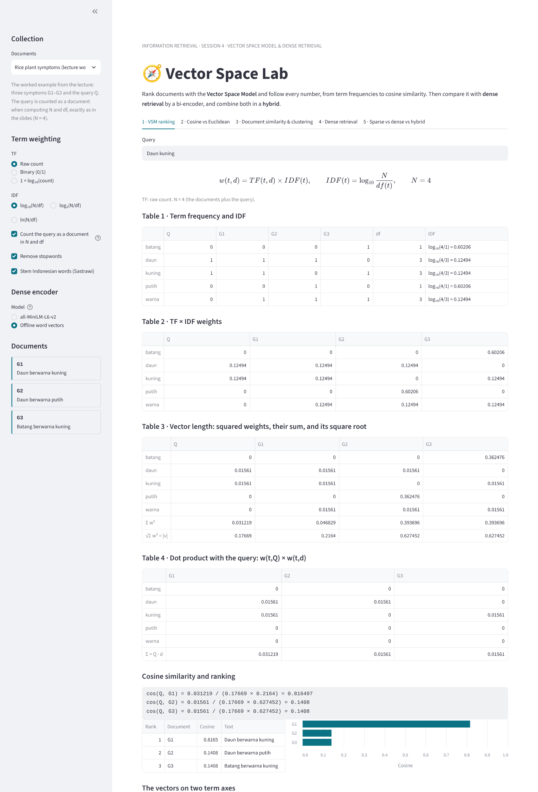
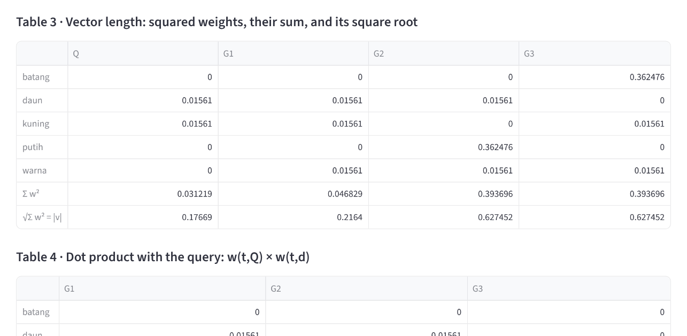
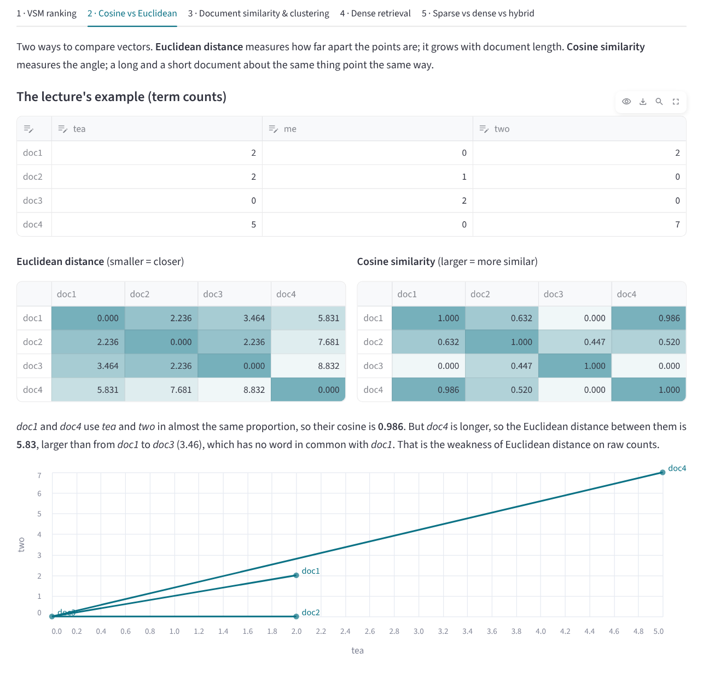
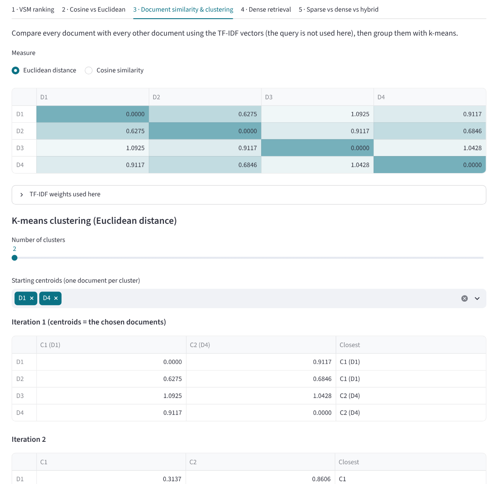
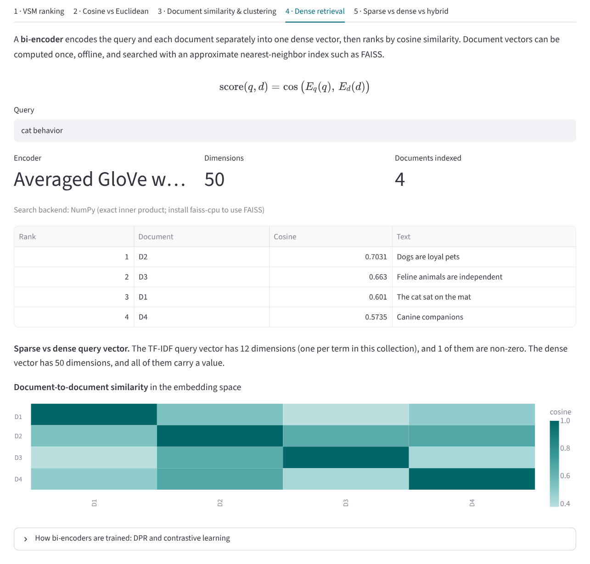
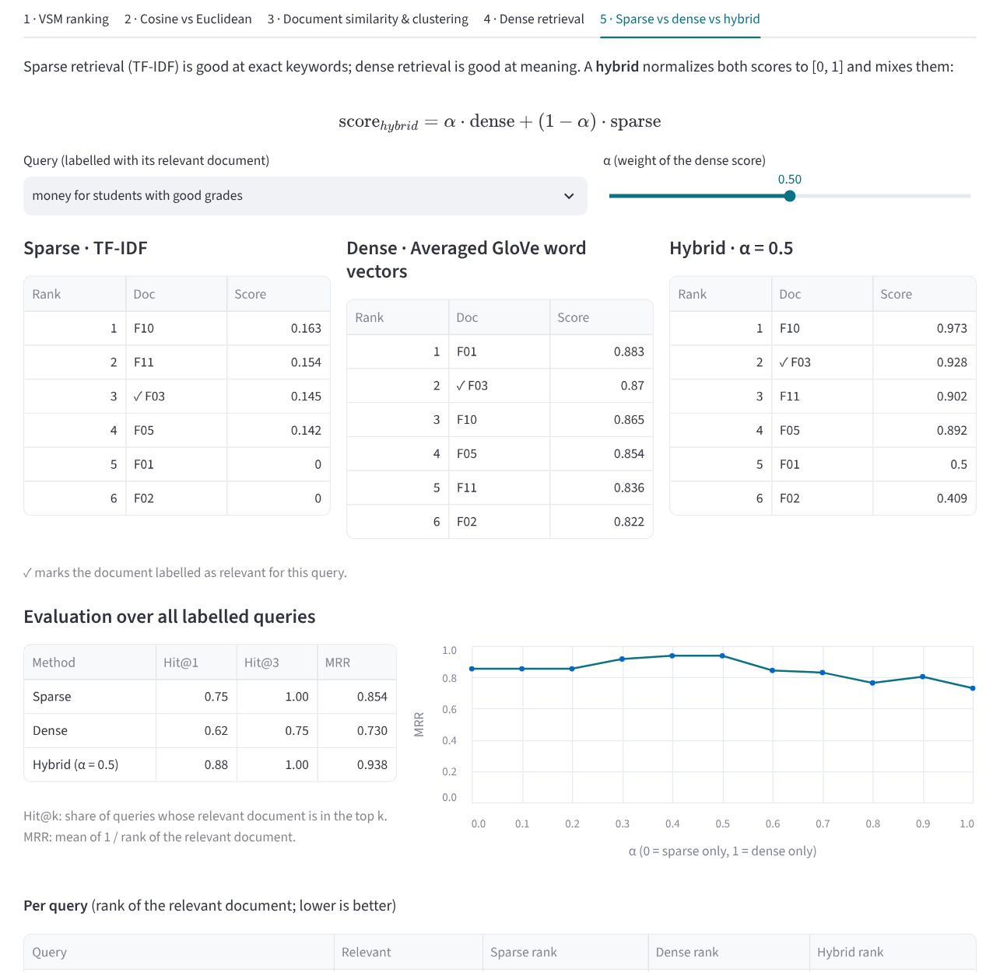
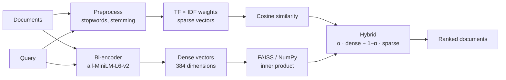

# 🧭 Vector Space Lab: Sparse, Dense, and Hybrid Retrieval

An interactive lab for the **Vector Space Model** and **dense retrieval**, built with Python and
Streamlit. Rank documents with TF-IDF and cosine similarity and follow every number, from term
frequencies to the final score, in the same tables as the lecture slides. Compare cosine similarity
with Euclidean distance, group documents with k-means, then search the same documents with a
**bi-encoder** (`all-MiniLM-L6-v2`) and combine both approaches in a **hybrid**.

This project was built for **Session 4: Vector Space Model & Dense Retrieval** of the
**Information Retrieval Systems** course (*Sistem Temu Kembali Informasi*, STKI).

🔗 **Live demo:** *add the Streamlit link here after deploying*

## View

The full interface: collection, term-weighting options, encoder, and documents in the sidebar; the
query and every step of the VSM calculation in the main area.



## Table of contents

- [View](#view)
- [Features](#features)
- [Screenshots](#screenshots)
- [Collections](#collections)
- [How it works](#how-it-works)
- [Worked examples](#worked-examples)
- [A note on SimilarityTest.xlsx](#a-note-on-similaritytestxlsx)
- [Project structure](#project-structure)
- [Running locally](#running-locally)
- [Deploying to Streamlit Community Cloud](#deploying-to-streamlit-community-cloud)
- [Customizing](#customizing)
- [Limitations](#limitations)
- [References](#references)

---

## Features

- **VSM step by step.** Four tables in the lecture's layout: term frequency and IDF, TF × IDF
  weights, squared weights with their sum and square root (the vector length), and the dot product
  with the query. Each cosine is written out, for example
  `cos(Q, G1) = 0.031219 / (0.17669 × 0.2164) = 0.816497`.
- **Every weighting choice is an option.** TF as raw count, binary, or 1 + log₁₀; IDF with log₁₀,
  log₂, or ln; and whether the query counts as a document in N and df (the old slides do this).
  Each collection opens with the settings its source used.
- **Vectors on two axes.** The query and the documents drawn as arrows on any two terms.
- **Cosine vs Euclidean.** The lecture's *tea / me / two* example, editable, with both distance
  matrices and a plot that shows why Euclidean distance favors short documents.
- **Cosine calculator.** Type two vectors and see the dot product, lengths, and cosine worked out.
- **Document similarity and k-means.** Pairwise Euclidean or cosine matrix and k-means clustering
  with chosen starting centroids, one table per iteration (the spreadsheet examples).
- **Dense retrieval.** Bi-encoder search with `all-MiniLM-L6-v2` (384 dimensions), FAISS when
  installed, and a document-to-document similarity heatmap.
- **Sparse vs dense vs hybrid.** Three rankings side by side, an α slider for
  `α · dense + (1 − α) · sparse`, and Hit@1, Hit@3, and MRR over eight labelled queries.
- **Works offline.** If MiniLM cannot be downloaded or PyTorch is not installed, the app switches
  to averaged GloVe word vectors (bundled) and says so.

## Screenshots

**VSM tables.** The lecture's worked example (rice plant symptoms), reproduced to the same digits.



**Cosine vs Euclidean.** *doc1* and *doc4* point the same way (cosine 0.986) but are far apart
(distance 5.83) because *doc4* is longer.



**Document similarity and clustering.** Spreadsheet example B: Euclidean distance matrix and
k-means from centroids D1 and D4.



<details>
<summary><b>Dense retrieval and hybrid search</b></summary>

These two screenshots were taken with the offline word-vector encoder, so the dense scores differ
from what `all-MiniLM-L6-v2` produces in the deployed app.





</details>

## Collections

| Collection | Documents | Source | Default settings |
|---|---:|---|---|
| Rice plant symptoms | 3 + query | Worked example in the old VSM slides | raw TF, log₁₀, query counted (N = 4) |
| Leaf colors | 3 + query | Quiz in the old VSM slides | raw TF, log₁₀, query counted (N = 4) |
| Spreadsheet example A | 3 | `SimilarityTest.xlsx`, left part | binary TF, log₂, N = 3 |
| Spreadsheet example B | 4 | `SimilarityTest.xlsx`, right part | binary TF, log₁₀, N = 4, k-means from D1 and D4 |
| Cats and dogs | 4 | TF-IDF vs dense example in the new slides | log TF, log₁₀ |
| University FAQ | 12 | Written for this lab, after the lecture's FAQ case study | log TF, log₁₀, 8 labelled queries |

Indonesian collections are stemmed with Sastrawi (*berwarna* → *warna*, *penyakit* → *sakit*,
*pencurian* → *curi*), as in the lecture examples.

## How it works



### Vector Space Model (Salton et al., 1975)

Documents and the query are vectors in a space with one dimension per term. The value of each
dimension is a TF-IDF weight, and relevance is the closeness of the vectors.

```
TF(t, d)  = count, 1/0, or 1 + log10(count)
IDF(t)    = log(N / df(t))
w(t, d)   = TF(t, d) × IDF(t)
cos(q, d) = Σ w(t,q) · w(t,d) / ( √Σ w(t,q)² × √Σ w(t,d)² )
```

A term that is rare in the collection (high IDF) and frequent in the document (high TF) gets the
highest weight. The denominator normalizes away document length: `cos = 1` means the same direction,
`cos = 0` means no shared term.

**Euclidean distance** `√Σ (a_t − b_t)²` measures how far apart two points are instead of the angle.
It grows with document length, which is why the VSM ranks with cosine.

### K-means

Each document goes to the nearest centroid (Euclidean distance on the TF-IDF vectors); each centroid
then moves to the mean of its documents; repeat until nothing changes.

### Dense retrieval (bi-encoder)

The query and every document are encoded separately into one dense vector, and the score is
`cos(E_q(q), E_d(d))`. Document vectors can be computed once, offline, and searched with an
approximate nearest-neighbor index such as FAISS. Because the encoder is trained on meaning,
*mobil* ≈ *kendaraan* and *cat* ≈ *feline*.

**DPR** (Karpukhin et al., 2020) trains two BERT encoders with a contrastive (InfoNCE) loss:

```
L = −log [ exp(sim(q, d⁺)/τ) / Σ_i exp(sim(q, d_i)/τ) ]        sim(q, d) = E_q(q)ᵀ E_d(d)
```

where *d⁺* is the relevant passage and the other passages in the batch are negatives. On Natural
Questions it reached 78.4% top-20 accuracy, against 59.1% for BM25.

### Hybrid search

Both score lists are min-max normalized to [0, 1] and mixed: `α · dense + (1 − α) · sparse`.
α = 0 is pure TF-IDF, α = 1 is pure dense.

## Worked examples

**Rice plant symptoms** (old slides). G1 *Daun berwarna kuning*, G2 *Daun berwarna putih*,
G3 *Batang berwarna kuning*, Q *Daun kuning*. N = 4 because the query is counted as a document.

| Term | Q | G1 | G2 | G3 | df | IDF = log₁₀(4/df) |
|---|:-:|:-:|:-:|:-:|:-:|---:|
| batang | 0 | 0 | 0 | 1 | 1 | 0.60206 |
| daun | 1 | 1 | 1 | 0 | 3 | 0.12494 |
| kuning | 1 | 1 | 0 | 1 | 3 | 0.12494 |
| putih | 0 | 0 | 1 | 0 | 1 | 0.60206 |
| warna | 0 | 1 | 1 | 1 | 3 | 0.12494 |

```
cos(Q, G1) = 0.031219 / (0.17669 × 0.2164)   = 0.816497
cos(Q, G2) = 0.01561  / (0.17669 × 0.627452) = 0.140800
cos(Q, G3) = 0.01561  / (0.17669 × 0.627452) = 0.140800
```

The same values as the slide (0.816497 and 0.14080).

**Leaf colors** (the quiz, same method). Q *Daun hijau*:

| Document | Q · d | \|d\| | Cosine |
|---|---:|---:|---:|
| Dokumen 1 *Daun bewarna coklat* | 0.090619 | 0.684620 | **0.406115** |
| Dokumen 2 *Bunga bewarna hijau* | 0.015610 | 0.627452 | 0.076330 |
| Dokumen 3 *Rumput bewarna hijau* | 0.015610 | 0.627452 | 0.076330 |

\|Q\| = 0.325928. *daun* appears in fewer documents than *hijau* (df 2 vs 3, counting the query),
so it has the higher IDF and Dokumen 1 wins.

**Cosine calculator** (old slides): x = (1, 1, 1, 3, 0), y = (0, 0, 0, 1, 1) →
x · y = 3, |x| = √12, |y| = √2, cos = 3 / √24 = **0.61**.

**Spreadsheet example A** (binary TF, IDF = log₂(3/df)), Euclidean distances:

| | D1 | D2 | D3 |
|---|---:|---:|---:|
| D1 | 0 | 3.5920 | 4.2742 |
| D2 | 3.5920 | 0 | 3.9262 |
| D3 | 4.2742 | 3.9262 | 0 |

The same values as the spreadsheet.

**Cats and dogs** (new slides), query *cat behavior*: TF-IDF gives D1 *The cat sat on the mat*
0.577 and every other document 0, because *feline* and *cat* are different terms. A dense encoder
gives *Feline animals are independent* a real score.

**University FAQ**, 8 labelled queries, with the offline word-vector encoder:

| Method | Hit@1 | Hit@3 | MRR |
|---|---:|---:|---:|
| Sparse (TF-IDF) | 0.75 | 1.00 | 0.854 |
| Dense (averaged GloVe) | 0.62 | 0.75 | 0.730 |
| Hybrid (α = 0.5) | 0.88 | 1.00 | **0.938** |

The hybrid beats both, the same pattern as the lecture's case study (P@5: 0.60 TF-IDF, 0.72 dense,
0.80 hybrid). With MiniLM the dense numbers change; check the app after deploying.

## A note on SimilarityTest.xlsx

Example B in the spreadsheet assigns **D2 to Cluster 2**. The distance formulas in cells L37:M40 read
rows 29–35, one row below the TF-IDF table in rows 28–34, so the term **mata** is left out of every
distance (and an empty row is included). With all seven terms:

| | to C1 (D1) | to C2 (D4) | Nearest |
|---|---:|---:|---|
| D1 | 0 | 0.9117 | C1 |
| D2 | **0.6275** | 0.6846 | **C1** |
| D3 | 1.0925 | 1.0428 | C2 |
| D4 | 0.9117 | 0 | C2 |

So the correct first step gives **Cluster 1: D1, D2** and **Cluster 2: D3, D4**. A second k-means
iteration with the updated centroids keeps the same groups. The app shows this note on the
clustering tab.

## Project structure

```
.
├── app.py                   # Streamlit app (user interface)
├── vsm.py                   # Preprocessing, TF/IDF options, VSM tables, cosine, Euclidean, k-means
├── dense.py                 # Bi-encoder (MiniLM or GloVe fallback), FAISS/NumPy index, hybrid, metrics
├── data/
│   ├── collections.json     # Collections, default settings, labelled queries
│   └── glove_50d_30k.npz    # GloVe 6B 50d, 30,000 words (offline fallback encoder, 3 MB)
├── docs/                    # Images used in this README
├── requirements.txt         # Python dependencies
└── .streamlit/config.toml   # App color theme
```

`vsm.py` and `dense.py` do not depend on Streamlit:

```bash
python vsm.py      # the rice plant example, step by step
python dense.py    # dense ranking for the cats-and-dogs example
```

## Running locally

Requires Python 3.10 or newer.

```bash
git clone https://github.com/USERNAME/REPO-NAME.git
cd REPO-NAME
pip install -r requirements.txt
streamlit run app.py
```

The first time the *all-MiniLM-L6-v2* encoder is used, sentence-transformers downloads it from the
Hugging Face Hub (about 90 MB).

## Deploying to Streamlit Community Cloud

1. Push all files to a GitHub repository, including the `data` and `.streamlit` folders. Use folder
   names **without spaces**, for example `vector-space-lab`.
2. Go to [share.streamlit.io](https://share.streamlit.io), choose **Create app**, and select this
   repository.
3. Set **Main file path** to `app.py` (or `vector-space-lab/app.py` if the app is in a subfolder).
4. Click **Deploy**. Any Python version from 3.10 up works.

`sentence-transformers` installs PyTorch, so the first deployment takes several minutes. If the
installation fails or takes too long, remove the `sentence-transformers` line from
`requirements.txt`: the app then uses the offline word-vector encoder and everything else works
the same.

**FAISS** is optional. Add `faiss-cpu` to `requirements.txt` to search with `faiss.IndexFlatIP`;
without it, the app computes the same exact inner products with NumPy.

## Customizing

- **Add a collection:** add an entry to `data/collections.json` with `documents`, a default
  `query`, its `settings` (`tf`, `idf_base`, `query_as_document`, `stopwords`, `stemming`), and
  optionally `labelled_queries` (query → relevant document IDs) and `clustering` (`init` centroids).
- **Tugas-4** asks for VSM and dense retrieval on the same dataset: add your dataset as a collection
  with labelled queries, and the *Sparse vs dense vs hybrid* tab compares both rankings and reports
  where each one succeeds or fails.

## Limitations

- `all-MiniLM-L6-v2` is trained on English. For Indonesian, a multilingual model such as
  `paraphrase-multilingual-MiniLM-L12-v2` works better (change `MINILM` in `dense.py`).
- The offline fallback averages word vectors, which is a weak document representation. It keeps
  the app usable, but it is not a real bi-encoder.
- The FAQ collection has one relevant document per query and only eight queries, so the metrics
  illustrate the comparison rather than prove which method is better.
- Stemming is applied to Indonesian only; English words are not stemmed.

## References

- Salton, G., Wong, A., & Yang, C. S. (1975). A Vector Space Model for Automatic Indexing.
  *Communications of the ACM*, 18(11), 613–620.
- Manning, C. D., Raghavan, P., & Schütze, H. (2008). *Introduction to Information Retrieval*,
  Chapter 6. Cambridge University Press.
- Reimers, N., & Gurevych, I. (2019). Sentence-BERT: Sentence Embeddings using Siamese
  BERT-Networks. *EMNLP*.
- Karpukhin, V., et al. (2020). Dense Passage Retrieval for Open-Domain Question Answering. *EMNLP*.
- Johnson, J., Douze, M., & Jégou, H. (2019). Billion-scale similarity search with GPUs.
  *IEEE Transactions on Big Data*.
- Pennington, J., Socher, R., & Manning, C. D. (2014). GloVe: Global Vectors for Word Representation.
  *EMNLP*.
- Lecture slides, Session 4: Vector Space Model & Dense Retrieval, STKI Lecturer Team, Faculty of
  Computer Science, Universitas Dian Nuswantoro.

---

Built by **Rizqi Aditya**, Informatics Engineering, Universitas Dian Nuswantoro,
for the Information Retrieval Systems course.
