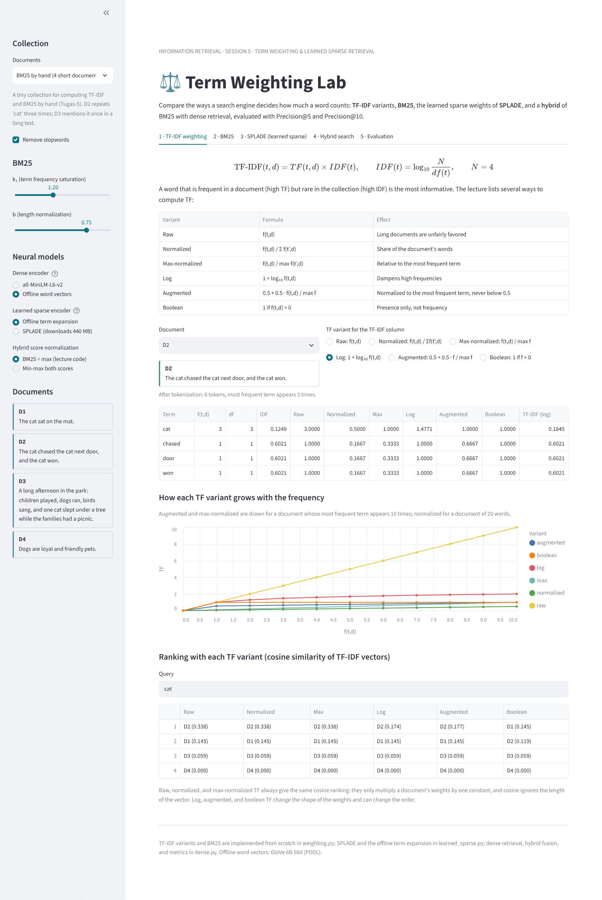
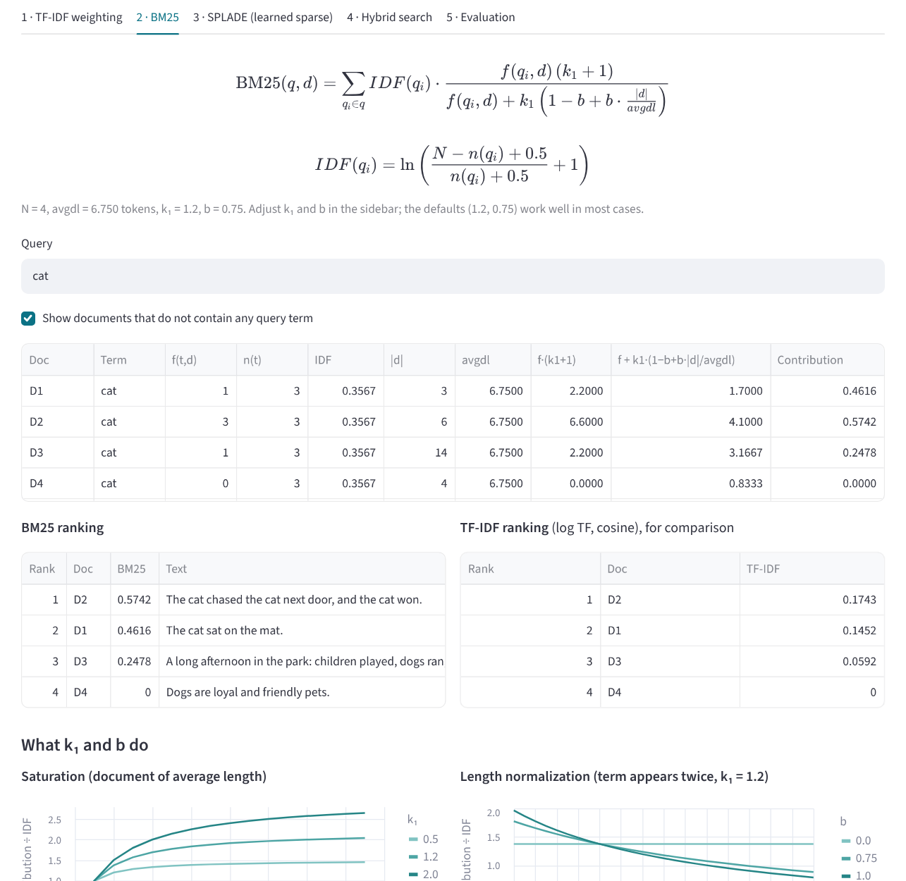
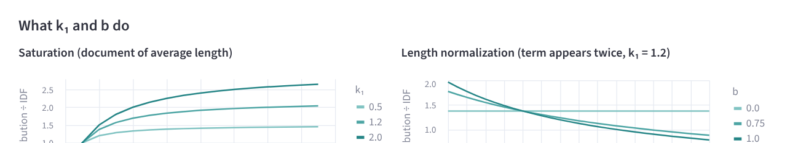
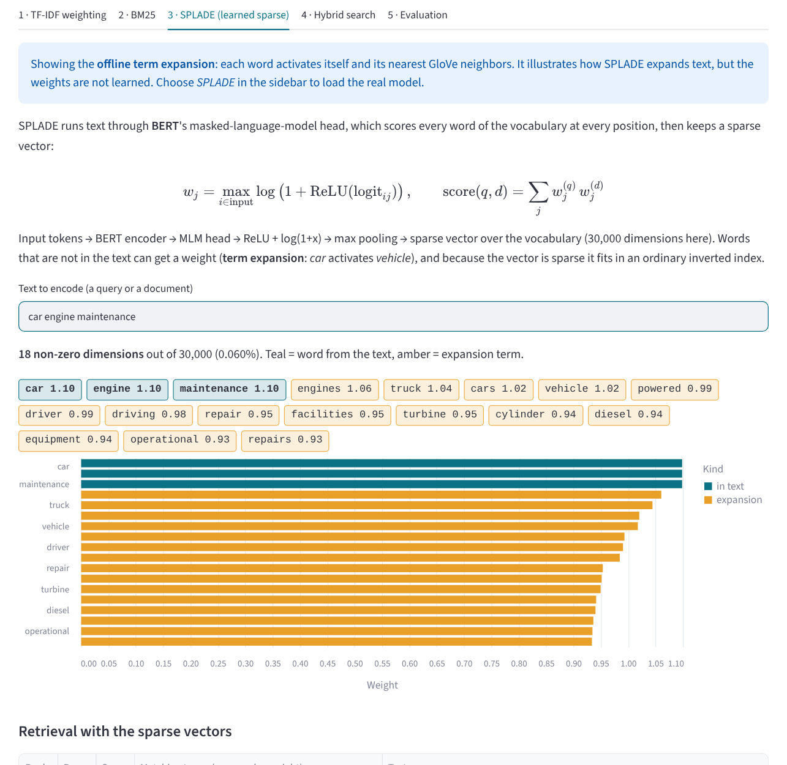
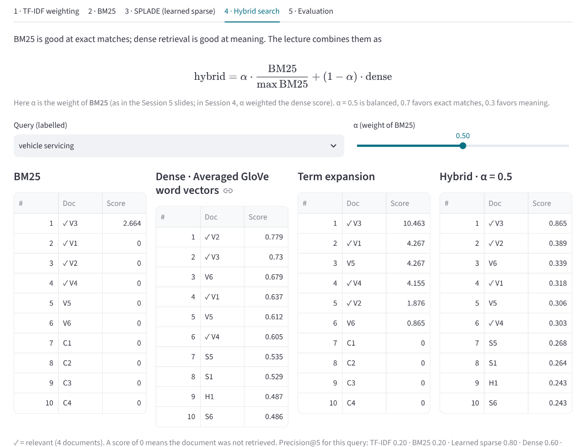
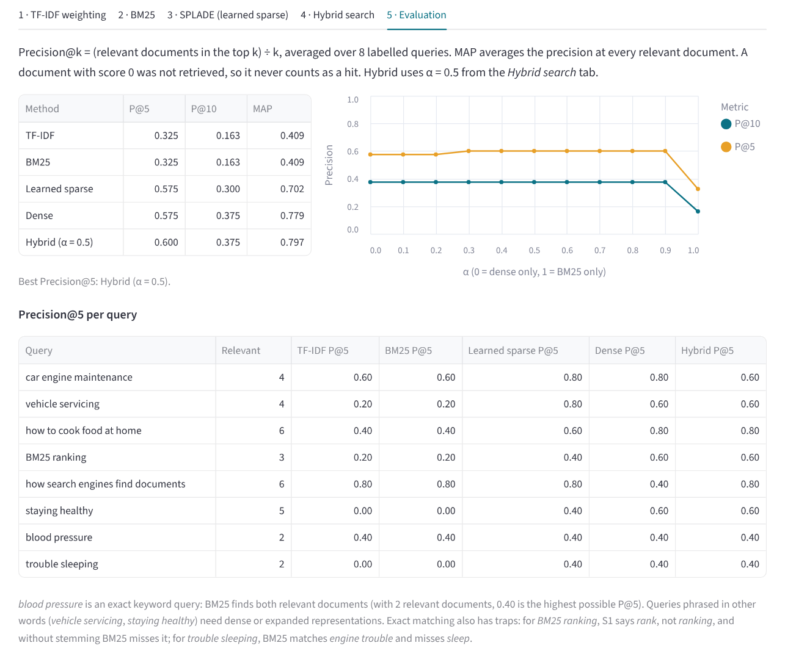

# ⚖️ Term Weighting Lab: TF-IDF, BM25, SPLADE & Hybrid Search

An interactive lab for **term weighting**: how much a word should count when a search engine ranks
documents. Built with Python and Streamlit. Compare the **TF variants** behind TF-IDF, follow
**BM25** term by term and see what `k₁` and `b` do, look inside a **learned sparse** representation
(SPLADE), and combine BM25 with dense retrieval in a **hybrid** search evaluated with Precision@5
and Precision@10.

This project was built for **Session 5: Term Weighting & Learned Sparse Retrieval** of the
**Information Retrieval Systems** course (*Sistem Temu Kembali Informasi*, STKI).

🔗 **Live demo:** https://information-retrieval-system-5mgtaeghbvah8u4n84vncb.streamlit.app/

## View

The full interface: collection, BM25 parameters, model choices, and documents in the sidebar; the
TF-IDF variants, their curves, and the ranking under each variant in the main area.



## Table of contents

- [View](#view)
- [Features](#features)
- [Screenshots](#screenshots)
- [Collections](#collections)
- [How it works](#how-it-works)
- [Worked example: BM25 by hand](#worked-example-bm25-by-hand)
- [Evaluation results](#evaluation-results)
- [A detail in the lecture's BM25 code](#a-detail-in-the-lectures-bm25-code)
- [Project structure](#project-structure)
- [Running locally](#running-locally)
- [Deploying to Streamlit Community Cloud](#deploying-to-streamlit-community-cloud)
- [Customizing](#customizing)
- [Limitations](#limitations)
- [References](#references)

---

## Features

- **Six TF variants.** Raw, normalized (f / Σf), max-normalized (f / max f), log, augmented, and
  boolean, side by side for every term of a document, with their growth curves and the ranking each
  one produces.
- **BM25 step by step.** Every quantity in the formula, per document and per query term: f(t,d),
  n(t), IDF, |d|, avgdl, numerator, denominator, and contribution.
- **k₁ and b sliders.** Re-rank instantly, with charts of term-frequency saturation and length
  normalization.
- **TF-IDF vs BM25.** Both rankings side by side for the same query.
- **SPLADE.** The sparse vector of any text, with expansion terms highlighted, retrieval by sparse
  dot product, and the matching terms behind each score. Uses the real
  `naver/splade-cocondenser-ensembledistil` model when selected, or an offline term-expansion
  stand-in.
- **Hybrid search.** `α · BM25 + (1 − α) · dense`, with BM25 normalized by its maximum as in the
  lecture code, and four rankings side by side.
- **Evaluation.** Precision@5, Precision@10, and MAP for TF-IDF, BM25, learned sparse, dense, and
  hybrid over eight labelled queries, plus Precision@k as a function of α (Tugas-5).

## Screenshots

**BM25 by hand.** Query *cat*: D2 (three occurrences) beats D1 (one), but not by three times; D3
mentions *cat* once in a long text and drops to 0.248.



**What k₁ and b do.** Saturation flattens toward k₁ + 1; with b > 0 the same count is worth less in
a longer document.



**Learned sparse representation.** *car engine maintenance* expanded to *vehicle*, *truck*,
*repair*, … (offline term expansion shown).



<details>
<summary><b>Hybrid search and evaluation</b></summary>

These screenshots use the offline encoders (GloVe word vectors for dense, term expansion for
learned sparse), so the dense and sparse scores differ from MiniLM and SPLADE in the deployed app.





</details>

## Collections

| Collection | Documents | Labelled queries | Used for |
|---|---:|---:|---|
| BM25 by hand | 4 | – | Computing TF-IDF and BM25 by hand: one short document, one with a repeated term, one long |
| Everyday articles | 24 | 8 | Four topics (vehicles, cooking, search engines, health); Precision@5 and @10 |

The labelled queries mix exact keywords (*blood pressure*, *BM25 ranking*) with queries phrased in
other words than the documents use (*vehicle servicing*, *staying healthy*, *trouble sleeping*).
The documents were written for this lab.

## How it works

```mermaid
flowchart LR
    Q[Query] --> T[Tokenize]
    T --> TF[TF-IDF<br/>6 TF variants]
    T --> BM[BM25<br/>k1, b]
    Q --> SP[SPLADE<br/>BERT MLM → ReLU + log1p → max pool]
    Q --> DE[Dense<br/>all-MiniLM-L6-v2]
    BM --> H[Hybrid<br/>α · BM25/max + 1−α · dense]
    DE --> H
    TF --> E[Evaluation<br/>P@5, P@10, MAP]
    BM --> E
    SP --> E
    DE --> E
    H --> E
```

### TF-IDF

```
TF-IDF(t,d) = TF(t,d) × IDF(t)          IDF(t) = log10(N / df(t))
```

| TF variant | Formula | Effect |
|---|---|---|
| Raw | f(t,d) | Long documents are unfairly favored |
| Normalized | f(t,d) / Σ f(t',d) | Share of the document's words |
| Max-normalized | f(t,d) / max f(t',d) | Relative to the most frequent term |
| Log | 1 + log₁₀ f(t,d) | Dampens high frequencies |
| Augmented | 0.5 + 0.5 · f(t,d) / max f | Normalized to the most frequent term, never below 0.5 |
| Boolean | 1 if f(t,d) > 0 | Presence only |

A word that is frequent in the document but rare in the collection gets the highest weight. One
thing the app makes visible: under cosine similarity, raw, normalized, and max-normalized TF always
give **the same ranking**, because they only scale a document's weights by a constant and cosine
ignores vector length. Log, augmented, and boolean TF change the shape of the weights.

### BM25 (Okapi)

```
BM25(q,d) = Σ IDF(q_i) · f(q_i,d)·(k1+1) / ( f(q_i,d) + k1·(1 − b + b·|d|/avgdl) )
IDF(q_i)  = ln( (N − n(q_i) + 0.5) / (n(q_i) + 0.5) + 1 )
```

- **k₁** (default 1.2) controls term-frequency saturation: the contribution of a term approaches
  `IDF · (k₁ + 1)` however often it appears. k₁ = 0 ignores frequency.
- **b** (default 0.75) controls length normalization: b = 0 ignores document length, b = 1
  normalizes fully.

BM25 is the default ranking function of Elasticsearch, Lucene, and Solr.

### SPLADE (learned sparse)

SPLADE runs text through BERT's masked-language-model head, which scores every word of the
30,522-word vocabulary at every input position, and keeps

```
w_j = max_i log(1 + ReLU(logit_ij))          score(q,d) = Σ_j w_j(q) · w_j(d)
```

Most weights are 0, so the vector is sparse and fits in an inverted index like BM25. Unlike BM25,
words that do not appear in the text can get a weight (term expansion: *car* activates *vehicle*),
which gives soft matching (Formal et al., SPLADE++, TOIS 2024).

**Offline term expansion.** When SPLADE is not loaded, the app uses a stand-in: each word activates
itself and its nearest GloVe neighbors (cosine ≥ 0.6), followed by the same `log(1 + ReLU(x))` and
max pooling. It shows what expansion does, but the weights are not learned.

### Hybrid search

```
hybrid = α · BM25 / max(BM25) + (1 − α) · cos(E(q), E(d))
```

In this session's slides **α is the weight of BM25** (in Session 4 it was the weight of the dense
score). α = 0.5 is balanced, 0.7 favors exact matches, 0.3 favors meaning.

### Evaluation

`Precision@k` = relevant documents in the top k ÷ k. MAP averages the precision at the rank of
every relevant document. A document with a score of 0 was not retrieved, so it never counts as a
hit, even when it happens to sit in the top k because of ties.

## Worked example: BM25 by hand

Collection *BM25 by hand*, query **cat**, after removing stopwords. N = 4, avgdl = 27 / 4 = 6.75.

| Doc | Text | \|d\| | f(cat) |
|---|---|---:|---:|
| D1 | The cat sat on the mat. | 3 | 1 |
| D2 | The cat chased the cat next door, and the cat won. | 6 | 3 |
| D3 | A long afternoon in the park: … one cat slept under a tree … | 14 | 1 |
| D4 | Dogs are loyal and friendly pets. | 4 | 0 |

IDF(cat) = ln((4 − 3 + 0.5) / (3 + 0.5) + 1) = ln(1.4286) = **0.3567**

| Doc | f·(k₁+1) | f + k₁·(1 − b + b·\|d\|/avgdl) | Contribution | Rank |
|---|---:|---:|---:|---:|
| D2 | 3 × 2.2 = 6.6 | 3 + 1.2 × (0.25 + 0.75 × 6/6.75) = 4.1000 | 0.3567 × 6.6 / 4.1 = **0.5742** | 1 |
| D1 | 1 × 2.2 = 2.2 | 1 + 1.2 × (0.25 + 0.75 × 3/6.75) = 1.7000 | 0.3567 × 2.2 / 1.7 = **0.4616** | 2 |
| D3 | 1 × 2.2 = 2.2 | 1 + 1.2 × (0.25 + 0.75 × 14/6.75) = 3.1667 | 0.3567 × 2.2 / 3.1667 = **0.2478** | 3 |
| D4 | 0 | – | 0 | 4 |

- **Saturation:** D2 has three times as many *cat*s as D1 but scores only 24% more.
- **Length normalization:** D1 and D3 both contain *cat* once; D3 is longer and scores about half.
  With b = 0 they tie at 0.357.

For comparison, TF-IDF with log TF and cosine: D2 0.1743, D1 0.1452, D3 0.0592. For D2 the TF
variants of *cat* (f = 3, IDF = log₁₀(4/3) = 0.1249) are: raw 3, normalized 0.5, max 1, log 1.4771,
augmented 1, boolean 1.

## Evaluation results

*Everyday articles*, 8 labelled queries, BM25 with k₁ = 1.2 and b = 0.75, hybrid α = 0.5, with the
**offline encoders** (GloVe average for dense, term expansion for learned sparse):

| Method | P@5 | P@10 | MAP |
|---|---:|---:|---:|
| TF-IDF (log TF, cosine) | 0.325 | 0.163 | 0.409 |
| BM25 | 0.325 | 0.163 | 0.409 |
| Learned sparse (term expansion) | 0.575 | 0.300 | 0.702 |
| Dense (averaged GloVe) | 0.575 | 0.375 | 0.779 |
| **Hybrid** (α = 0.5) | **0.600** | **0.375** | **0.797** |

The hybrid scores best, as the lecture concludes. α = 1 reproduces BM25 and α = 0 reproduces dense
exactly; every α between 0.3 and 0.9 gives P@5 = 0.600 here. The per-query table in the app shows
where each method fails: BM25 finds nothing for *staying healthy* and matches *engine trouble* for
*trouble sleeping*; it also misses S1 for *BM25 ranking*, because S1 says *rank* and nothing is
stemmed. With MiniLM and SPLADE the dense and sparse numbers change; check the app after deploying.

## A detail in the lecture's BM25 code

The slide computes document frequency with

```python
df = sum(1 for d in corpus if term in d.lower())
```

On a string, `in` matches **substrings**, so a term is also counted inside longer words. In the
*Everyday articles* collection:

| Term | df (whole words) | df (substring) | Extra matches |
|---|---:|---:|---|
| car | 2 | 4 | *cars* (V4), *carrots* (C1) |
| engine | 2 | 3 | *engines* (S1) |
| rank | 1 | 2 | *ranking* (S2) |
| cook | 0 | 2 | *cooking* (C4, C6) |

A larger df gives a smaller IDF. This app tokenizes and counts whole words; the *BM25* tab shows the
comparison for the current query.

## Project structure

```
.
├── app.py                   # Streamlit app (user interface)
├── weighting.py             # Tokenizer, TF variants, TF-IDF, BM25 with full trace
├── learned_sparse.py        # SPLADE (transformers) and the offline term-expansion stand-in
├── dense.py                 # MiniLM / GloVe dense encoder, hybrid fusion, P@k and MAP
├── data/
│   ├── collections.json     # Collections and labelled queries
│   └── glove_50d_30k.npz    # GloVe 6B 50d, 30,000 words (offline encoders, 3 MB)
├── docs/                    # Images used in this README
├── requirements.txt         # Python dependencies
└── .streamlit/config.toml   # App color theme
```

The modules do not depend on Streamlit:

```bash
python weighting.py         # BM25 by hand for the query "cat"
python learned_sparse.py    # sparse vectors with the offline term expansion
```

## Running locally

Requires Python 3.10 or newer.

```bash
git clone https://github.com/USERNAME/REPO-NAME.git
cd REPO-NAME
pip install -r requirements.txt
streamlit run app.py
```

## Deploying to Streamlit Community Cloud

1. Push all files to a GitHub repository, including the `data` and `.streamlit` folders. Use folder
   names **without spaces**, for example `term-weighting-lab`.
2. Go to [share.streamlit.io](https://share.streamlit.io), choose **Create app**, and select this
   repository.
3. Set **Main file path** to `app.py` (or `term-weighting-lab/app.py` if the app is in a subfolder).
4. Click **Deploy**. Any Python version from 3.10 up works.

`sentence-transformers` and `transformers` install PyTorch, so the first deployment takes several
minutes. The models download on first use: MiniLM (about 90 MB) loads by default; SPLADE (about
440 MB, roughly 1 GB of memory) loads only when you choose it in the sidebar, so the app stays
within Streamlit Cloud's memory limit until you need it. If the installation fails, remove
`sentence-transformers` and `transformers` from `requirements.txt`; the app then uses the offline
encoders for everything.

## Customizing

- **Add a collection** to `data/collections.json` with `documents`, a default `query`, and
  `labelled_queries` (query → list of relevant document IDs). Tugas-5 asks for TF-IDF and BM25 by
  hand, a BM25 + dense hybrid, and Precision@5 / @10: add your dataset this way and the *BM25* and
  *Evaluation* tabs compute all of it.
- **Stopwords** are in `STOPWORDS` in `weighting.py`.
- **The SPLADE model** is `SPLADE_MODEL` in `learned_sparse.py`; the dense model is `MINILM` in
  `dense.py`.

## Limitations

- No stemming: *rank* and *ranking*, *sleep* and *sleeping* are different terms for TF-IDF and BM25.
- The offline term expansion and the averaged GloVe vectors are stand-ins that keep the app working
  without downloads. They are not SPLADE or a trained bi-encoder.
- SPLADE and MiniLM are English models. For Indonesian text, use a multilingual model.
- 24 documents and 8 queries are enough to see the differences between methods, not to prove which
  one is better in general.

## References

- Robertson, S., & Zaragoza, H. (2009). The Probabilistic Relevance Framework: BM25 and Beyond.
  *Foundations and Trends in Information Retrieval*, 3(4), 333–389.
- Formal, T., Lassance, C., Piwowarski, B., & Clinchant, S. (2024). Towards Effective and Efficient
  Sparse Neural Information Retrieval (SPLADE++). *ACM Transactions on Information Systems*.
- Lin, J., Ma, X., Lin, S.-C., Yang, J.-H., Pradeep, R., & Nogueira, R. (2021). Pyserini: A Python
  Toolkit for Reproducible Information Retrieval Research. *SIGIR*.
- Manning, C. D., Raghavan, P., & Schütze, H. (2008). *Introduction to Information Retrieval*,
  Chapters 6 and 11. Cambridge University Press.
- Reimers, N., & Gurevych, I. (2019). Sentence-BERT. *EMNLP*.
- Lecture slides, Session 5: Term Weighting & Learned Sparse Retrieval, STKI Lecturer Team, Faculty
  of Computer Science, Universitas Dian Nuswantoro.

---

Built by **Rizqi Aditya**, Informatics Engineering, Universitas Dian Nuswantoro,
for the Information Retrieval Systems course.
