# 🔎 Search Engine Lab: Architecture, Hybrid Search, Late Interaction & Vector Databases

An interactive, miniature **search engine** built from scratch with Python and Streamlit. It crawls a
simulated web of 37 pages, processes and deduplicates them, builds inverted, dense and metadata
indexes, understands queries (Google-style operators, spelling correction, query expansion, intent),
retrieves with **BM25 + dense** retrieval, merges both with **hybrid fusion** (weighted sum or
reciprocal rank fusion), and **reranks** the top results. Two more tabs look inside **late
interaction (ColBERT)** and the **index types of a vector database**.

This project was built for **Session 6: Search Engine Architecture & Hybrid Search** of the
**Information Retrieval Systems** course (*Sistem Temu Kembali Informasi*, STKI), together with the
*Search Engine Concept* material (crawling, indexing, searching, and search operators).

🔗 **Live demo:** *add the Streamlit link here after deploying*

## View

The full interface: crawler, model and retrieval settings in the sidebar; the pipeline at the top
with live counts for every stage; and the *Search* tab with the query processor and a results page.

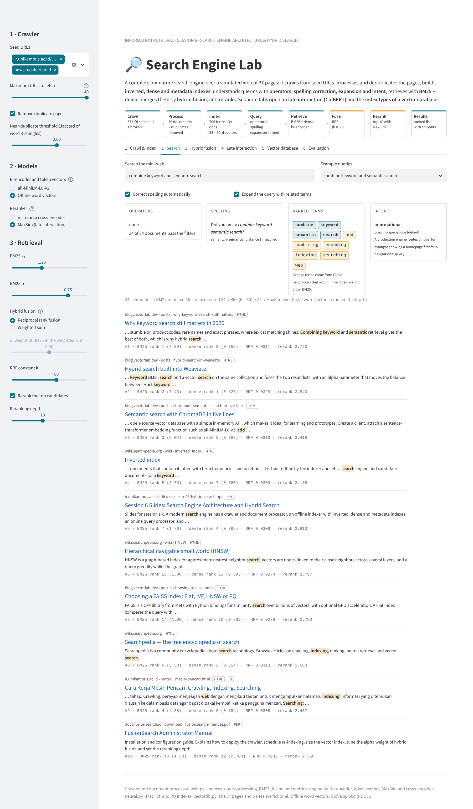

## Table of contents

- [View](#view)
- [Features](#features)
- [Screenshots](#screenshots)
- [The simulated web](#the-simulated-web)
- [How it works](#how-it-works)
- [Worked examples](#worked-examples)
- [Evaluation results](#evaluation-results)
- [Project structure](#project-structure)
- [Running locally](#running-locally)
- [Deploying to Streamlit Community Cloud](#deploying-to-streamlit-community-cloud)
- [Customizing](#customizing)
- [Limitations](#limitations)
- [References](#references)

---

## Features

- **Crawler.** Breadth-first crawl from seed URLs with a frontier and a visited set, a crawl budget,
  a broken link (HTTP 404), and an orphan page that no link leads to, so it is never discovered.
- **Document processor.** HTML parsing that keeps the title and main text and strips navigation,
  sidebars, footers and scripts; out-link extraction; language identification (English or
  Indonesian); exact and near-duplicate detection (Jaccard over word 3-shingles), keeping the copy
  with the most in-links as the canonical page.
- **Three indexes.** An inverted index (look up any term's postings, df and IDF), a dense index (one
  vector per document) and a metadata index (host, URL, file type, language, title).
- **Query processor.** The operators from the lecture (`intitle:`, `allintitle:`, `inurl:`,
  `allinurl:`, `site:`, `filetype:`), "Did you mean" spelling correction by edit distance, query
  expansion with word-embedding neighbours, and rule-based intent detection (navigational,
  transactional, informational).
- **Multi-stage retrieval.** BM25 and a bi-encoder (all-MiniLM-L6-v2), fused by a weighted sum or
  by RRF, then reranked by a cross-encoder (ms-marco-MiniLM-L-6-v2) or by MaxSim. Results appear as
  a search results page with snippets, highlighted terms and the score from every stage.
- **Hybrid fusion.** The lecture notebook's example reproduced exactly (`rank_bm25` formula,
  min-max BM25, cosine), every document under both fusions, how α moves the ranking, and what one
  list position is worth in RRF.
- **Late interaction.** The MaxSim matrix between query and document tokens as a heatmap; bi-encoder,
  MaxSim and cross-encoder scores side by side; the whole index ranked three ways; and the storage
  cost of keeping one vector per token.
- **Vector database.** Flat, IVF and PQ indexes over 30,000 word vectors, written in NumPy: results,
  recall against exact search, vectors scanned, bytes per vector, and the recall-versus-nprobe curve.
- **Evaluation.** P@3, P@5, MAP and MRR over 11 labelled queries for BM25, dense, both fusions and
  both fusions with reranking, plus MAP as a function of α.

## Screenshots

The screenshots were taken with the offline models (GloVe word vectors for the bi-encoder and token
vectors, MaxSim for reranking). With all-MiniLM-L6-v2 and the cross-encoder in the deployed app, the
dense, rerank and evaluation numbers are different.

**Crawler.** 37 URLs fetched from two seeds: 36 pages, one broken link, and one page (*Learning to
rank*) that no crawled page links to.

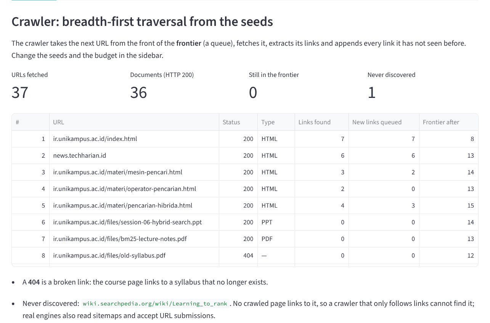

**Document processor.** The raw HTML the server returns and the document the parser extracts from
it, with its out-links and detected language. Below it, the two duplicates that were removed: a
mirror (exact) and a republished copy (near duplicate, Jaccard 0.947).

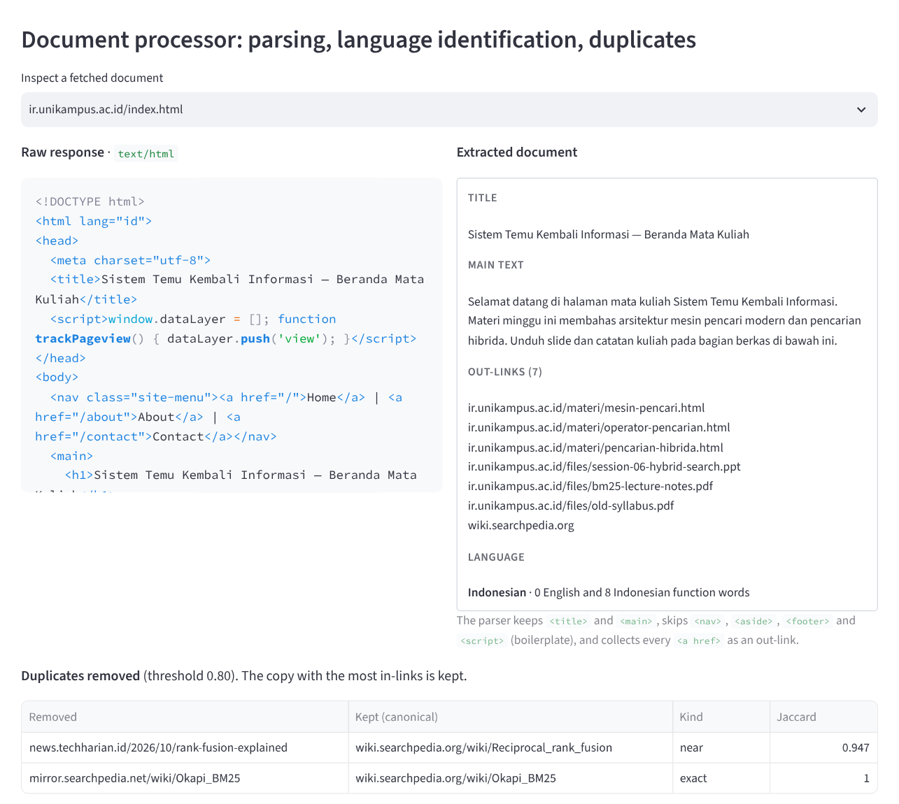

**Indexes.** The postings of *search*, the first dimensions of the dense vectors, and the metadata
used by the operators.

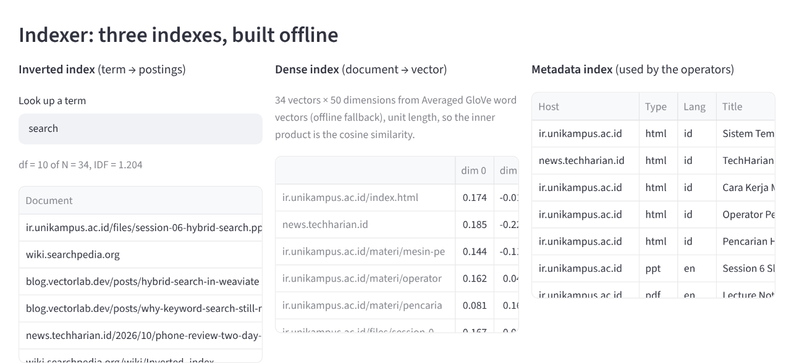

**Search.** The query *combine keyword and semantc search*: *semantc* is corrected to *semantic*,
the expansion adds related index terms in orange, the intent is informational, and every result
shows its BM25 rank, dense rank, RRF score and rerank score.

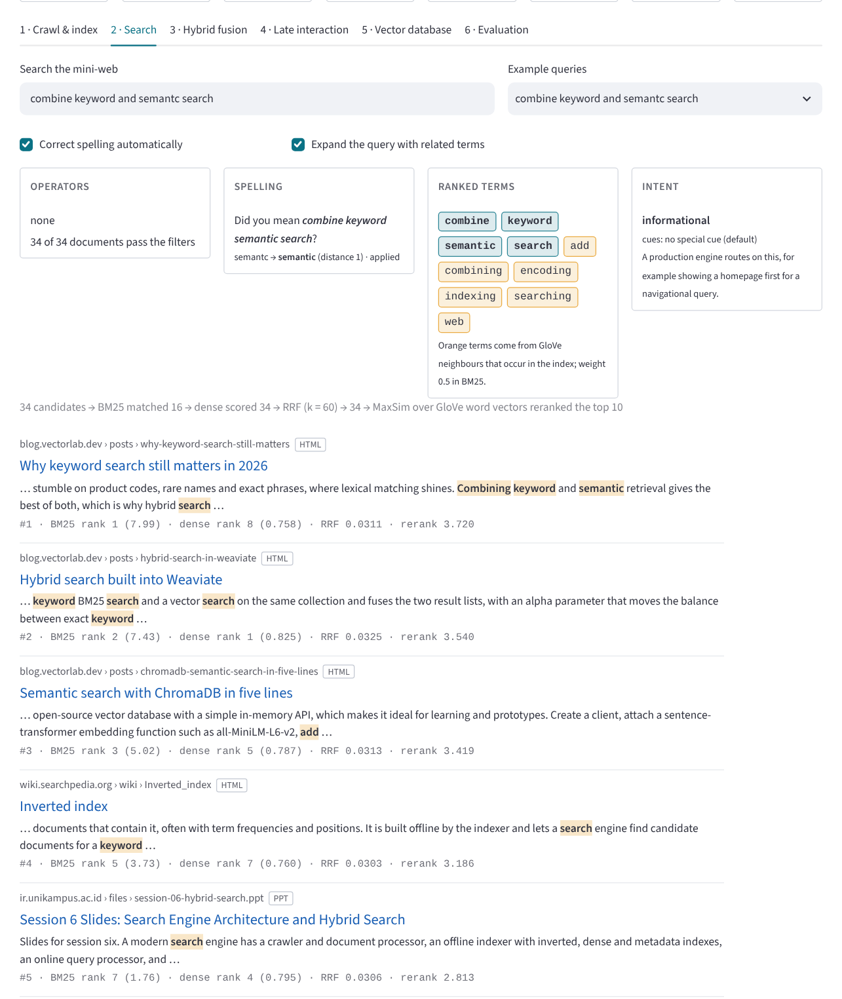

**Operators.** `filetype:pdf bm25` keeps 2 of 34 documents and ranks them by *bm25*; the query is
recognised as transactional.

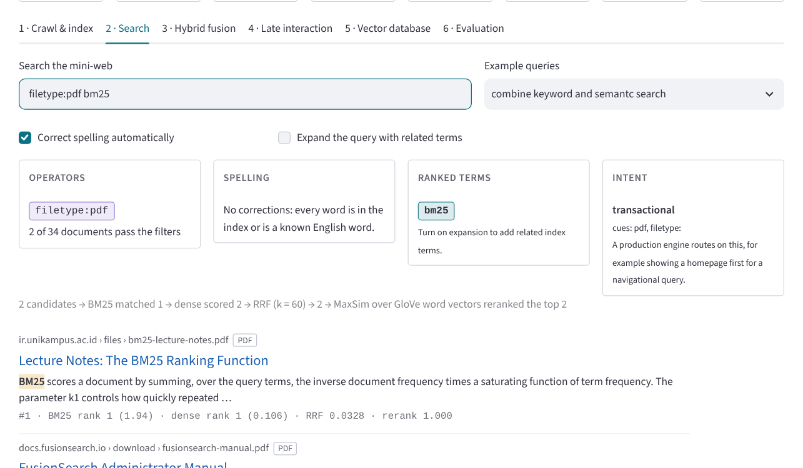

<details>
<summary><b>Hybrid fusion, late interaction, vector database and evaluation</b></summary>

**Hybrid fusion** with the lecture notebook's example. With the offline vectors the dense scores of
these Indonesian documents are close to 0; with all-MiniLM-L6-v2 (as in the notebook) they are not.

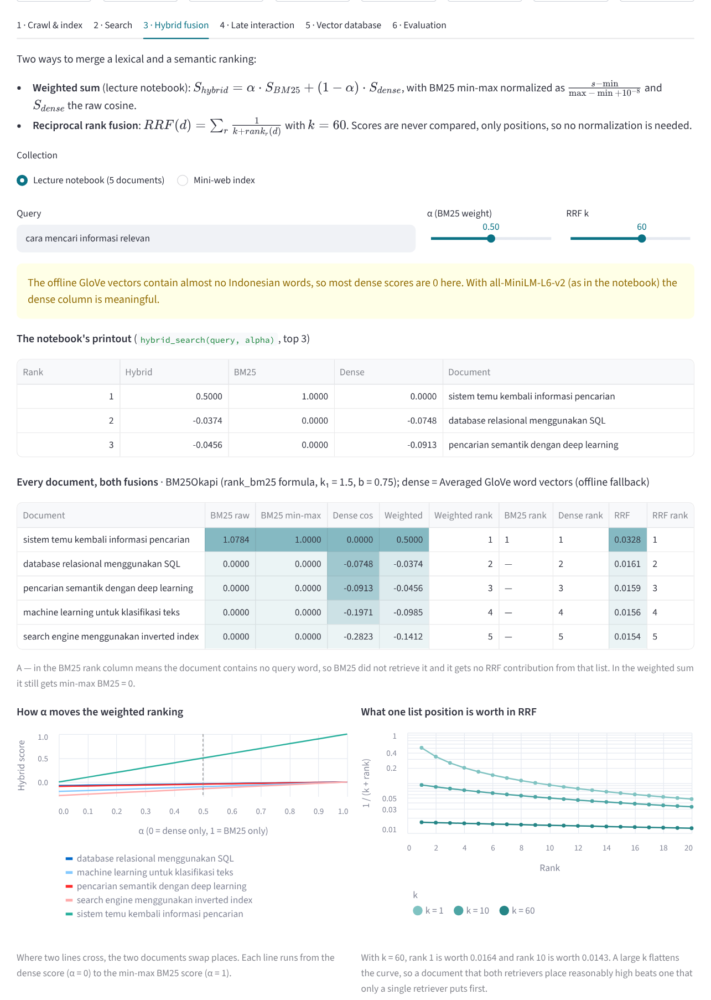

**Late interaction.** Each orange dot is the maximum similarity of a query token; the MaxSim score is
the sum of the dots.

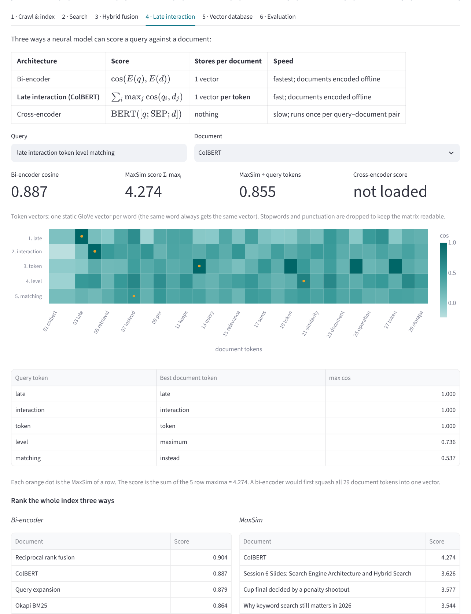

**Vector database.** The same query answered by Flat, IVF and PQ indexes, and the speed–recall
trade-off of IVF.

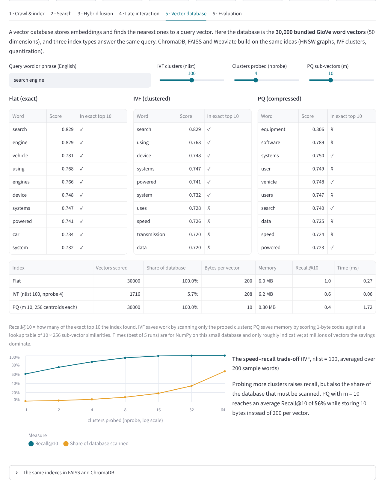

**Evaluation.**

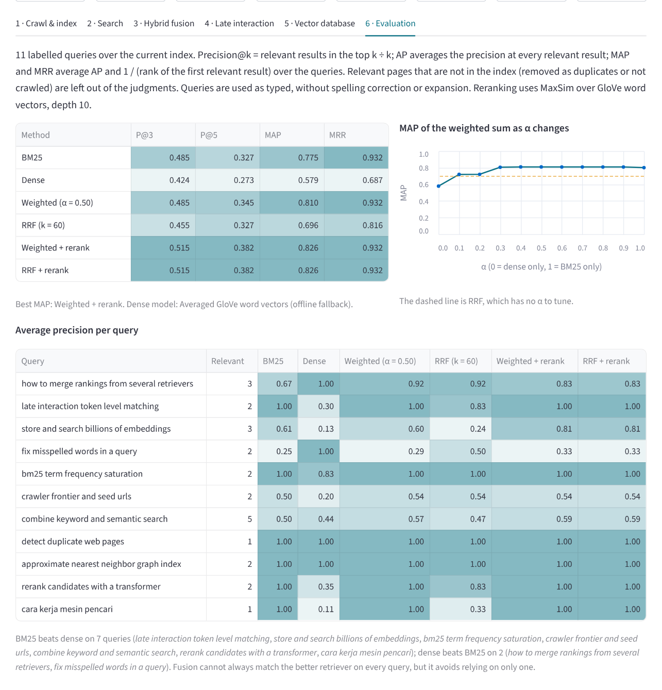

</details>

## The simulated web

The crawler does not go on the internet. `data/web.json` holds 37 pages on six fictional sites, and
`web.fetch()` plays the web server: it wraps each HTML page in realistic boilerplate, serves PDF and
PPT files as extracted text, and answers 404 for a link that leads nowhere.

| Site | Pages | Content |
|---|---:|---|
| `ir.unikampus.ac.id` | 6 | Course site: lecture pages in Indonesian, slides (PPT) and notes (PDF), one broken link |
| `wiki.searchpedia.org` | 16 | Encyclopedia articles: crawler, inverted index, BM25, dense retrieval, RRF, ColBERT, cross-encoder, HNSW, PQ, … (one orphan) |
| `mirror.searchpedia.net` | 1 | An exact copy of the BM25 article |
| `blog.vectorlab.dev` | 4 | Posts on ChromaDB, FAISS index types, Weaviate hybrid search, why keyword search still matters |
| `docs.fusionsearch.io` | 3 | Product documentation: ranking pipeline, query understanding, a PDF manual |
| `news.techharian.id` | 7 | News: cooking (Indonesian), football, travel, a phone review, local search engines (Indonesian), and a republished copy of the RRF article |

The distractor pages and the copies are there on purpose: they give the crawler, the duplicate
detector, the language detector and the rankers something to get wrong. The 11 labelled queries
mix exact keywords (*bm25 term frequency saturation*), paraphrases that share few words with the
relevant pages (*fix misspelled words in a query*, *how to merge rankings from several
retrievers*), and one Indonesian query (*cara kerja mesin pencari*).

## How it works

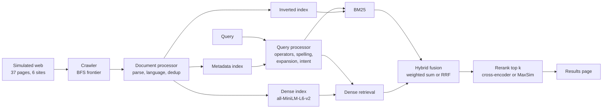

The lecture divides a modern search engine into four components; the app implements each one.

### 1. Crawler & document processor (`web.py`)

- **Crawling.** The frontier is a queue: take the first URL, fetch it, extract its links, append the
  links not seen before. A page no crawled page links to is never found (real engines also use
  sitemaps and URL submissions).
- **HTML parsing.** Keep `<title>` and `<main>`; skip `<nav>`, `<aside>`, `<footer>` and `<script>`;
  collect every `<a href>`.
- **Language identification.** Count English and Indonesian function words; the language with more
  matches wins.
- **Deduplication.** Exact copies have the same fingerprint (MD5 of the normalized text). Near
  copies have a Jaccard similarity of word 3-shingles at or above the threshold (0.8 by default).
  Of each group, the page with the most in-links is kept.

### 2. Indexer (`engine.py`)

The **inverted index** maps each term to its postings (document → term frequency). Title and body
are indexed together; English and Indonesian stopwords are removed; there is no stemming. The
**dense index** stores one unit-length vector per document. The **metadata index** stores the host,
URL, file type, language and title words, which the operators filter on.

### 3. Query processor (`engine.py`)

| Operator | Meaning | Example | Result in the mini-web |
|---|---|---|---|
| `intitle:w` | the title contains *w*; the other words are matched in the content | `intitle:hybrid search` | 2 pages |
| `allintitle:` | every following word is in the title; cannot be combined with other operators | `allintitle:hybrid search` | 2 pages |
| `inurl:w` | the URL contains *w* | `inurl:posts vector` | 4 blog posts |
| `allinurl:` | every following word is in the URL; cannot be combined | `allinurl:guide ranking` | 1 page |
| `site:x` | the host is *x* or ends with *.x* | `bm25 site:ac.id` | 6 course pages |
| `filetype:x` | the document type is *x* | `filetype:pdf bm25` | 2 PDFs |

- **Spelling correction.** A word that is neither in the index nor a known English word (the GloVe
  vocabulary) is replaced by the most frequent index term within edit distance 1 (words of up to 5
  letters) or 2 (Damerau-Levenshtein, so swapped letters count as one edit). *hybird serach* →
  *hybrid search*.
- **Query expansion.** For each query word, up to two GloVe neighbours (cosine ≥ 0.6) that also occur
  in the index are added with weight 0.5 in BM25. Expansion can help or add noise; the app shows the
  added terms so you can judge.
- **Intent detection.** Download words or `filetype:` → transactional; site names or `site:` →
  navigational; otherwise informational.

### 4. Retrieval engine (`engine.py`, `neural.py`)

**BM25** with k₁ = 1.2 and b = 0.75 and `IDF = ln(1 + (N − n + 0.5) / (n + 0.5))`, as in Session 5.
The notebook example in the *Hybrid fusion* tab uses the `rank_bm25.BM25Okapi` formula instead
(k₁ = 1.5, b = 0.75, `IDF = ln((N − n + 0.5) / (n + 0.5))`, a negative IDF replaced by 0.25 × the
average IDF), so its numbers match the notebook exactly.

**Dense retrieval**: cosine similarity of all-MiniLM-L6-v2 embeddings (a bi-encoder).

**Hybrid fusion**, two options:

```
Weighted sum:  S_hybrid(d) = α · minmax(BM25)(d) + (1 − α) · cos(q, d)
               minmax(s)   = (s − min) / (max − min + 1e-8)          (lecture notebook)

RRF:           RRF(d) = Σ_r 1 / (k + rank_r(d)),   k = 60             (Cormack et al., 2009)
```

In the weighted sum, **α is the weight of BM25**: α = 1 is BM25 alone, α = 0 is dense alone. RRF
uses only positions, so BM25 scores (unbounded) and cosines (−1 to 1) never have to be put on the
same scale. A document BM25 does not retrieve (no query word) gets nothing from the BM25 list.

**Reranking.** The top *k* fused results (10 by default) are reordered by the cross-encoder, which
reads query and document together, `score = BERT([q; SEP; d])`. Without it, MaxSim is used.

### Late interaction (ColBERT)

| Architecture | Score | Stores per document |
|---|---|---|
| Bi-encoder | cos(E(q), E(d)) | 1 vector |
| Late interaction (ColBERT) | Σᵢ maxⱼ cos(qᵢ, dⱼ) | 1 vector per token |
| Cross-encoder | BERT([q; SEP; d]) | nothing; runs once per query–document pair |

ColBERT keeps an embedding for every token and, for each query token, takes its best match among the
document tokens (MaxSim). It approaches cross-encoder quality while documents can still be encoded
offline, at the cost of storage. ColBERTv2 reduces that cost with residual compression (Santhanam et
al., 2022). This app computes MaxSim over MiniLM's token outputs (or GloVe word vectors offline),
which shows how late interaction scores and what it stores, but MiniLM was not trained for MaxSim,
so it does not reproduce ColBERTv2's accuracy.

### Vector databases (`vectordb.py`)

| Index | Idea | Cost |
|---|---|---|
| Flat | compare the query with every vector | exact; time grows with the collection |
| IVF | k-means into `nlist` clusters; scan only the `nprobe` closest | faster; can miss neighbours |
| PQ | split each vector into `m` parts; store each part as a 1-byte centroid id | 200 → `m` bytes; approximate scores |
| HNSW | walk a graph of near neighbours (FAISS, ChromaDB, Weaviate) | fast, high recall, extra memory (described, not implemented) |

From the slides: **ChromaDB** is the simplest to learn with (in-memory, five lines of code),
**FAISS** (Meta) scales to billions of vectors with GPU support, and **Weaviate** is a full
database with a GraphQL API and built-in hybrid search. The app's *Vector database* tab shows the
equivalent FAISS and ChromaDB code.

## Worked examples

### The lecture notebook by hand

Query *cara mencari informasi relevan* over the notebook's five documents (whitespace tokens).
N = 5, document lengths 5, 5, 4, 5, 5, so avgdl = 24 / 5 = 4.8. Only *informasi* occurs in the
collection, once, in doc 0:

```
IDF(informasi) = ln(5 − 1 + 0.5) − ln(1 + 0.5) = ln 3 = 1.0986
BM25(doc 0)    = 1.0986 × 1 · 2.5 / (1 + 1.5 · (0.25 + 0.75 · 5/4.8)) = 1.0986 × 0.9816 = 1.0784
BM25(others)   = 0
min-max        → doc 0: 1.0000, others: 0.0000
hybrid (α=0.5) → doc 0: 0.5 + 0.5 · cos(doc 0), others: 0.5 · cos(d)
```

Two things the example shows. *mencari* (to search) and *pencarian* (search) share the root *cari*,
but without stemming BM25 does not match them, so doc 1 gets no BM25 score. And min-max
normalization gives the best BM25 document 1.0 however weak its match is: here a single shared word
adds a full α = 0.5 to doc 0.

### RRF by hand (k = 60)

| Document | BM25 rank | Dense rank | RRF |
|---|---:|---:|---:|
| A | 1 | 3 | 1/61 + 1/63 = 0.03227 |
| B | 2 | 2 | 1/62 + 1/62 = 0.03226 |
| C | 1 | not retrieved | 1/61 = 0.01639 |

Being ranked well by both retrievers (A, B) is worth twice as much as being first in only one (C).
With k = 60, rank 1 (0.0164) and rank 10 (0.0143) are close, so agreement counts more than position.

### MaxSim with illustrative numbers

Query tokens *late*, *interaction*; document tokens *late*, *model*, *interact*:

| | late | model | interact | max |
|---|---:|---:|---:|---:|
| **late** | 0.95 | 0.20 | 0.10 | 0.95 |
| **interaction** | 0.30 | 0.15 | 0.80 | 0.80 |

score = 0.95 + 0.80 = **1.75**. Each query token finds its own best partner; a bi-encoder would
compare only two averaged vectors.

### Vector index trade-off

Averages over 200 sample words from the 30,000 GloVe vectors, Recall@10 against exact search:

| IVF, nlist = 100 | nprobe 1 | 2 | 4 | 8 | 16 | 64 |
|---|---:|---:|---:|---:|---:|---:|
| Recall@10 | 60.1% | 74.7% | 86.5% | 95.2% | 99.2% | 100% |
| Share of database scanned | 1.3% | 2.6% | 5.1% | 9.7% | 18.1% | 65.9% |

| PQ, 256 centroids per part | m = 5 | m = 10 | m = 25 | m = 50 |
|---|---:|---:|---:|---:|
| Bytes per vector (Flat: 200) | 5 | 10 | 25 | 50 |
| Recall@10 | 40.0% | 55.6% | 82.8% | 96.3% |

Scanning about 10% of the database already finds 95% of the true neighbours.

## Evaluation results

11 labelled queries, index of 34 documents after deduplication, BM25 k₁ = 1.2 and b = 0.75,
α = 0.5, RRF k = 60, reranking depth 10, with the **offline models** (GloVe for dense and token
vectors, MaxSim for reranking):

| Method | P@3 | P@5 | MAP | MRR |
|---|---:|---:|---:|---:|
| BM25 | 0.485 | 0.327 | 0.775 | 0.932 |
| Dense (averaged GloVe) | 0.424 | 0.273 | 0.579 | 0.687 |
| Weighted sum (α = 0.5) | 0.485 | 0.345 | 0.810 | 0.932 |
| RRF (k = 60) | 0.455 | 0.327 | 0.696 | 0.816 |
| Weighted sum + rerank | **0.515** | **0.382** | **0.826** | **0.932** |
| RRF + rerank | **0.515** | **0.382** | **0.826** | **0.932** |

- The weighted hybrid beats both of its parts on MAP, and reranking improves it further.
- RRF scores below BM25 here. It gives the two lists equal say, and the offline dense ranking is
  weak, so its mistakes pull good BM25 results down. The weighted sum with α = 0.5 leans on BM25
  instead, because min-max puts the best BM25 match at 1.0 while cosines stay close together.
- The two reranked rows are identical because the reranker reorders the whole top 10, so fusion only
  decides which documents reach it. For every query both fusions let the same relevant documents
  into the top 10; the few non-relevant pages that differ do not change where the relevant ones end
  up.
- Per query, BM25 wins exact-term queries (including the Indonesian one, which GloVe cannot read)
  and dense wins the paraphrases (*fix misspelled words in a query*, *how to merge rankings…*).

With all-MiniLM-L6-v2 and the cross-encoder the dense and reranked rows change, and RRF may compare
differently; the *Evaluation* tab of the deployed app shows the actual numbers.

## Project structure

```
.
├── app.py                   # Streamlit app (user interface)
├── web.py                   # Simulated server, crawler, HTML parser, language detection, deduplication
├── engine.py                # Inverted & metadata index, BM25, operators, spelling, expansion,
│                            #   intent, snippets, weighted fusion, RRF, evaluation metrics
├── neural.py                # Bi-encoder, token vectors, MaxSim, cross-encoder (+ offline fallbacks)
├── vectordb.py              # Flat, IVF and PQ vector indexes in NumPy
├── glove.py                 # Loader for the bundled GloVe vectors
├── data/
│   ├── web.json             # The 37 pages, seeds, 11 labelled queries, notebook example
│   └── glove_50d_30k.npz    # GloVe 6B 50d, 30,000 words (3 MB)
├── docs/                    # Images used in this README
├── requirements.txt         # Python dependencies
└── .streamlit/config.toml   # App color theme
```

The modules do not depend on Streamlit and can be run from the terminal:

```bash
python web.py        # crawl, duplicates, undiscovered pages, languages
python engine.py     # index statistics, operators, spelling, the notebook's BM25 scores
python neural.py     # MaxSim and bi-encoder scores for one query and document
python vectordb.py   # Flat vs IVF vs PQ for three words
```

## Running locally

Requires Python 3.10 or newer.

```bash
git clone https://github.com/USERNAME/REPO-NAME.git
cd REPO-NAME
pip install -r requirements.txt
streamlit run app.py
```

## Deploying to Streamlit Community Cloud

1. Push all files to a GitHub repository, including the `data` and `.streamlit` folders. Use folder
   names **without spaces**, for example `search-engine-lab`.
2. Go to [share.streamlit.io](https://share.streamlit.io), choose **Create app**, and select this
   repository.
3. Set **Main file path** to `app.py` (or `search-engine-lab/app.py` if the app is in a subfolder).
4. Click **Deploy**. Any Python version from 3.10 up works (tested with 3.13 and 3.14).

`sentence-transformers` installs PyTorch, so the first deployment takes several minutes. The two
models download on first use, about 90 MB each: all-MiniLM-L6-v2 for dense retrieval and token
vectors, and ms-marco-MiniLM-L-6-v2 for reranking. If a model cannot be loaded, the app says so and
falls back to the bundled GloVe vectors (and to MaxSim for reranking). To skip PyTorch entirely,
remove `sentence-transformers` from `requirements.txt`; everything then runs offline.

## Customizing

- **Pages, links and seeds** are in `data/web.json`. Each page has a `url`, `type` (`html`, `pdf` or
  `ppt`), `title`, `body` and `links`. Rebuilding the web with your own pages changes every tab.
- **Labelled queries** are `queries` in the same file: a query and the URLs of its relevant pages.
- **Stopwords** are `STOPWORDS` in `engine.py`; intent cues are `NAV_CUES`, `TRANS_CUES` and
  `INFO_CUES`.
- **Models** are `MINILM` and `CROSS` in `neural.py`. For Indonesian text, a multilingual model such
  as `paraphrase-multilingual-MiniLM-L12-v2` is a better choice than all-MiniLM-L6-v2.

## Limitations

- The web is simulated and tiny. A real crawler also handles robots.txt, politeness delays,
  redirects, JavaScript-rendered pages, URL normalization and re-crawling.
- No stemming: *mencari* and *pencarian*, *rank* and *ranking* are different terms.
- all-MiniLM-L6-v2 and the cross-encoder are English models; the offline GloVe vectors know almost
  no Indonesian, so Indonesian pages rely on BM25.
- The late interaction tab uses MiniLM token outputs, not a trained ColBERT checkpoint. HNSW is
  described but not implemented.
- 34 documents and 11 queries are enough to see how the methods differ, not to prove which is better
  in general.

## References

- Cormack, G. V., Clarke, C. L. A., & Büttcher, S. (2009). Reciprocal Rank Fusion Outperforms
  Condorcet and Individual Rank Learning Methods. *SIGIR*.
- Khattab, O., & Zaharia, M. (2020). ColBERT: Efficient and Effective Passage Search via
  Contextualized Late Interaction over BERT. *SIGIR*.
- Santhanam, K., Khattab, O., Saad-Falcon, J., Potts, C., & Zaharia, M. (2022). ColBERTv2: Effective
  and Efficient Retrieval via Lightweight Late Interaction. *NAACL*.
- Johnson, J., Douze, M., & Jégou, H. (2019). Billion-Scale Similarity Search with GPUs. *IEEE
  Transactions on Big Data*.
- Lin, J., Ma, X., Lin, S.-C., Yang, J.-H., Pradeep, R., & Nogueira, R. (2021). Pyserini: A Python
  Toolkit for Reproducible Information Retrieval Research. *SIGIR*.
- Jégou, H., Douze, M., & Schmid, C. (2011). Product Quantization for Nearest Neighbor Search.
  *IEEE TPAMI*, 33(1), 117–128.
- Malkov, Y. A., & Yashunin, D. A. (2020). Efficient and Robust Approximate Nearest Neighbor Search
  Using Hierarchical Navigable Small World Graphs. *IEEE TPAMI*, 42(4), 824–836.
- Broder, A. Z. (1997). On the Resemblance and Containment of Documents. *Compression and Complexity
  of Sequences*.
- Reimers, N., & Gurevych, I. (2019). Sentence-BERT. *EMNLP*.
- Nogueira, R., & Cho, K. (2019). Passage Re-ranking with BERT. *arXiv:1901.04085*.
- Manning, C. D., Raghavan, P., & Schütze, H. (2008). *Introduction to Information Retrieval*,
  Chapters 19–20 (web search, crawling, near duplicates). Cambridge University Press.
- Pennington, J., Socher, R., & Manning, C. D. (2014). GloVe: Global Vectors for Word Representation.
  *EMNLP*.
- Lecture materials, Session 6: Search Engine Architecture & Hybrid Search (Junta Zeniarja, M.Kom),
  and *Search Engine Concept*, STKI Lecturer Team, Faculty of Computer Science, Universitas Dian
  Nuswantoro.

---

Built by **Rizqi Aditya**, Informatics Engineering, Universitas Dian Nuswantoro,
for the Information Retrieval Systems course.
