# 📏 IR Evaluation Lab: Classic & Modern Metrics for Search

An interactive lab for **evaluating information retrieval systems**, built with Python and
Streamlit. It computes every measure from the lecture step by step (precision, recall, F1,
accuracy, P@k, R@k, AP, MAP, MRR, nDCG), runs five retrieval systems on a small **TREC-style test
collection**, tests whether differences are significant, measures **agreement between relevance
assessors** (Cohen's κ), and ends with the modern view: a **BEIR-style** per-domain comparison and
**RAGAS-style** metrics for retrieval-augmented generation.

This project was built for **Session 7: Evaluating IR Models: Classic & Modern Metrics** of the
**Information Retrieval Systems** course (*Sistem Temu Kembali Informasi*, STKI), together with the
*Evaluasi* material (user happiness, benchmarks, precision, recall and accuracy).

🔗 **Live demo:** https://information-retrieval-system-6sot3vl4oedinqb6xb9xtv.streamlit.app/

## View

The full interface: relevance judgments, relevance threshold, nDCG gain and dense model in the
sidebar; the *Precision & recall* tab in the main area with the contingency table, the measures, the
precision–recall trade-off, and the lecture's "why not accuracy" example.

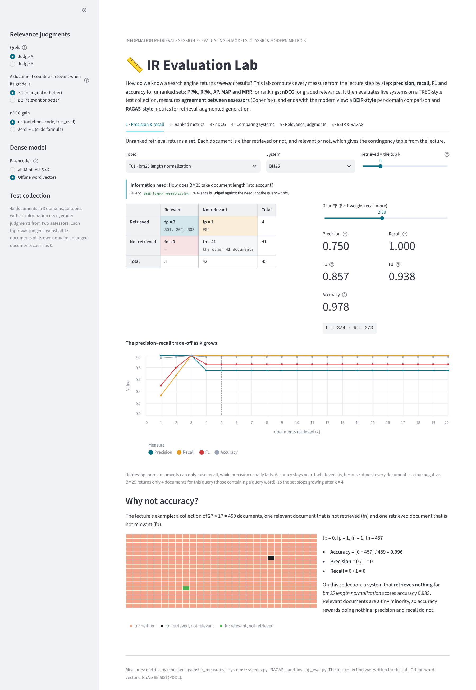

## Table of contents

- [View](#view)
- [Features](#features)
- [Screenshots](#screenshots)
- [The test collection](#the-test-collection)
- [How it works](#how-it-works)
- [Worked examples](#worked-examples)
- [Two corrections to the lecture material](#two-corrections-to-the-lecture-material)
- [Evaluation results](#evaluation-results)
- [Project structure](#project-structure)
- [Running locally](#running-locally)
- [Deploying to Streamlit Community Cloud](#deploying-to-streamlit-community-cloud)
- [Customizing](#customizing)
- [Limitations](#limitations)
- [References](#references)

---

## Features

- **Set-based measures.** The contingency table (tp, fp, fn, tn, with the document ids in each
  cell), precision, recall, F1, Fβ and accuracy for any topic, system and cutoff k, and how they
  change as k grows.
- **Why not accuracy.** The lecture's 27 × 17 = 459-document example (accuracy 0.996 with precision
  and recall 0), and the accuracy of a system that retrieves nothing.
- **Ranked measures.** The notebook's example (relevant D1, D3, D5; ranking D1 … D7) as an editable
  table: P@k, R@k and P@k·rel(k) at every position, AP written out, reciprocal rank, R-precision, the
  precision–recall curve (raw and 11-point interpolated), and MRR over several queries.
- **nDCG.** Editable graded relevance, the discount and both gains (rel and 2^rel − 1) per position,
  DCG, IDCG and nDCG@k, including relevant documents that were not retrieved.
- **Checks of the lecture's numbers.** The slide's `ir_measures` example recomputed, with the two
  printed values that do not match (see [below](#two-corrections-to-the-lecture-material)).
- **TREC-style comparison.** Boolean AND, TF-IDF, BM25, a dense bi-encoder and a hybrid (RRF) on 15
  topics: P@5, P@10, R@10, R-precision, MAP, MRR, nDCG@10, query latency and index-build time;
  averaged precision–recall curves; per-topic scores; the rank of each system under each measure.
- **Significance.** A paired randomization test between any two systems on any per-topic measure.
- **TREC files.** Download the qrels and the run of any system in the standard TREC formats.
- **Assessor agreement.** Cohen's κ on Manning et al.'s 2 × 2 example and on the two assessors of
  this collection, MAP under each assessor, and Kendall's τ between the two system orders. You can
  also judge a topic yourself and compare.
- **BEIR & RAGAS.** nDCG@10 per domain, and LLM-free stand-ins for faithfulness, answer relevance,
  context precision and context recall, with a sentence-by-sentence explanation.

## Screenshots

The screenshots use the offline dense model (averaged GloVe vectors), so the Dense and Hybrid numbers
differ from all-MiniLM-L6-v2 in the deployed app. Everything else (the lexical systems, the
notebook and slide examples, κ) is identical.

**Precision and recall.** Topic T01 with BM25, top 5: three relevant documents retrieved, one
non-relevant (F06), none missed, so P = 0.75 and R = 1. Accuracy is 0.978 almost by default.

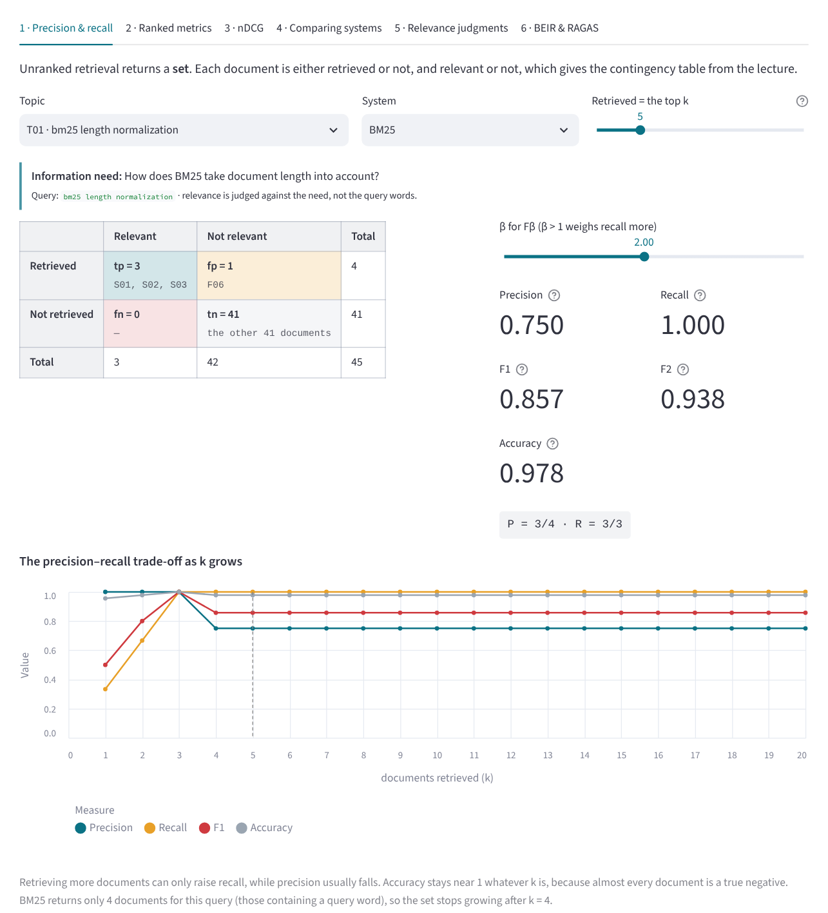

**Why not accuracy.** The lecture's example: one missed relevant document and one wrong retrieval
in 459 documents give accuracy 0.996 with precision and recall 0.

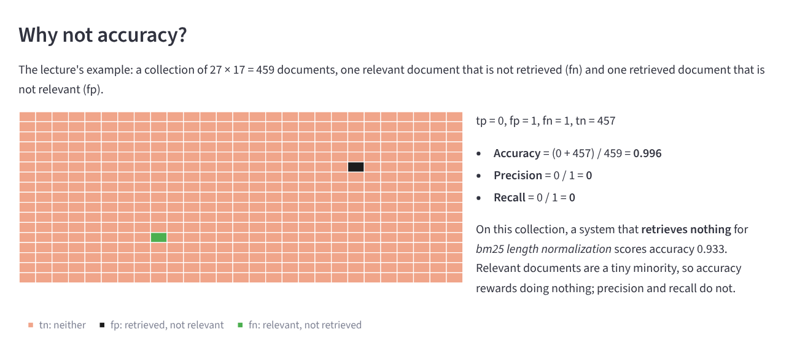

**Ranked measures.** The notebook's ranking, position by position: AP = (1/3)(1/1 + 2/3 + 3/5) =
0.7556.

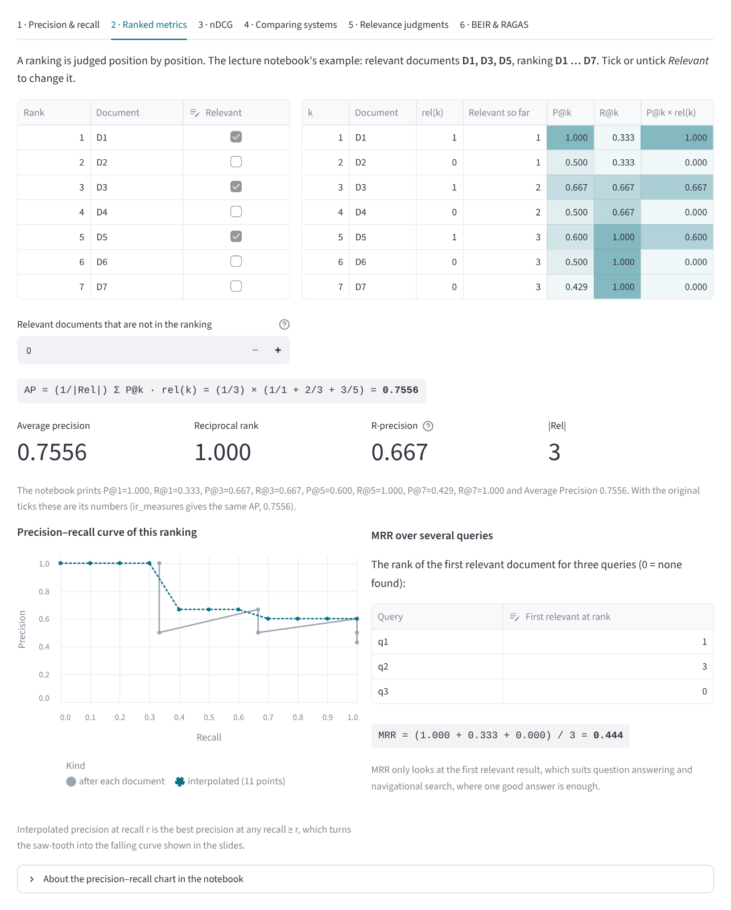

**nDCG.** The notebook's grades [3, 0, 2, 0, 1, 0, 0]: nDCG@5 = 0.9212 with the linear gain of its
code, 0.9461 with the exponential gain of its formula.

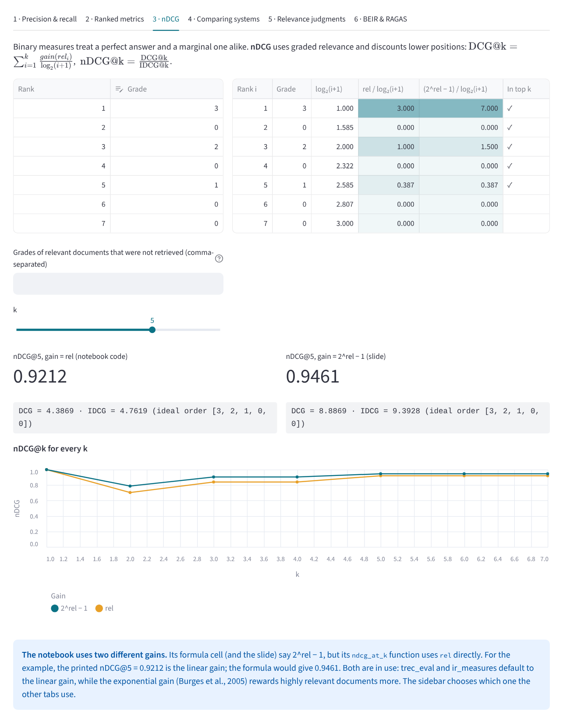

<details>
<summary><b>Slide check, system comparison, significance, assessors, BEIR and RAGAS</b></summary>

**The slide's ir_measures example**, recomputed.

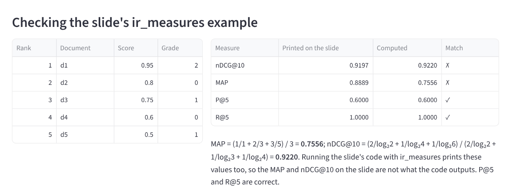

**Comparing systems** on the 15 topics.

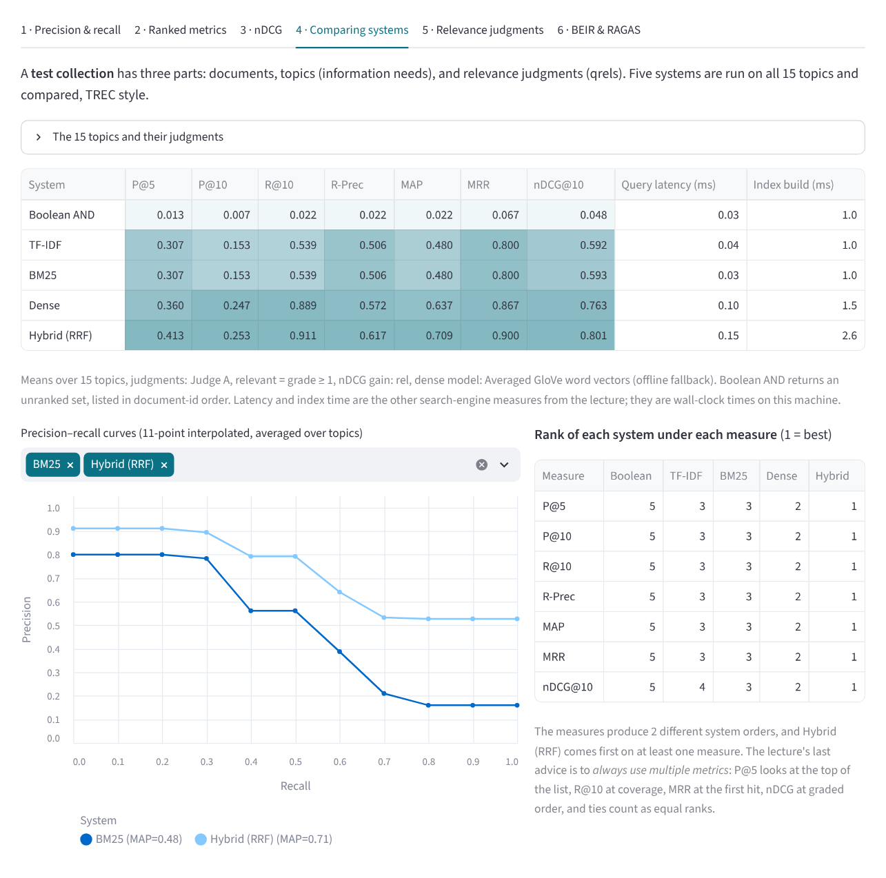

**Paired randomization test**: the hybrid against BM25 on AP.

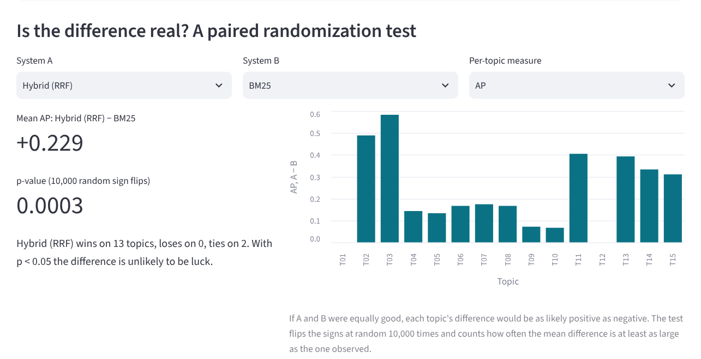

**Relevance judgments**: Cohen's κ, the two assessors, and MAP under each.

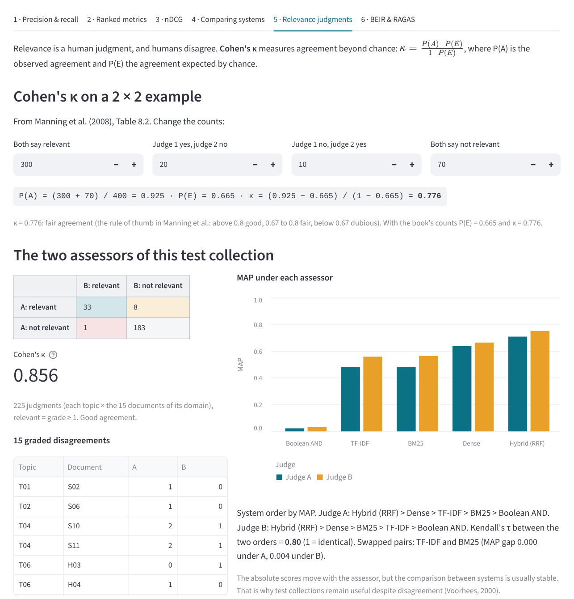

**BEIR-style** nDCG@10 per domain.

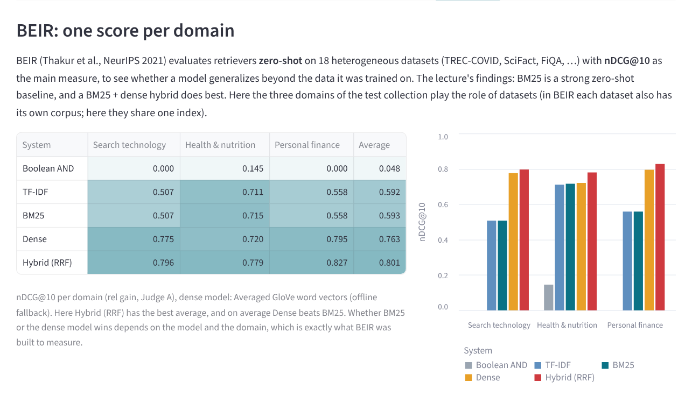

**RAGAS-style metrics** for the olive-oil question, with an answer that adds an invented claim:
faithfulness drops to 0.50, and the sentence that is not supported is shown in red.

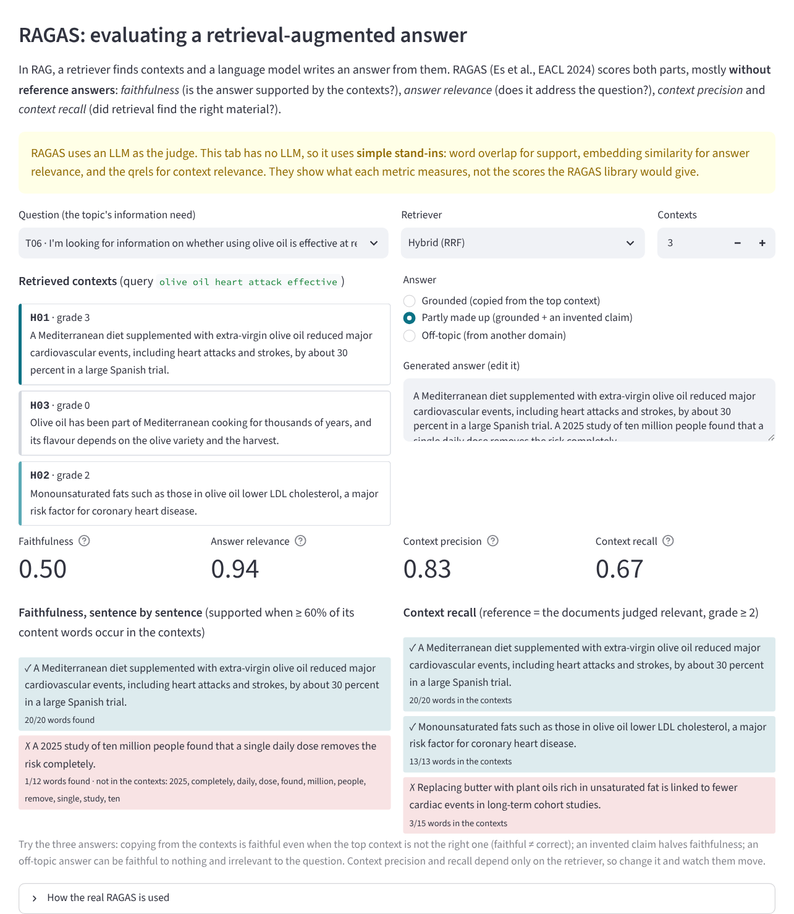

</details>

## The test collection

A test collection has three parts (lecture: *benchmark documents, benchmark queries, relevance
judgments*). This one was written for the lab, in the format of TREC:

| Part | Content |
|---|---|
| Documents | 45 short documents in 3 domains: *Search technology* (S01–S15), *Health & nutrition* (H01–H15), *Personal finance* (F01–F15) |
| Topics | 15 topics, 5 per domain. Each has a **query** (TREC *title*) and an **information need** (TREC *description*) |
| Qrels | Graded judgments: 0 not relevant, 1 marginal, 2 relevant, 3 highly relevant. Each topic was judged against the 15 documents of its domain, by **two assessors** (Judge A and Judge B) |

Topic T06 is the lecture's own example: need *"whether using olive oil is effective at reducing your
risk of heart attacks"*, query *olive oil heart attack effective*. Relevance is judged against the
need, not the query words, so H03 (*olive oil … Mediterranean cooking … flavour*) is **not
relevant** although it contains *olive oil*, and H05 (*plant oils rich in unsaturated fat … fewer
cardiac events*) **is** relevant although it shares no query word. Several topics are built the same
way, so exact matching and meaning matching give different results.

## How it works

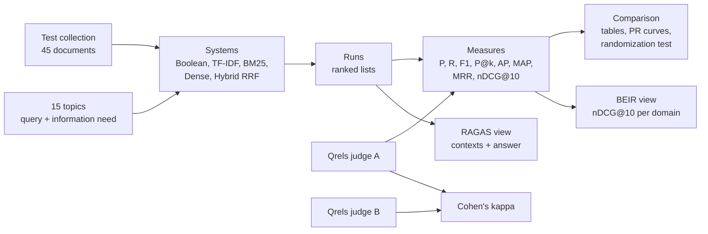

### Set-based measures (unranked retrieval)

|  | Relevant | Not relevant |
|---|---|---|
| **Retrieved** | tp | fp |
| **Not retrieved** | fn | tn |

```
Precision P = tp / (tp + fp) = P(relevant | retrieved)
Recall    R = tp / (tp + fn) = P(retrieved | relevant)
F1          = 2PR / (P + R)          Fβ = (1 + β²)PR / (β²P + R)
Accuracy    = (tp + tn) / (tp + fp + fn + tn)
```

Accuracy is a poor measure for search: almost every document is a true negative, so a system that
retrieves nothing is already "accurate".

### Ranked measures

```
P@k  = relevant in the top k / k               R@k = relevant in the top k / |Rel|
AP   = (1/|Rel|) Σ_k P@k · rel(k)              MAP = mean of AP over the topics
RR   = 1 / rank of the first relevant result   MRR = mean of RR
R-precision = P@|Rel|
```

|Rel| counts all relevant documents, including those the system never retrieved. A document counts
as relevant when its grade is at least 1 (the TREC convention); the sidebar can raise the threshold
to 2. The **interpolated** precision at recall r is the highest precision at any recall ≥ r; the
11-point curve averaged over topics is the precision–recall chart of the slides.

### nDCG (graded relevance)

```
DCG@k  = Σ_{i=1..k} gain(rel_i) / log2(i + 1)        gain = rel  or  2^rel − 1
nDCG@k = DCG@k / IDCG@k                              IDCG = DCG of the ideal order of all judged documents
```

### The five systems

| System | Scoring |
|---|---|
| Boolean AND | documents containing every query term; an unranked set |
| TF-IDF | log TF × log₁₀(N/df), cosine similarity |
| BM25 | k₁ = 1.2, b = 0.75, IDF = ln(1 + (N − n + 0.5)/(n + 0.5)) |
| Dense | all-MiniLM-L6-v2 bi-encoder, cosine (offline fallback: averaged GloVe vectors) |
| Hybrid (RRF) | reciprocal rank fusion of BM25 and Dense, Σ 1/(60 + rank) |

### Significance

With 15 topics, a difference in MAP can be luck. The **paired randomization test** assumes that, if
two systems were equally good, each topic's difference could have had either sign; it flips the signs
at random 10,000 times and reports how often the mean difference is at least as large as the one
observed (the p-value).

### Assessor agreement

```
κ = (P(A) − P(E)) / (1 − P(E))
P(A) = observed agreement      P(E) = P_A(yes)·P_B(yes) + P_A(no)·P_B(no)
```

Manning et al.'s rule of thumb: κ > 0.8 good agreement, 0.67–0.8 fair, below 0.67 dubious.

### BEIR and RAGAS

**BEIR** (Thakur et al., NeurIPS 2021) evaluates retrievers zero-shot on 18 datasets with nDCG@10 as
the main measure. The lecture's points: BM25 is a strong zero-shot baseline, and a BM25 + dense hybrid
does best. Here the three domains play the role of datasets, sharing one index.

**RAGAS** (Es et al., EACL 2024) evaluates retrieval-augmented generation with four metrics. The real
library uses an LLM as the judge; this app has no LLM and uses stand-ins that show what each metric
measures:

| Metric | Question it answers | Stand-in in this app |
|---|---|---|
| Faithfulness | Is the answer supported by the contexts? | share of answer sentences with ≥ 60% of their content words in the contexts |
| Answer relevance | Does the answer address the question? | cosine of the question and answer embeddings |
| Context precision | Are the retrieved contexts relevant, and ranked first? | Σ P@k·v_k / relevant contexts, relevance from the qrels |
| Context recall | Did retrieval find everything the answer needs? | share of the reference sentences (documents with grade ≥ 2) supported by the contexts |

## Worked examples

### Precision and recall (the slide's 459 documents)

tp = 0, fp = 1, fn = 1, tn = 459 − 2 = 457:

```
Accuracy  = (0 + 457) / 459 = 0.996
Precision = 0 / (0 + 1)     = 0
Recall    = 0 / (0 + 1)     = 0
```

### Ranked measures (the notebook)

Relevant {D1, D3, D5}, ranking D1, D2, D3, D4, D5, D6, D7:

| k | Document | rel | P@k | R@k | P@k · rel |
|---:|---|---:|---:|---:|---:|
| 1 | D1 | 1 | 1.000 | 0.333 | 1.000 |
| 2 | D2 | 0 | 0.500 | 0.333 | 0 |
| 3 | D3 | 1 | 0.667 | 0.667 | 0.667 |
| 4 | D4 | 0 | 0.500 | 0.667 | 0 |
| 5 | D5 | 1 | 0.600 | 1.000 | 0.600 |
| 6 | D6 | 0 | 0.500 | 1.000 | 0 |
| 7 | D7 | 0 | 0.429 | 1.000 | 0 |

AP = (1.000 + 0.667 + 0.600) / 3 = **0.7556**. RR = 1. If one more relevant document existed but was
not retrieved, AP would drop to 2.267 / 4 = 0.567.

### nDCG (the notebook's grades)

Grades [3, 0, 2, 0, 1, 0, 0], k = 5, ideal order [3, 2, 1, 0, 0]:

```
linear gain:      DCG@5 = 3/1 + 2/2 + 1/2.585 = 4.3869     IDCG@5 = 3/1 + 2/1.585 + 1/2 = 4.7619     nDCG@5 = 0.9212
exponential gain: DCG@5 = 7/1 + 3/2 + 1/2.585 = 8.8869     IDCG@5 = 7/1 + 3/1.585 + 1/2 = 9.3928     nDCG@5 = 0.9461
```

### Cohen's κ (Manning et al., Table 8.2)

300 both relevant, 70 both not relevant, 20 + 10 disagreements, 400 documents:

```
P(A) = 370 / 400 = 0.925
P(E) = 0.800 × 0.775 + 0.200 × 0.225 = 0.665
κ    = (0.925 − 0.665) / (1 − 0.665) = 0.776      → fair agreement
```

## Two corrections to the lecture material

1. **The printed output of the `ir_measures` slide.** For the slide's qrels (d1 = 2, d3 = 1, d5 = 1)
   and run (d1 … d5), the slide prints `nDCG@10: 0.9197` and `MAP: 0.8889`. Running that code with
   `ir_measures` gives **nDCG@10 = 0.9220** and **AP = 0.7556**:

   ```
   AP      = (1/1 + 2/3 + 3/5) / 3                                   = 0.7556
   nDCG@10 = (2/log2 2 + 1/log2 4 + 1/log2 6) / (2/log2 2 + 1/log2 3 + 1/log2 4)
           = 2.8869 / 3.1309                                         = 0.9220
   ```

   P@5 = 0.6 and R@5 = 1.0 on the slide are correct.

2. **The notebook's nDCG gain.** Its formula cell says `(2^rel − 1) / log2(i+1)`, but its
   `ndcg_at_k` function computes `rel / log2(i+1)`. The printed nDCG@5 = 0.9212 is the linear gain;
   the formula gives 0.9461. Both gains are in use (trec_eval and ir_measures use the linear gain by
   default; Burges et al., 2005 introduced the exponential one), so the app shows both. The
   notebook's function also builds the ideal ranking from the retrieved list only, which ignores
   relevant documents that were never retrieved; the app lets you add them.

All measures in `metrics.py` were checked against `ir_measures` for every system and topic of the
test collection, with no difference.

## Evaluation results

15 topics, Judge A, relevant = grade ≥ 1, linear gain, with the **offline dense model** (averaged
GloVe vectors):

| System | P@5 | P@10 | R@10 | R-Prec | MAP | MRR | nDCG@10 |
|---|---:|---:|---:|---:|---:|---:|---:|
| Boolean AND | 0.013 | 0.007 | 0.022 | 0.022 | 0.022 | 0.067 | 0.048 |
| TF-IDF | 0.307 | 0.153 | 0.539 | 0.506 | 0.480 | 0.800 | 0.592 |
| BM25 | 0.307 | 0.153 | 0.539 | 0.506 | 0.480 | 0.800 | 0.593 |
| Dense (averaged GloVe) | 0.360 | 0.247 | 0.889 | 0.572 | 0.637 | 0.867 | 0.763 |
| **Hybrid (RRF)** | **0.413** | **0.253** | **0.911** | **0.617** | **0.709** | **0.900** | **0.801** |

- **Boolean AND** retrieves something for only one topic (T08): requiring every query word fails
  whenever a relevant document phrases the need differently.
- **TF-IDF and BM25** are almost identical on documents this short.
- **Lexical matching misses paraphrases.** For T03 (*spelling correction queries*) BM25 retrieves
  only S09, which contains *queries*; the relevant S07 talks about *mistyped* terms and *did-you-mean*
  suggestions. For T06 BM25 puts H03 (olive-oil cooking, not relevant) second.
- **Hybrid against BM25:** +0.229 MAP, better on 13 topics and worse on none, p = 0.0003 (paired
  randomization test). **Hybrid against Dense:** p = 0.28, not significant with 15 topics.
- **Two assessors:** κ = 0.856 (33 agree relevant, 183 agree not relevant, 9 disagree; good
  agreement). MAP rises for every system under Judge B, who is stricter, but the system order stays
  the same except for TF-IDF and BM25, whose MAPs differ by at most 0.004 (Kendall's τ = 0.80).
- **Per domain (nDCG@10):** Hybrid 0.796 / 0.779 / 0.827 (search / health / finance), BM25 0.507 /
  0.715 / 0.558. Here the offline dense model beats BM25 in every domain, unlike the BEIR finding
  quoted in the lecture.

With all-MiniLM-L6-v2 the Dense and Hybrid rows change; the *Comparing systems* tab of the deployed
app shows the actual numbers.

## Project structure

```
.
├── app.py                   # Streamlit app (user interface)
├── metrics.py               # All measures, κ, randomization test, Kendall's τ
├── systems.py               # Boolean, TF-IDF, BM25, dense encoder, RRF; runs with timing
├── rag_eval.py              # LLM-free stand-ins for the four RAGAS metrics
├── data/
│   ├── collection.json      # Documents, topics, two sets of qrels, notebook and slide examples
│   └── glove_50d_30k.npz    # GloVe 6B 50d, 30,000 words (offline dense model, 3 MB)
├── docs/                    # Images used in this README
├── requirements.txt         # Python dependencies
└── .streamlit/config.toml   # App color theme
```

The modules do not depend on Streamlit:

```bash
python metrics.py     # the notebook, slide and κ examples
python systems.py     # mean scores of the five systems (offline dense model)
python rag_eval.py    # faithfulness of a partly invented answer
```

## Running locally

Requires Python 3.10 or newer.

```bash
git clone https://github.com/USERNAME/REPO-NAME.git
cd REPO-NAME
pip install -r requirements.txt
streamlit run app.py
```

## Deploying to Streamlit Community Cloud

1. Push all files to a GitHub repository, including the `data` and `.streamlit` folders. Use folder
   names **without spaces**, for example `ir-evaluation-lab`.
2. Go to [share.streamlit.io](https://share.streamlit.io), choose **Create app**, and select this
   repository.
3. Set **Main file path** to `app.py` (or `ir-evaluation-lab/app.py` if the app is in a subfolder).
4. Click **Deploy**. Any Python version from 3.10 up works (tested with 3.13 and 3.14).

`sentence-transformers` installs PyTorch, so the first deployment takes several minutes, and
all-MiniLM-L6-v2 (about 90 MB) downloads on first use. If it cannot be loaded, the app says so and
uses the bundled GloVe vectors. To skip PyTorch entirely, remove `sentence-transformers` from
`requirements.txt`.

## Customizing

- **Your own collection.** Replace `documents`, `topics` and `qrels` in `data/collection.json` (the
  qrels map topic → document → grade, for one or more assessors). Every tab recomputes.
- **Your own runs.** The *Comparing systems* tab exports the qrels and the run of each system in
  TREC format, which `ir_measures` and `trec_eval` read directly, for example
  `ir_measures qrels.txt run_BM25.txt nDCG@10 AP P@5` (for BM25 this prints nDCG@10 0.5935, AP
  0.4795, P@5 0.3067).
- **Stopwords and BM25 parameters** are in `systems.py`; the dense model is `MINILM`.

## Limitations

- 45 documents and 15 topics are enough to see how the measures behave, not to rank real systems.
  The randomization test shows how uncertain such a small comparison is.
- Each topic was judged only against the documents of its own domain; documents of other domains
  count as not relevant.
- The RAGAS tab uses word overlap and embedding similarity instead of an LLM judge, so it cannot
  recognise paraphrases or negations the way RAGAS does.
- Latency and index times are measured on whatever machine runs the app, for a tiny collection.
- The lecture's other user-focused measures (returning users, task completion, A/B tests) need real
  users and are discussed, not simulated.

## References

- Manning, C. D., Raghavan, P., & Schütze, H. (2008). *Introduction to Information Retrieval*,
  Chapter 8: Evaluation in information retrieval. Cambridge University Press.
- Thakur, N., Reimers, N., Rücklé, A., Srivastava, A., & Gurevych, I. (2021). BEIR: A Heterogeneous
  Benchmark for Zero-shot Evaluation of Information Retrieval Models. *NeurIPS Datasets and
  Benchmarks*.
- Es, S., James, J., Espinosa-Anke, L., & Schockaert, S. (2024). RAGAS: Automated Evaluation of
  Retrieval Augmented Generation. *EACL (System Demonstrations)*.
- Saad-Falcon, J., Khattab, O., Potts, C., & Zaharia, M. (2024). ARES: An Automated Evaluation
  Framework for Retrieval-Augmented Generation Systems. *NAACL*.
- Järvelin, K., & Kekäläinen, J. (2002). Cumulated Gain-Based Evaluation of IR Techniques. *ACM
  TOIS*, 20(4), 422–446.
- Burges, C., Shaked, T., Renshaw, E., et al. (2005). Learning to Rank Using Gradient Descent. *ICML*.
- Smucker, M. D., Allan, J., & Carterette, B. (2007). A Comparison of Statistical Significance Tests
  for Information Retrieval Evaluation. *CIKM*.
- Voorhees, E. M. (2000). Variations in Relevance Judgments and the Measurement of Retrieval
  Effectiveness. *Information Processing & Management*, 36(5), 697–716.
- Cormack, G. V., Clarke, C. L. A., & Büttcher, S. (2009). Reciprocal Rank Fusion Outperforms
  Condorcet and Individual Rank Learning Methods. *SIGIR*.
- MacAvaney, S., Macdonald, C., & Ounis, I. (2022). Streamlining Evaluation with ir-measures. *ECIR*.
- Lecture materials, Session 7: Evaluating IR Models (Junta Zeniarja, M.Kom), and *Evaluasi*, STKI
  Lecturer Team, Faculty of Computer Science, Universitas Dian Nuswantoro.

---

Built by **Rizqi Aditya**, Informatics Engineering, Universitas Dian Nuswantoro,
for the Information Retrieval Systems course.
