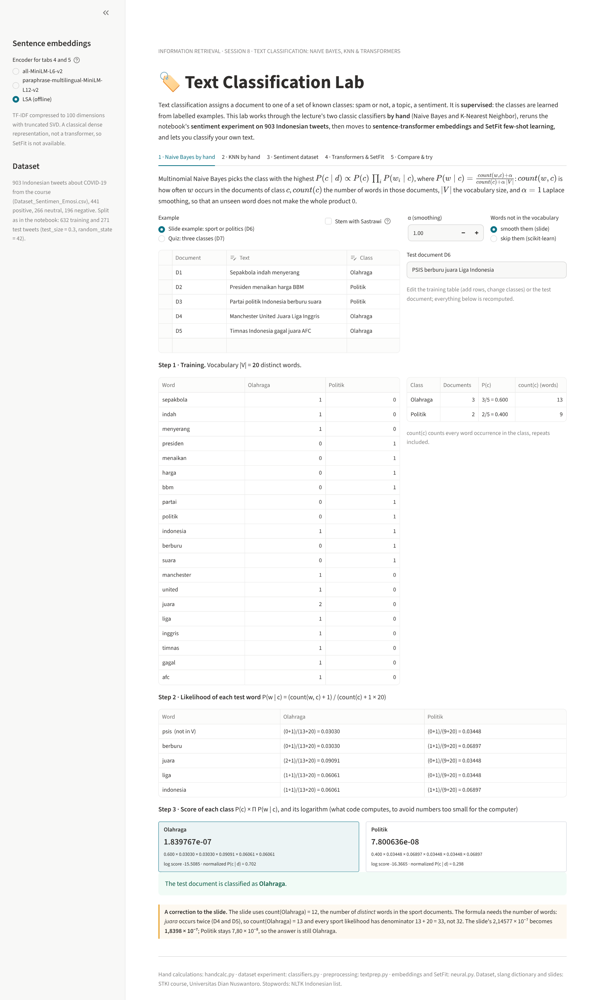
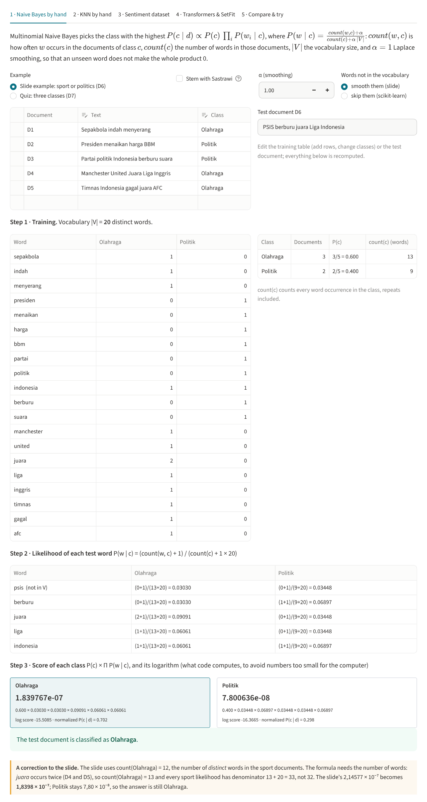
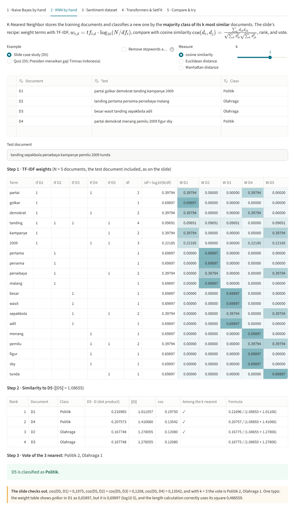
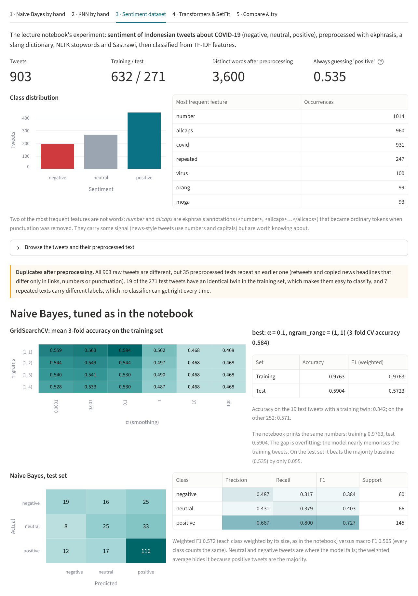
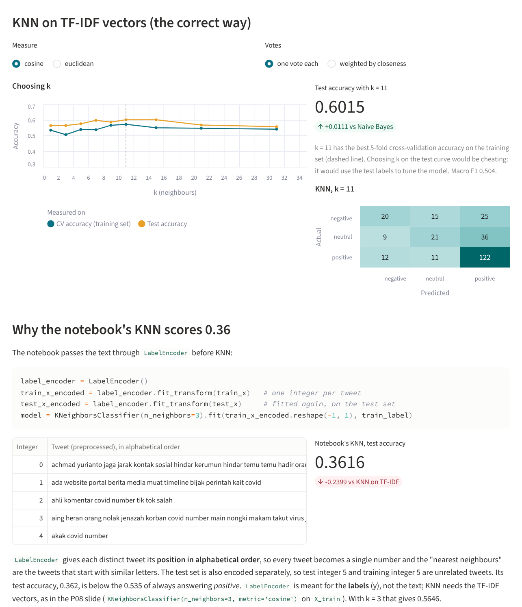
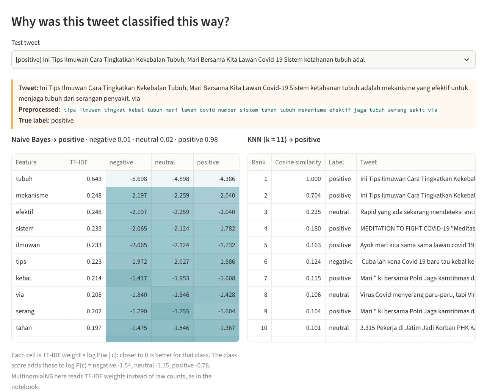
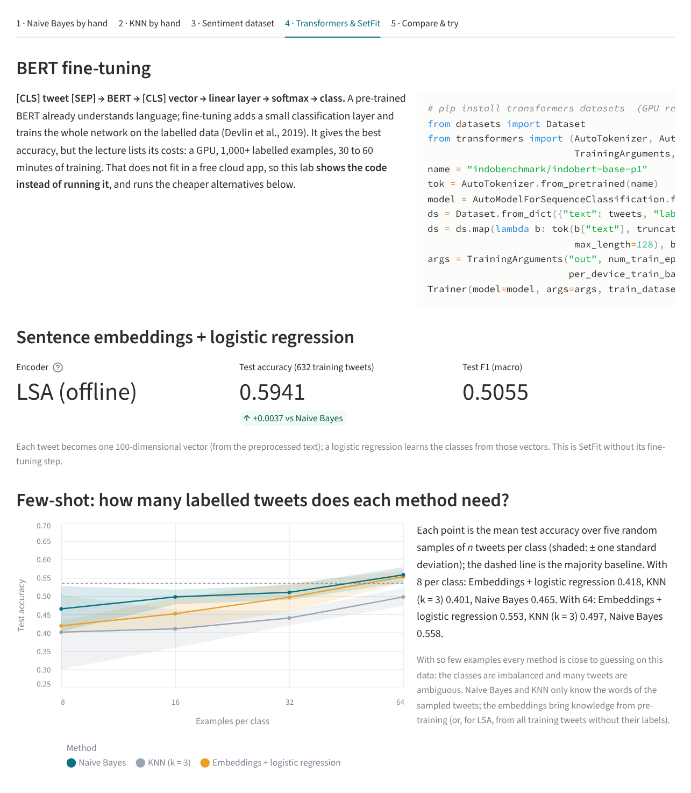
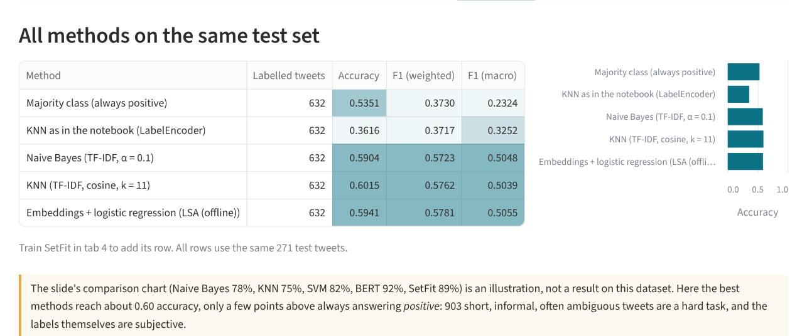
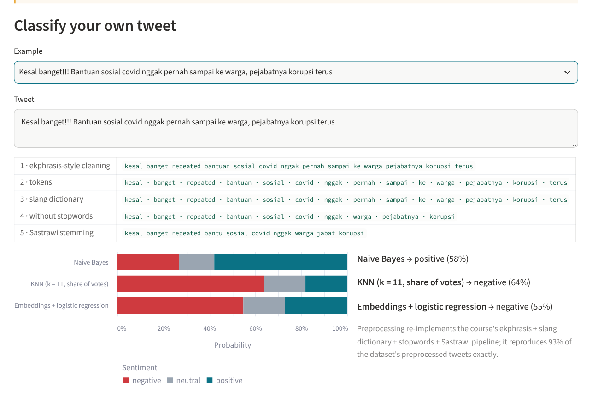
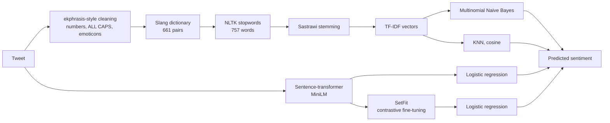

# 🏷️ Text Classification Lab: Naive Bayes, KNN, Transformers & SetFit

An interactive lab for **text classification**, built with Python and Streamlit. It works through
the lecture's two classic classifiers **by hand** (Multinomial Naive Bayes and K-Nearest Neighbor),
reruns the course notebook's **sentiment experiment on 903 Indonesian tweets about COVID-19**, then
moves to **sentence-transformer embeddings** and **SetFit few-shot learning**, and lets you classify
your own tweet with every model side by side.

This project was built for **Session 8: Text Classification with Naive Bayes, KNN & Transformers**
of the **Information Retrieval Systems** course (*Sistem Temu Kembali Informasi*, STKI), together
with the older decks *Klasifikasi Dokumen dengan Naive Bayes* and *Klasifikasi Dokumen dengan
K-Nearest Neighbor* and the notebooks `01-TFIDF`, `02-Klasifikasi Text Mining Naive Bayes` and
`Pipeline-Klasifikasi Text Mining-NB-KNN`.

🔗 **Live demo:** *add the Streamlit link here after deploying*

## View

The full interface: the encoder used for the transformer tabs in the sidebar, and the *Naive Bayes
by hand* tab with the lecture's sport-or-politics example worked out step by step.



## Table of contents

- [View](#view)
- [Features](#features)
- [Screenshots](#screenshots)
- [The dataset](#the-dataset)
- [How it works](#how-it-works)
- [Worked examples](#worked-examples)
- [Corrections to the course material](#corrections-to-the-course-material)
- [Results on the tweet dataset](#results-on-the-tweet-dataset)
- [Project structure](#project-structure)
- [Running locally](#running-locally)
- [Deploying to Streamlit Community Cloud](#deploying-to-streamlit-community-cloud)
- [Customizing](#customizing)
- [Limitations](#limitations)
- [References](#references)

---

## Features

- **Naive Bayes by hand.** The slide example (sport or politics, D6) and the three-class quiz (D7):
  vocabulary with counts per class, priors, every likelihood written as `(count + α)/(count(c) + α|V|)`,
  the product and its logarithm, and the normalized posterior. Edit the documents, the classes, the
  test document, α, stemming, and how unseen words are treated.
- **KNN by hand.** The slide case study (D5) and the quiz: tf, df, idf, TF-IDF weights, dot
  products, vector lengths, cosine similarities, the ranking and the vote for any k, with Euclidean
  and Manhattan distance as alternatives.
- **The notebook's experiment, reproduced exactly.** The same split and the same 24-setting grid
  search give the same numbers (Naive Bayes: training accuracy 0.9763, test 0.5904). Also shown: the
  grid of cross-validation scores, the confusion matrix, per-class precision, recall and F1, and the
  majority-class baseline.
- **KNN done correctly.** TF-IDF vectors with cosine similarity, k chosen by cross-validation on the
  training set, next to the notebook's version and an explanation of why it scores 0.36.
- **Explanations.** For any test tweet: the per-word contributions to the Naive Bayes score and the
  k nearest training tweets.
- **Transformers.** BERT fine-tuning explained with code; sentence embeddings + logistic regression;
  a few-shot comparison (8 to 64 examples per class) of Naive Bayes, KNN and embeddings; and
  **SetFit** contrastive fine-tuning that runs in the app on the CPU.
- **Compare & try.** All methods on the same test set, and your own tweet classified by each, with
  every preprocessing step shown.

## Screenshots

The screenshots use the offline **LSA** embeddings, because the transformer models cannot be
downloaded in the environment where they were taken. Tabs 1 to 3 do not depend on the encoder. In
the deployed app, all-MiniLM-L6-v2 or the multilingual model replace LSA in tabs 4 and 5, and SetFit
can be trained (with LSA it is disabled).

**Naive Bayes by hand**: the slide example. Olahraga 1.8398 × 10⁻⁷ against Politik 7.8006 × 10⁻⁸.



**KNN by hand**: the slide case study. The cosines match the slide: 0.1975, 0.13542, 0.1208, 0.1208.



**The sentiment dataset and Naive Bayes**: class distribution, the most frequent features, the
duplicate check, the grid search and the confusion matrix.



<details>
<summary><b>KNN, explanations, transformers, comparison and your own tweet</b></summary>

**KNN on TF-IDF vectors** with k chosen by cross-validation, and why the notebook's KNN scores 0.36.



**Why was this tweet classified this way?** Naive Bayes word contributions and the nearest
neighbours.



**Transformers**: BERT fine-tuning code, embeddings + logistic regression, and the few-shot curves.



**All methods on the same test set.**



**Classify your own tweet**: the five preprocessing steps and each model's prediction.



</details>

## The dataset

`data/tweets_sentiment.csv` is the course's `Dataset_Sentimen_Emosi.csv` after the notebook's
preprocessing (`clean_dataset_part01.csv`): **903 Indonesian tweets about COVID-19**, labelled
negative (−1, 196 tweets), neutral (0, 266) or positive (1, 441). Each row keeps the original tweet,
the cleaned text (`step01`) and the fully preprocessed text (`ProcessedText`). The dataset's emotion
labels are not used, as in the notebook.

The split is the notebook's: `train_test_split(test_size=0.3, random_state=42)`, 632 training and 271
test tweets. 145 of the 271 test tweets are positive, so **always answering "positive" already scores
0.535**: that is the baseline every classifier must beat.

Two things worth knowing about the data:

- The most frequent features after preprocessing are *number* (1,014 times) and *allcaps* (960),
  ahead of *covid* (931). They are ekphrasis annotations (`<number>`, `<allcaps> … </allcaps>`) that
  became ordinary words when punctuation was removed.
- All 903 raw tweets are different, but **35 preprocessed texts repeat an earlier one** (retweets and
  copied headlines that differ only in links or numbers). 19 test tweets have an identical twin in
  the training set: Naive Bayes classifies 84% of those correctly against 57% of the others. 7
  repeated texts carry different labels.

## How it works



### Multinomial Naive Bayes

```
P(c | d) ∝ P(c) · Π_i P(w_i | c)
P(c)     = documents of class c / all documents
P(w | c) = (count(w, c) + α) / (count(c) + α·|V|)
```

`count(w, c)` is how often word w occurs in the documents of class c, `count(c)` the **number of words**
(tokens) in those documents, |V| the number of distinct training words, and α = 1 Laplace smoothing,
which keeps an unseen word from making the whole product 0. Real implementations add logarithms
instead of multiplying, because the products quickly become too small for floating point.

In scikit-learn (and the notebook), `MultinomialNB` is fed **TF-IDF weights** instead of raw counts:
the same formula with fractional counts. A word's contribution to a class score is then
`TF-IDF(w) × log P(w | c)`, which is what the explanation table shows.

### K-Nearest Neighbor

1. Represent every document as a TF-IDF vector, `w(t, d) = tf(t, d) · log10(N / df(t))`.
2. Compute the similarity of the new document to every training document, usually
   `cos(x, y) = x·y / (‖x‖‖y‖)`; Euclidean `√Σ(xᵢ − yᵢ)²` and Manhattan `Σ|xᵢ − yᵢ|` are distances, where
   smaller means closer.
3. Take the k most similar documents and return their majority class.

KNN does no training (it stores the documents) and is non-parametric. Small k follows noise, large
k smooths too much, and the right k is chosen by **cross-validation on the training set**, never on
the test set.

### Transformers

- **BERT fine-tuning** (Devlin et al., 2019): `[CLS] text [SEP] → BERT → [CLS] vector → linear
  layer → softmax`, trained end to end on the labelled data. The most accurate option, but it needs a
  GPU, 1,000+ labels and 30 to 60 minutes (lecture), so the app shows the code
  (`indobenchmark/indobert-base-p1` with Hugging Face `Trainer`) without running it.
- **Sentence embeddings + logistic regression**: each tweet becomes one vector from a pretrained
  sentence-transformer, and a logistic regression learns the classes.
- **SetFit** (Tunstall et al., 2022): first fine-tune the sentence-transformer on **pairs** built
  from a few labelled examples (same class → target similarity 1, different class → 0, loss = squared
  error between the cosine and the target), then train the logistic regression on the new embeddings.
  With 8 examples per class and 10 iterations that is 8 × 3 × 10 × 2 = 480 pairs. The app implements
  this in plain PyTorch on a copy of the encoder, so the `setfit` package is not needed.

Encoders available in the sidebar:

| Encoder | Notes |
|---|---|
| `all-MiniLM-L6-v2` | The model in the slide's SetFit code. English, 384 dimensions, about 90 MB |
| `paraphrase-multilingual-MiniLM-L12-v2` | Trained on 50+ languages including Indonesian, 384 dimensions, about 470 MB |
| LSA (offline) | TF-IDF reduced to 100 dimensions with truncated SVD. No download; SetFit not available |

### Preprocessing new text

The course pipeline uses **ekphrasis**, which downloads word statistics on first use. `textprep.py`
re-implements the parts this dataset needs (numbers, dates, times, percentages, ALL-CAPS runs,
elongated words, repeated punctuation, hashtags, emoticons), then applies the notebook's steps:
remove "RT", lowercase, split hyphens, drop non-ASCII characters, URLs, single letters and
punctuation, normalize slang with the course's *kamus perbaikan kata*, remove the NLTK Indonesian
stopwords, and stem with Sastrawi. It reproduces the course's `ProcessedText` **exactly for 841 of the
903 tweets (93.1%)**; the average token overlap is 0.990.

## Worked examples

### Naive Bayes: the slide example (D6)

Training: D1 *Sepakbola indah menyerang* (Olahraga), D2 *Presiden menaikan harga BBM* (Politik),
D3 *Partai politik Indonesia berburu suara* (Politik), D4 *Manchester United Juara Liga Inggris*
(Olahraga), D5 *Timnas Indonesia gagal juara AFC* (Olahraga). Test: D6 *PSIS berburu juara Liga
Indonesia*.

|V| = 20, P(Olahraga) = 3/5 = 0.6, P(Politik) = 2/5 = 0.4, count(Olahraga) = 13, count(Politik) = 9.

| Word | P(w \| Olahraga) | P(w \| Politik) |
|---|---|---|
| psis | (0+1)/(13+20) = 0.03030 | (0+1)/(9+20) = 0.03448 |
| berburu | (0+1)/33 = 0.03030 | (1+1)/29 = 0.06897 |
| juara | (2+1)/33 = 0.09091 | (0+1)/29 = 0.03448 |
| liga | (1+1)/33 = 0.06061 | (0+1)/29 = 0.03448 |
| indonesia | (1+1)/33 = 0.06061 | (1+1)/29 = 0.06897 |

```
Olahraga: 0.6 × 0.03030 × 0.03030 × 0.09091 × 0.06061 × 0.06061 = 1.8398 × 10⁻⁷
Politik:  0.4 × 0.03448 × 0.06897 × 0.03448 × 0.03448 × 0.06897 = 7.8006 × 10⁻⁸   → Olahraga
```

**Quiz (D7 *Demo buruh menaikan upah minimum*, tokenized and stemmed):** every class has 2 documents
and 10 words, |V| = 25. Olahraga and Politik contain none of *demo, buruh, naik, upah, minimum*:
(1/3) × (1/35)⁵ = 6.35 × 10⁻⁹ each. Ekonomi contains *naik* twice, *upah* and *minimum* once:
(1/3) × (1/35)(1/35)(3/35)(2/35)(2/35) = 7.62 × 10⁻⁸ → **Ekonomi**.

### KNN: the slide case study (D5)

Preprocessed: D1 *partai golkar demokrat tanding kampanye 2009* (Politik), D2 *tanding pertama
persema persebaya malang* (Olahraga), D3 *besar wasit tanding sepakbola adil* (Olahraga), D4 *partai
demokrat menang pemilu 2009 figur sby* (Politik); test D5 *tanding sepakbola persebaya kampanye pemilu
2009 tunda*. N = 5 (D5 included), so for example idf(tanding) = log10(5/4) = 0.09691 and
idf(golkar) = log10(5/1) = 0.69897.

| | D5 · D | ‖D‖ | cos(D5, D) |
|---|---:|---:|---:|
| D1 (Politik) | 0.216965 | 1.011057 | 0.216965 / (1.086551 × 1.011057) = **0.19750** |
| D4 (Politik) | 0.207573 | 1.410660 | **0.13542** |
| D2 (Olahraga) | 0.167748 | 1.278055 | **0.12080** |
| D3 (Olahraga) | 0.167748 | 1.278055 | **0.12080** |

With k = 3: D1, D4, D2 → Politik 2, Olahraga 1 → **Politik**, as on the slide.

**Quiz (D5 *Presiden menaikan gaji Timnas Indonesia*, after stopword removal and stemming):**
cos with D2 (*presiden indonesia naik harga bbm*, Politik) 0.2896, D4 (*timnas indonesia gagal juara
afc*, Olahraga) 0.1331, D3 (Politik) 0.0068, D1 (Olahraga) 0. With k = 3: Politik 2, Olahraga 1 →
**Politik**.

## Corrections to the course material

1. **count(Olahraga) on the Naive Bayes slide.** The slide uses count(C) = 12 for the sport class,
   which is the number of *distinct* words. The formula needs the number of words in the class, and
   *juara* occurs twice (D4 and D5), so count(Olahraga) = 13. Every sport likelihood has denominator
   33 instead of 32, and the score is 1.8398 × 10⁻⁷ instead of 2.1458 × 10⁻⁷. The conclusion
   (Olahraga) does not change.
2. **The KNN in `Pipeline-Klasifikasi Text Mining-NB-KNN.ipynb`.** The notebook runs
   `LabelEncoder().fit_transform(train_x)` on the **text**, which turns every tweet into one integer,
   its position in alphabetical order, and then fits `KNeighborsClassifier` on that single number. The
   test set is encoded with a second `fit_transform`, so test and training integers do not even refer
   to the same ordering. The "neighbours" are tweets that start with similar letters, and the test
   accuracy (0.3616, reproduced exactly) is below the 0.535 of always answering *positive*.
   `LabelEncoder` is meant for labels. KNN needs the TF-IDF vectors, as in the P08 slide
   (`KNeighborsClassifier(n_neighbors=3, metric="cosine")` on `X_train`): that gives **0.5646** with
   k = 3 and **0.6015** with k = 11, the k chosen by cross-validation.
3. **The KNN slide's weight table** shows *golkar* in D1 as 0,65897; it is 0,69897 (log10 5). The
   length calculation correctly uses its square, 0,488559, so the cosines are right.
4. **`train_label.ravel()`** in the notebooks fails with pandas 3 (`Series.ravel` was removed); use
   `train_label.values`.

## Results on the tweet dataset

The notebook's split, 271 test tweets. Embeddings are the offline LSA vectors; with all-MiniLM-L6-v2
or the multilingual model that row changes.

| Method | Accuracy | F1 (weighted) | F1 (macro) |
|---|---:|---:|---:|
| Always "positive" (baseline) | 0.5351 | 0.3730 | 0.2324 |
| KNN as in the notebook (LabelEncoder) | 0.3616 | 0.3717 | 0.3252 |
| Naive Bayes, TF-IDF, α = 0.1, unigrams (grid search) | 0.5904 | 0.5723 | 0.5048 |
| KNN, TF-IDF, cosine, k = 3 (as on the slide) | 0.5646 | 0.5648 | 0.5099 |
| **KNN, TF-IDF, cosine, k = 11 (k chosen by 5-fold CV)** | **0.6015** | 0.5762 | 0.5039 |
| LSA embeddings + logistic regression | 0.5941 | **0.5781** | **0.5055** |

- **Every method is only a few points above the baseline.** The tweets are short, informal and often
  ambiguous, the classes are imbalanced, and the labels are subjective.
- **Naive Bayes overfits**: training accuracy 0.9763 against 0.5904 on the test set.
- **Weighted F1 hides the weak classes.** Per class, Naive Bayes reaches F1 0.727 on positive tweets
  but only 0.384 on negative and 0.403 on neutral ones (recall 0.317 and 0.379). Macro F1, which
  counts every class equally, shows this; weighted F1, the notebook's choice, mostly reflects the
  large positive class.
- **Few-shot** (mean of five random samples, LSA): with 8 tweets per class Naive Bayes reaches 0.465,
  embeddings 0.418 and KNN 0.401; with 64 per class 0.558, 0.553 and 0.497. Naive Bayes and the
  embeddings only pass the majority baseline at 64 examples per class, and KNN does not reach it. The
  slide's comparison chart (SetFit 89% with 8 examples) is an illustration, not a result on this
  dataset; train SetFit in the deployed app to see what it does on these tweets.

## Project structure

```
.
├── app.py                       # Streamlit app (user interface)
├── handcalc.py                  # Naive Bayes and KNN step by step (the worked examples)
├── classifiers.py               # The notebook's experiment: split, grid search, KNN, explanations
├── neural.py                    # Encoders, logistic-regression head, few-shot sampling, SetFit fine-tuning
├── textprep.py                  # The course's preprocessing pipeline, for new text
├── data/
│   ├── tweets_sentiment.csv     # 903 tweets: raw, step01, preprocessed, sentiment
│   ├── kamus_perbaikan_kata.csv # The course's slang dictionary (661 pairs)
│   └── stopwords_id_nltk.txt    # NLTK Indonesian stopwords (757 words)
├── docs/                        # Images used in this README
├── requirements.txt             # Python dependencies
└── .streamlit/config.toml       # App color theme
```

The modules do not depend on Streamlit:

```bash
python handcalc.py      # the two slide examples
python classifiers.py   # the notebook's results, KNN for each k, the baseline
python neural.py        # LSA embeddings, full and few-shot
python textprep.py      # how closely the preprocessing matches the course's ProcessedText
```

## Running locally

Requires Python 3.10 or newer.

```bash
git clone https://github.com/USERNAME/REPO-NAME.git
cd REPO-NAME
pip install -r requirements.txt
streamlit run app.py
```

## Deploying to Streamlit Community Cloud

1. Push all files to a GitHub repository, including the `data` and `.streamlit` folders. Use folder
   names **without spaces**, for example `text-classification-lab`.
2. Go to [share.streamlit.io](https://share.streamlit.io), choose **Create app**, and select this
   repository.
3. Set **Main file path** to `app.py` (or `text-classification-lab/app.py` if the app is in a
   subfolder).
4. Click **Deploy**. Any Python version from 3.10 up works (tested with 3.13 and 3.14).

`sentence-transformers` installs PyTorch, so the first deployment takes several minutes. The chosen
encoder downloads on first use (about 90 MB for all-MiniLM-L6-v2, 470 MB for the multilingual model).
If it cannot be loaded, the app says so and uses the offline LSA embeddings. SetFit keeps a second,
fine-tuned copy of the encoder in memory; with the multilingual model that can approach the memory
limit of a free Streamlit app, so all-MiniLM-L6-v2 is the default.

## Customizing

- **Another dataset**: replace `data/tweets_sentiment.csv` with columns `tweet`, `sentiment`,
  `processed` (and `step01`). The classes are set in `LABELS` and `CLASSES` in `classifiers.py`.
- **Grid search**: `NB_GRID` and `K_GRID` in `classifiers.py`.
- **Encoders**: `MODELS` in `neural.py`; any sentence-transformers model name works.
- **Slang dictionary and stopwords**: the files in `data/`.

## Limitations

- BERT fine-tuning is explained, not run: it needs a GPU and much more time than a free cloud app has.
- SetFit here uses the core of the method (pair generation, CosineSimilarityLoss, logistic head)
  without the `setfit` package's extras such as hyperparameter search. Results vary a lot with the
  random sample of few-shot examples.
- The preprocessing of new text matches the course's output for 93% of the tweets, not all of them.
- 903 tweets, one split: differences of one or two points between methods are within the noise.

## References

- Manning, C. D., Raghavan, P., & Schütze, H. (2008). *Introduction to Information Retrieval*,
  Chapter 13 (text classification and Naive Bayes) and Chapter 14 (vector space classification,
  kNN). Cambridge University Press.
- McCallum, A., & Nigam, K. (1998). A Comparison of Event Models for Naive Bayes Text Classification.
  *AAAI Workshop on Learning for Text Categorization*.
- Devlin, J., Chang, M.-W., Lee, K., & Toutanova, K. (2019). BERT: Pre-training of Deep Bidirectional
  Transformers for Language Understanding. *NAACL*.
- Tunstall, L., Reimers, N., Jo, U. E. S., Bates, L., Korat, D., Wasserblat, M., & Pereg, O. (2022).
  Efficient Few-Shot Learning Without Prompts (SetFit). *arXiv:2209.11055*.
- Reimers, N., & Gurevych, I. (2019). Sentence-BERT. *EMNLP*.
- Reimers, N., & Gurevych, I. (2020). Making Monolingual Sentence Embeddings Multilingual using
  Knowledge Distillation. *EMNLP*.
- Wilie, B., Vincentio, K., Winata, G. I., et al. (2020). IndoNLU: Benchmark and Resources for
  Evaluating Indonesian Natural Language Understanding. *AACL*.
- Baziotis, C., Pelekis, N., & Doulkeridis, C. (2017). DataStories at SemEval-2017 Task 4 (ekphrasis).
  *SemEval*.
- Lecture materials, Session 8: Text Classification (Junta Zeniarja, M.Kom); *Klasifikasi Dokumen
  dengan Naive Bayes* and *Klasifikasi Dokumen dengan K-Nearest Neighbor*, STKI Lecturer Team; the
  course notebooks and dataset. Faculty of Computer Science, Universitas Dian Nuswantoro.

---

Built by **Rizqi Aditya**, Informatics Engineering, Universitas Dian Nuswantoro,
for the Information Retrieval Systems course.
