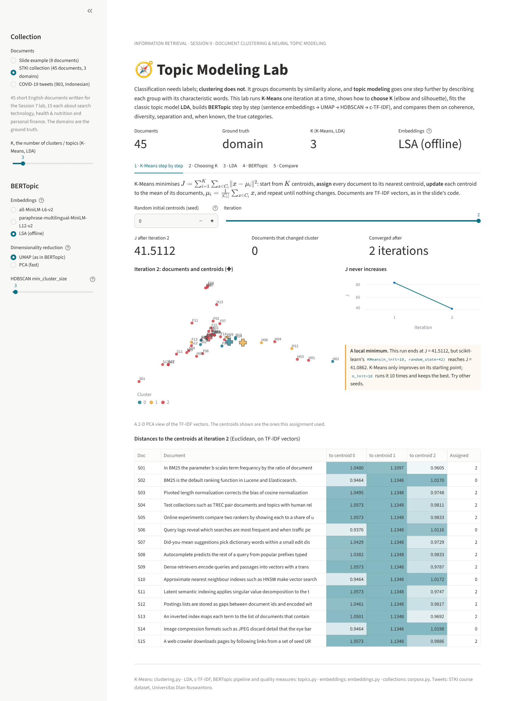
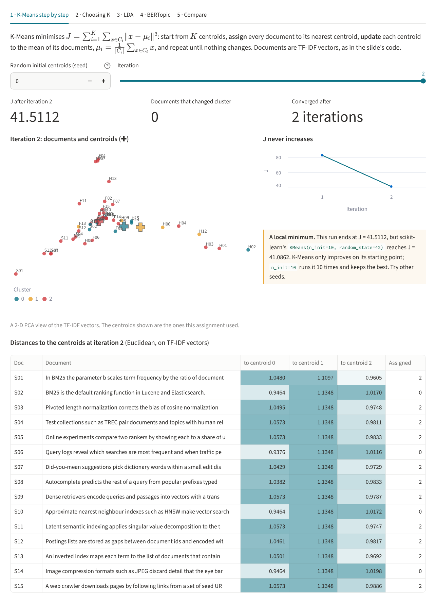
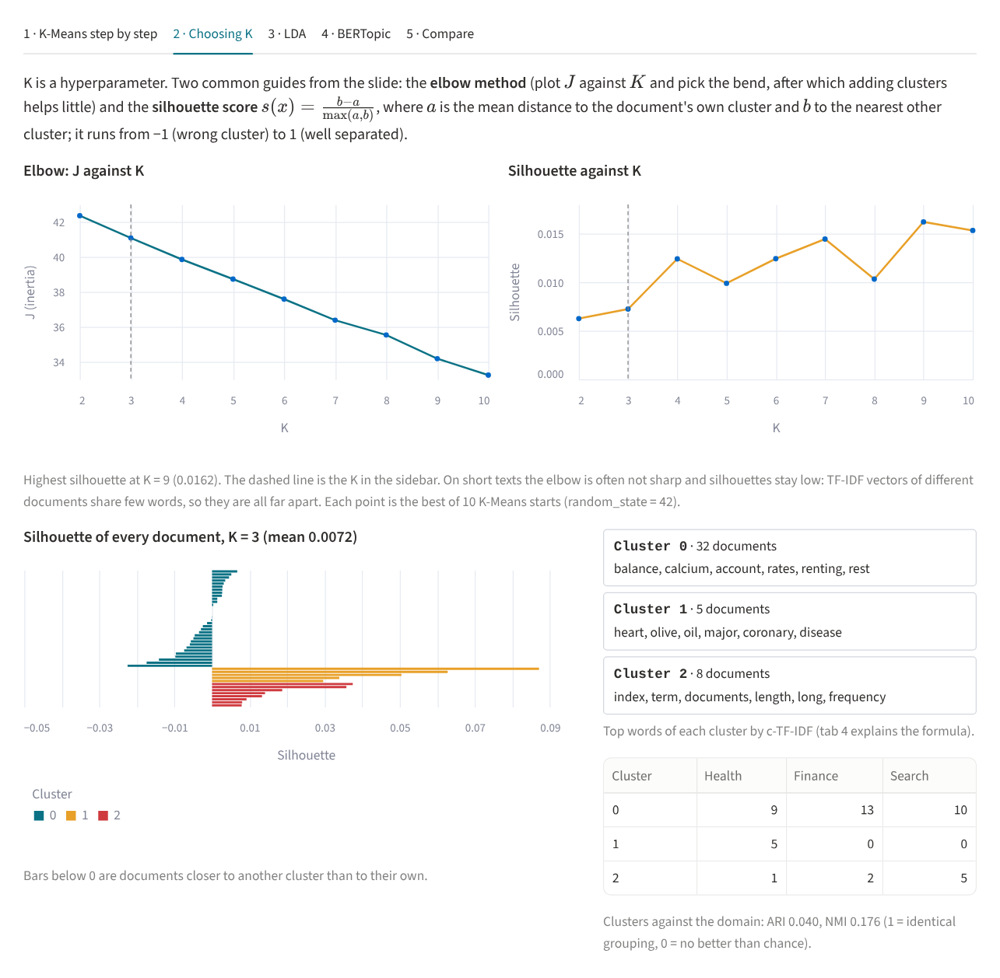
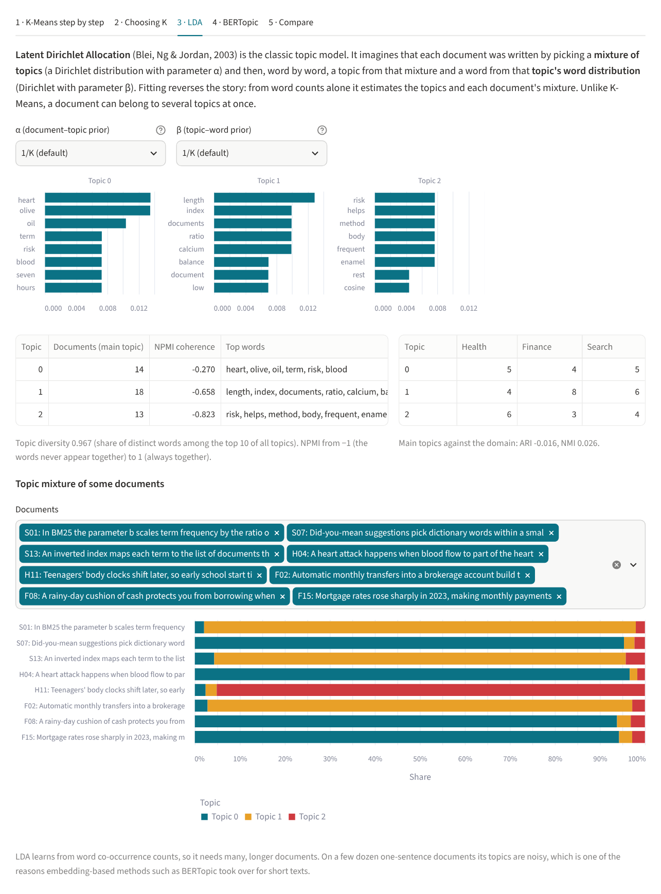
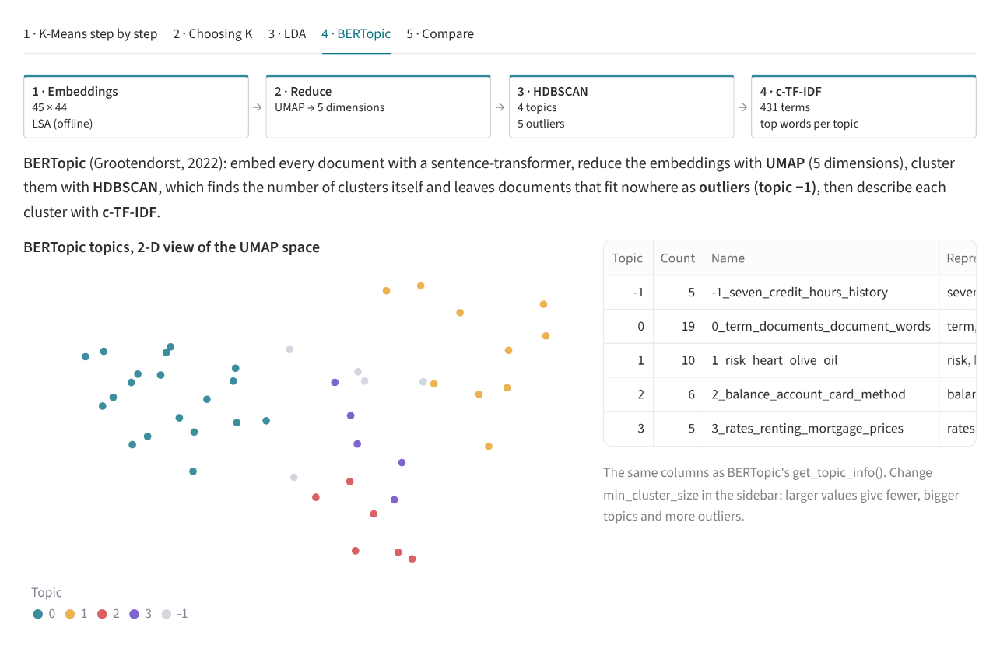
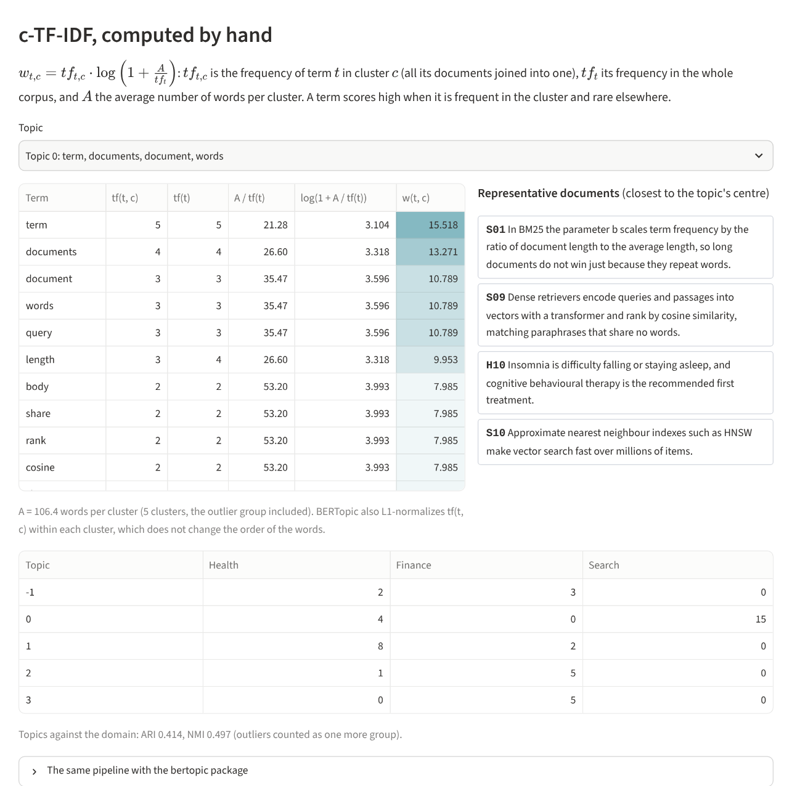
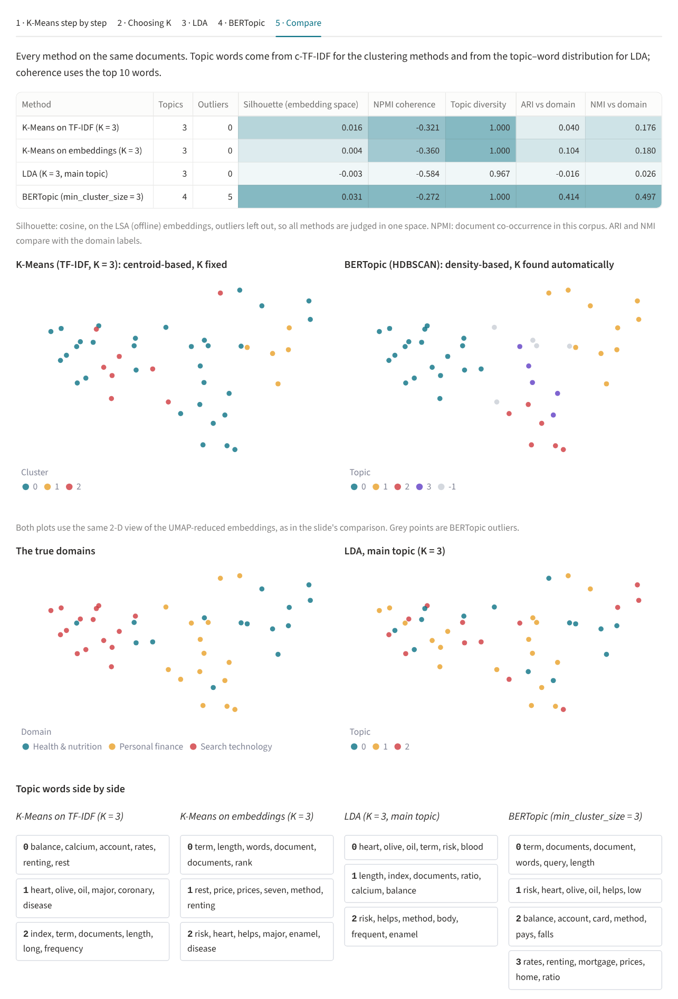
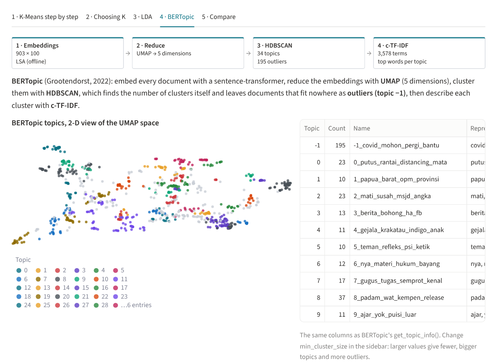
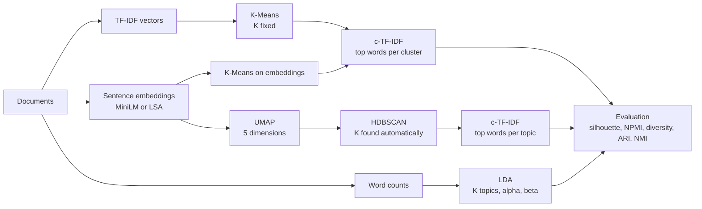

# 🧭 Topic Modeling Lab: K-Means, LDA & BERTopic

An interactive lab for **document clustering and topic modeling**, built with Python and Streamlit.
It runs **K-Means one iteration at a time**, shows how to **choose K** with the elbow method and the
silhouette score, fits the classic topic model **LDA**, builds **BERTopic** step by step (sentence
embeddings → UMAP → HDBSCAN → c-TF-IDF, with c-TF-IDF computed by hand), and compares all of them
on the same documents with coherence, diversity, separation and, when the true categories are known,
agreement with them.

This project was built for **Session 9: Document Clustering & Neural Topic Modeling** of the
**Information Retrieval Systems** course (*Sistem Temu Kembali Informasi*, STKI).

🔗 **Live demo:** *add the Streamlit link here after deploying*

## View

The full interface: the collection, K and the BERTopic settings in the sidebar, and the *K-Means step
by step* tab on the 45-document STKI collection.



## Table of contents

- [View](#view)
- [Features](#features)
- [Screenshots](#screenshots)
- [The collections](#the-collections)
- [How it works](#how-it-works)
- [Worked examples](#worked-examples)
- [Results](#results)
- [Notes on the course material](#notes-on-the-course-material)
- [Project structure](#project-structure)
- [Running locally](#running-locally)
- [Deploying to Streamlit Community Cloud](#deploying-to-streamlit-community-cloud)
- [Customizing](#customizing)
- [Limitations](#limitations)
- [References](#references)

---

## Features

- **K-Means step by step.** Pick a seed and move an iteration slider. Each step shows the documents
  and centroids on a 2-D PCA map, the objective J after each iteration, and the distance from every
  document to every centroid. When a run stops at a worse J than scikit-learn's best-of-10, the app
  says it is a local minimum.
- **Choosing K.** Elbow plot (J against K), mean silhouette against K, the silhouette of every
  document, the top words of each cluster, and a cross-table against the true categories with ARI
  and NMI.
- **LDA.** Latent Dirichlet Allocation with selectable α and β priors. Shows the top words of each
  topic, NPMI coherence per topic, topic diversity, and the topic mixture of any documents you pick.
- **BERTopic, built step by step.** Embeddings → UMAP (5 dimensions) → HDBSCAN → c-TF-IDF, with a
  pipeline strip, a 2-D map of the topics, a table in the format of `get_topic_info()`, outliers
  (topic −1), representative documents, and the **c-TF-IDF weights computed by hand** for any topic.
  The equivalent code for the `bertopic` package is included.
- **Compare.** K-Means on TF-IDF, K-Means on embeddings, LDA and BERTopic side by side in one table
  (number of topics, outliers, silhouette, NPMI, diversity, ARI, NMI). Also shows the same 2-D map
  coloured by each method and by the true labels (the slide's K-Means vs BERTopic comparison), and
  the topic words of each method.
- **Three collections.** The slide's 8 documents, a 45-document English collection with three known
  domains, and the course's 903 Indonesian COVID-19 tweets.
- **Works offline.** If a sentence-transformer cannot be downloaded, the app says so and uses LSA
  embeddings (TF-IDF + truncated SVD) instead.

## Screenshots

The screenshots use the offline **LSA** embeddings, because the sentence-transformer models cannot
be downloaded in the environment where they were taken. Tabs 1 to 3 do not depend on the
embeddings. In the deployed app, all-MiniLM-L6-v2 or the multilingual MiniLM replace LSA in tabs 4
and 5, so the BERTopic topics and the comparison numbers will differ from the ones below.

**K-Means step by step**: seed 0 converges in 2 iterations at J = 41.5112, a local minimum
(scikit-learn's best of 10 starts reaches 41.0862).



**Choosing K**: on short texts the elbow is not sharp and silhouettes stay close to 0.



**LDA**: top words per topic, coherence, and the topic mixture of chosen documents.



**BERTopic**: the pipeline, the topic map and the topic table.



**c-TF-IDF computed by hand**, the representative documents, and the topics against the domains.



**Compare**: every method on the same documents.



**BERTopic on the 903 tweets**: 34 topics and 195 outliers with `min_cluster_size = 10`.



## The collections

| Collection | Documents | Ground truth | Defaults |
|---|---|---|---|
| Slide example | 8 short English phrases from the slide's K-Means code (machine learning, information retrieval, NLP) | none | K = 3, `min_cluster_size` = 2 |
| STKI collection | 45 one-sentence English documents, 15 each on search technology, health & nutrition, and personal finance | the domain | K = 3, `min_cluster_size` = 3 |
| COVID-19 tweets | The course's 903 Indonesian tweets, preprocessed as in the course notebook | the sentiment label (not a topic) | K = 6, `min_cluster_size` = 10 |

The STKI collection is the same one used in the Session 7 lab. Its known domains make it possible to
check whether a method finds the "right" groups. For the tweets the only label is sentiment, which
is not what topic models group by, so ARI and NMI against it are expected to be near 0. The tokens
that the course's ekphrasis preprocessing inserted (`number`, `allcaps`, `hashtag`, …) are treated
as stopwords so they do not show up as topic words.

## How it works



### K-Means

```
J = Σ_i Σ_{x ∈ C_i} ‖x − μ_i‖²
1. pick K initial centroids at random
2. assign:  C_i = { x : ‖x − μ_i‖ ≤ ‖x − μ_j‖ for all j }
3. update:  μ_i = (1/|C_i|) Σ_{x ∈ C_i} x
4. repeat 2–3 until no document changes cluster
```

J never increases, but K-Means only improves on its starting point, so it can stop in a local
minimum. scikit-learn's `n_init=10` runs it ten times and keeps the lowest J. The app runs K-Means
on the sparse TF-IDF matrix, as the slide's code does; dense or float32 input can end in a different
clustering.

**Silhouette** of a document: `s = (b − a) / max(a, b)`, where `a` is its mean distance to its own
cluster and `b` to the nearest other cluster. It ranges from −1 (wrong cluster) to 1 (well separated).

### LDA

Each document is a mixture of topics, θ_d ~ Dirichlet(α), and each topic is a distribution over
words, φ_k ~ Dirichlet(β). Every word is generated by drawing a topic z from θ_d and then a word from
φ_z. Fitting reverses the process: from word counts alone it estimates φ and every θ_d
(scikit-learn's batch variational Bayes, 50 iterations).

### BERTopic

| Step | Setting in this app (BERTopic's defaults) |
|---|---|
| Embeddings | all-MiniLM-L6-v2, paraphrase-multilingual-MiniLM-L12-v2, or offline LSA |
| UMAP | `n_neighbors=15, n_components=5, min_dist=0.0, metric="cosine", random_state=42` |
| HDBSCAN | `min_cluster_size` from the sidebar, `metric="euclidean"`, `cluster_selection_method="eom"`; points that fit no cluster become topic −1 |
| c-TF-IDF | `w(t,c) = tf(t,c) · log(1 + A / tf(t))` |

Here `tf(t,c)` is the frequency of term t in cluster c (all its documents joined into one), `tf(t)`
its frequency in the whole corpus, and `A` the average number of words per cluster.

### Evaluation

- **Silhouette (embedding space)**: cosine silhouette of each method's labels on the same
  embeddings, outliers left out, so all methods are judged in one space.
- **NPMI coherence**: for each pair of a topic's top 10 words,
  `NPMI = log(P(wi,wj) / (P(wi)·P(wj))) / −log P(wi,wj)`, with probabilities from document
  co-occurrence. It ranges from −1 (never together) to 1 (always together).
- **Topic diversity**: the share of distinct words among the top 10 words of all topics.
- **ARI / NMI**: agreement with the true labels (1 = identical grouping, 0 = chance).

## Worked examples

### K-Means: the slide's code

The slide's code (`TfidfVectorizer(max_features=100)`, `KMeans(n_clusters=3, random_state=42,
n_init=10)`) gives these labels for the 8 documents:

| Doc | Text | Cluster |
|---|---|---|
| d1 | machine learning algorithm neural network deep | 1 |
| d2 | information retrieval search query document | 0 |
| d3 | natural language processing text analysis | 2 |
| d4 | neural network deep learning classification | 1 |
| d5 | search engine web crawling indexing | 0 |
| d6 | text mining sentiment analysis opinion | 2 |
| d7 | reinforcement learning reward policy agent | 1 |
| d8 | document ranking relevance scoring evaluation | 0 |

Silhouette score: **0.1296**. The three clusters are machine learning (d1, d4, d7), search
(d2, d5, d8) and text analysis (d3, d6). Choosing K on this collection:

| K | 2 | 3 | 4 | 5 | 6 | 7 |
|---|---|---|---|---|---|---|
| J | 5.16 | 3.89 | 2.83 | 1.89 | 1.04 | 0.36 |
| Silhouette | 0.0868 | 0.1296 | **0.1541** | 0.1440 | 0.1340 | 0.0903 |

The highest silhouette is at K = 4, not 3. With 8 documents that share almost no words, every
choice is weak; K = 3 matches how the documents were written.

### c-TF-IDF: the word "learning" in the slide example

BERTopic (`min_cluster_size = 2`) puts the slide's documents in the same three groups. Topic 0 is
d1, d4 and d7. The three topics together have 41 words, so A = 41 / 3 = 13.667.

```
tf("learning", topic 0) = 3      (once each in d1, d4, d7)
tf("learning")          = 3      (it appears nowhere else)
w = 3 · ln(1 + 13.667 / 3) = 3 · ln(5.556) = 3 · 1.7148 = 5.144
```

5.144 is the highest weight in topic 0, followed by *deep*, *neural* and *network* (4.117 each:
2 · ln(1 + 13.667/2)). The app shows this table for every topic of every collection.

## Results

All numbers are from the app with the offline **LSA** embeddings and UMAP. With a sentence-transformer
the embedding-based rows (K-Means on embeddings, BERTopic) change.

### STKI collection (45 documents, K = 3)

| Method | Topics | Outliers | Silhouette | NPMI | Diversity | ARI | NMI |
|---|---|---|---|---|---|---|---|
| K-Means on TF-IDF | 3 | 0 | 0.016 | −0.321 | 1.000 | 0.040 | 0.176 |
| K-Means on embeddings | 3 | 0 | 0.004 | −0.360 | 1.000 | 0.104 | 0.180 |
| LDA (main topic) | 3 | 0 | −0.003 | −0.584 | 0.967 | −0.016 | 0.026 |
| **BERTopic** (`min_cluster_size` = 3) | 4 | 5 | **0.031** | **−0.272** | 1.000 | **0.414** | **0.497** |

BERTopic gets closest to the true domains. Its topic 0 holds all 15 search-technology documents
(plus 4 health ones). The finance documents split into two topics: *balance, account, card* and
*rates, renting, mortgage*. K-Means on TF-IDF puts 32 of the 45 documents in one cluster, because
one-sentence documents share very few words. The TF-IDF silhouette is 0.0072 at K = 3, and J falls
almost in a straight line from 42.4 (K = 2) to 33.3 (K = 10), with no elbow.

### COVID-19 tweets (903, K = 6)

| Method | Topics | Outliers | Silhouette | NPMI | Diversity | ARI vs sentiment | NMI vs sentiment |
|---|---|---|---|---|---|---|---|
| K-Means on TF-IDF | 6 | 0 | 0.042 | −0.000 | 0.800 | −0.012 | 0.073 |
| K-Means on embeddings | 6 | 0 | 0.041 | −0.018 | 0.800 | 0.019 | 0.077 |
| LDA (main topic) | 6 | 0 | −0.006 | −0.053 | 0.583 | 0.005 | 0.017 |
| **BERTopic** (`min_cluster_size` = 10) | 34 | 195 | **0.182** | −0.134 | **0.935** | 0.019 | 0.079 |

K-Means on TF-IDF puts more than half the tweets (516) in one cluster. BERTopic finds 34 topics and
leaves 195 tweets as outliers. Most of its topics are readable, for example:

- *orang, positif, pdp, pasien*: daily case updates
- *moga, allah, doa*: prayers
- *cegah, polsek, polri, desa*: police prevention activities
- *masker, jaga, jarak, kumpul*: masks and physical distancing
- *medis, tenaga, apd*: health workers and protective equipment
- *putus, rantai, physical distancing*: breaking the chain of infection
- *padam, kempen, wat*: tweets in Malay rather than Indonesian

ARI and NMI against sentiment are near 0 for every method, as expected: topics are not sentiment.

## Notes on the course material

- **The slide's code runs as shown** and gives the labels and the silhouette (0.1296) above. The
  slide does not print an output to compare with.
- **The BERTopic citation.** The slide cites "Grootendorst, Computational Linguistics 2022". As far
  as I know, the paper is an arXiv preprint: *BERTopic: Neural topic modeling with a class-based
  TF-IDF procedure*, arXiv:2203.05794 (2022).
- **c-TF-IDF in the `bertopic` package** also L1-normalizes `tf(t,c)` within each cluster. That
  does not change the order of the words within a topic, so the app uses the slide's formula.
- **Very small collections.** The slide's BERTopic example has 6 documents, and the slide itself
  says to use 20 or more. UMAP and HDBSCAN need neighbours to work with. In this app the 8-document
  example works only because `min_cluster_size` is 2.
- **LDA is listed in the learning outcomes but has no slide of its own**, so tab 3 explains it from
  Blei, Ng & Jordan (2003).

## Project structure

```
.
├── app.py                     # Streamlit app (user interface)
├── clustering.py              # K-Means step by step, choosing K, silhouettes
├── topics.py                  # LDA, c-TF-IDF, UMAP/PCA, HDBSCAN, BERTopic pipeline, NPMI, diversity
├── embeddings.py              # Sentence-transformers and the offline LSA fallback
├── corpora.py                 # The three collections
├── data/
│   ├── stki_collection.json   # 45 documents with their domains
│   └── tweets_sentiment.csv   # 903 tweets: raw, preprocessed, sentiment
├── docs/                      # Images used in this README
├── requirements.txt           # Python dependencies
└── .streamlit/config.toml     # App color theme
```

The modules do not depend on Streamlit:

```bash
python corpora.py      # the three collections
python clustering.py   # the slide's K-Means and choosing K
python topics.py       # LDA and BERTopic with LSA embeddings
```

## Running locally

Requires Python 3.10 or newer.

```bash
git clone https://github.com/USERNAME/REPO-NAME.git
cd REPO-NAME
pip install -r requirements.txt
streamlit run app.py
```

## Deploying to Streamlit Community Cloud

1. Push all files to a GitHub repository, including the `data` and `.streamlit` folders. Use folder
   names **without spaces**, for example `topic-modeling-lab`.
2. Go to [share.streamlit.io](https://share.streamlit.io), choose **Create app**, and select this
   repository.
3. Set **Main file path** to `app.py` (or `topic-modeling-lab/app.py` if the app is in a subfolder).
4. Click **Deploy**. Any Python version from 3.10 up works (tested with 3.13 and 3.14).

`sentence-transformers` installs PyTorch, so the first deployment takes several minutes. The chosen
model downloads on first use (about 90 MB for all-MiniLM-L6-v2, 470 MB for the multilingual
model). If it cannot be loaded, the app says so and uses LSA. **UMAP compiles itself with numba the
first time it runs**, which can take a minute; later runs take seconds. Choose **PCA (fast)** in the
sidebar to skip it.

## Customizing

- **Another collection**: add a loader to `corpora.py` that returns a `Corpus` (ids, raw text,
  cleaned text, optional labels, stopwords, default K and `min_cluster_size`) and add its name to
  `NAMES`.
- **Embedding models**: `MODELS` in `embeddings.py`; any sentence-transformers model name works.
- **UMAP and HDBSCAN settings**: `reduce` and `hdbscan` in `topics.py`.

## Limitations

- BERTopic is rebuilt from its parts (umap-learn, scikit-learn's HDBSCAN, c-TF-IDF by hand) so
  every step can be shown. The `bertopic` package adds options such as topic reduction,
  representation models and dynamic topics; its code is shown in the app but not run.
- UMAP uses a fixed seed, but its results can still change between machines and library versions,
  so the BERTopic topics can differ slightly from the numbers above.
- NPMI is computed from document co-occurrence inside the same small collection, not from a large
  reference corpus, so it is noisy and mostly negative on short texts.
- LDA needs many, longer documents. On one-sentence documents and tweets its topics are weak.

## References

- Manning, C. D., Raghavan, P., & Schütze, H. (2008). *Introduction to Information Retrieval*,
  Chapter 16 (flat clustering, K-Means). Cambridge University Press.
- Blei, D. M., Ng, A. Y., & Jordan, M. I. (2003). Latent Dirichlet Allocation. *Journal of Machine
  Learning Research*, 3, 993–1022.
- Grootendorst, M. (2022). BERTopic: Neural topic modeling with a class-based TF-IDF procedure.
  *arXiv:2203.05794*.
- McInnes, L., Healy, J., & Melville, J. (2018). UMAP: Uniform Manifold Approximation and Projection
  for Dimension Reduction. *arXiv:1802.03426*.
- Campello, R. J. G. B., Moulavi, D., & Sander, J. (2013). Density-Based Clustering Based on
  Hierarchical Density Estimates (HDBSCAN). *PAKDD*.
- Rousseeuw, P. J. (1987). Silhouettes: A graphical aid to the interpretation and validation of
  cluster analysis. *Journal of Computational and Applied Mathematics*, 20, 53–65.
- Bouma, G. (2009). Normalized (Pointwise) Mutual Information in Collocation Extraction. *GSCL*.
- Röder, M., Both, A., & Hinneburg, A. (2015). Exploring the Space of Topic Coherence Measures.
  *WSDM*.
- Dieng, A. B., Ruiz, F. J. R., & Blei, D. M. (2020). Topic Modeling in Embedding Spaces.
  *Transactions of the ACL*, 8, 439–453 (topic diversity).
- Reimers, N., & Gurevych, I. (2019). Sentence-BERT. *EMNLP*.
- Lecture materials, Session 9: *Clustering Dokumen & Neural Topic Modeling*, STKI 2026, and the
  course's tweet dataset. Faculty of Computer Science, Universitas Dian Nuswantoro.

---

Built by **Rizqi Aditya**, Informatics Engineering, Universitas Dian Nuswantoro,
for the Information Retrieval Systems course.
