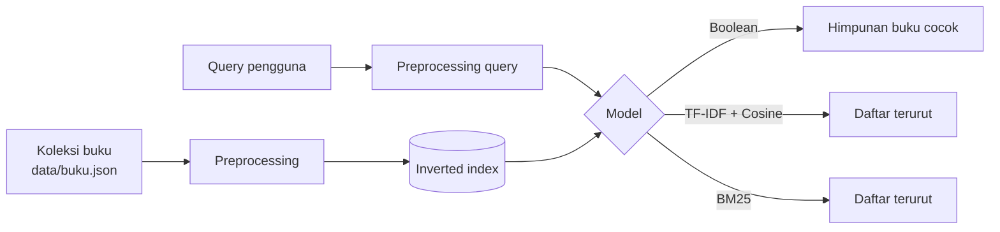

# Katalog Temu Kembali

Mesin pencari mini untuk katalog buku, dibuat dengan **Python + Streamlit** sebagai media belajar mata kuliah **Sistem Temu Kembali Informasi (STKI) — Pertemuan 1: Pengenalan STKI**, Teknik Informatika, Universitas Dian Nuswantoro.

Aplikasi ini memperlihatkan apa yang terjadi di balik sebuah kotak pencarian: query diproses, dicocokkan lewat **inverted index**, lalu diberi skor oleh tiga model temu kembali yang bisa dibandingkan secara langsung.

---

## Daftar isi

1. [Fitur](#fitur)
2. [Struktur folder](#struktur-folder)
3. [Menjalankan di komputer sendiri](#menjalankan-di-komputer-sendiri)
4. [Deploy ke Streamlit Community Cloud](#deploy-ke-streamlit-community-cloud)
5. [Cara memakai aplikasi](#cara-memakai-aplikasi)
6. [Konsep yang diterapkan](#konsep-yang-diterapkan)
7. [Contoh query dan apa yang dipelajari](#contoh-query-dan-apa-yang-dipelajari)
8. [Mengganti atau menambah data buku](#mengganti-atau-menambah-data-buku)
9. [Keterbatasan](#keterbatasan)
10. [Referensi](#referensi)

---

## Fitur

| Fitur | Penjelasan |
|---|---|
| **Tiga model pencarian** | Boolean (AND / OR / NOT), TF-IDF + Cosine Similarity, dan BM25 |
| **Parameter BM25 interaktif** | Slider `k₁` (saturasi tf) dan `b` (normalisasi panjang dokumen) |
| **Kartu hasil** | Nomor panggil gaya Dewey, istilah yang cocok distabilo, dan rincian sumbangan skor per istilah |
| **Tab Pemrosesan query** | Langkah case folding → tokenisasi → stopword removal |
| **Tab Inverted index** | df, idf, dan posting list setiap istilah query, plus seluruh indeks |
| **Tab Perbandingan model** | Peringkat ketiga model untuk query yang sama, berdampingan |
| **Tambah buku** | Buku baru langsung diindeks ulang sehingga df, idf, dan avgdl ikut berubah |
| **Saklar stopword** | Lihat pengaruh stopword removal terhadap indeks dan hasil |

## Struktur folder

```
katalog-temu-kembali/
├── app.py               # Antarmuka Streamlit (tampilan)
├── ir_engine.py         # Logika IR: preprocessing, inverted index, Boolean, TF-IDF, BM25
├── data/
│   └── buku.json        # Koleksi 18 buku contoh
├── .streamlit/
│   └── config.toml      # Tema dan pengaturan Streamlit
├── requirements.txt     # Library yang dibutuhkan
└── README.md
```

Logika pencarian (`ir_engine.py`) sengaja dipisah dari tampilan (`app.py`). Dengan begitu `ir_engine.py` bisa dibaca sebagai materi kuliah, diuji sendiri, atau dipakai di Jupyter Notebook tanpa Streamlit.

## Menjalankan di komputer sendiri

Butuh **Python 3.10 atau lebih baru**.

```bash
# 1. Masuk ke folder proyek
cd katalog-temu-kembali

# 2. (Disarankan) buat virtual environment
python3 -m venv .venv
source .venv/bin/activate          # Windows: .venv\Scripts\activate

# 3. Install library
pip install -r requirements.txt

# 4. Jalankan aplikasi
streamlit run app.py
```

Browser akan terbuka di `http://localhost:8501`.

Untuk menguji mesin pencarinya saja lewat terminal, tanpa antarmuka:

```bash
python ir_engine.py
```

## Deploy ke Streamlit Community Cloud

1. Buat repository baru di GitHub, lalu unggah seluruh isi folder ini (termasuk folder `data/` dan `.streamlit/`).
   ```bash
   git init
   git add .
   git commit -m "Katalog Temu Kembali"
   git branch -M main
   git remote add origin https://github.com/<username>/katalog-temu-kembali.git
   git push -u origin main
   ```
2. Buka [share.streamlit.io](https://share.streamlit.io) dan masuk dengan akun GitHub.
3. Pilih **Create app**, lalu isi:
   - **Repository**: `<username>/katalog-temu-kembali`
   - **Branch**: `main`
   - **Main file path**: `app.py`
4. (Opsional) Di **Advanced settings**, pilih versi Python 3.10 atau lebih baru.
5. Klik **Deploy**. Streamlit otomatis membaca `requirements.txt` dan memasang library-nya.

Setiap kali ada `git push` baru ke branch tersebut, aplikasi akan diperbarui otomatis.

> Jika `app.py` tidak berada di root repository (misalnya di dalam subfolder), isi **Main file path** dengan path lengkapnya, contoh `katalog-temu-kembali/app.py`.

## Cara memakai aplikasi

1. **Ketik query** di kotak pencarian, atau klik salah satu tombol contoh.
2. **Pilih model** di sidebar: BM25, TF-IDF + Cosine, atau Boolean.
3. Baca hasilnya di tab **Hasil pencarian**. Angka di "stempel" ungu adalah skor relevansi. Label kecil di bawah deskripsi menunjukkan sumbangan skor dari tiap istilah.
4. Buka tab **Pemrosesan query** untuk melihat bagaimana query dipecah dan stopword dibuang.
5. Buka tab **Inverted index** untuk melihat posting list istilah query.
6. Buka tab **Perbandingan model** untuk melihat perbedaan peringkat antar-model.
7. Untuk BM25, geser **k₁** dan **b**, lalu perhatikan perubahan peringkatnya.

**Penulisan query Boolean:** gunakan `AND`, `OR`, `NOT`, misalnya `pemrograman AND NOT java`. Query dibaca dari kiri ke kanan tanpa tanda kurung. Istilah yang ditulis tanpa operator di antaranya digabung dengan `AND`.

## Konsep yang diterapkan

### Alur sistem



Alur ini mengikuti komponen sistem IR pada materi: *document collection → indexing → query processing → matching → ranking*.

### 1. Preprocessing
| Langkah | Contoh |
|---|---|
| Case folding | `Mesin Pencari` → `mesin pencari` |
| Tokenisasi | `mesin pencari web` → `[mesin, pencari, web]` |
| Stopword removal | `cara kerja mesin pencari` → `[kerja, mesin, pencari]` |

Stemming belum dipakai; topik ini dibahas di Pertemuan 2.

### 2. Inverted index
Struktur data inti IR. Setiap istilah dipetakan ke **posting list**, yaitu daftar buku yang memuat istilah itu beserta frekuensinya:

```
pemrograman → B05:1 → B06:1 → B07:1 → B16:1
```

Indeks dibangun **sekali**. Setelah itu, pencarian cukup membuka posting list istilah query tanpa harus membaca semua buku satu per satu (linear search).

### 3. Model Boolean
`R(q, d) = 1` jika buku memenuhi ekspresi query, `0` jika tidak. `AND` adalah irisan posting list, `OR` gabungan, `NOT` komplemen. Hasilnya **tidak diranking**, sehingga semua buku yang cocok dianggap sama relevannya.

### 4. TF-IDF + Cosine Similarity (Vector Space Model)
Buku dan query diubah menjadi vektor bobot:

$$w_{t,d} = (1 + \log_{10} tf_{t,d}) \times \log_{10}\frac{N}{df_t}$$

lalu kemiripannya diukur dengan sudut antar-vektor:

$$\text{sim}(q,d) = \frac{\vec q \cdot \vec d}{\lVert \vec q \rVert \, \lVert \vec d \rVert}$$

Istilah yang jarang muncul di koleksi (df kecil) mendapat bobot IDF besar karena lebih informatif.

### 5. BM25
Model probabilistik yang menjadi standar mesin pencari dan masih dipakai sebagai baseline hingga kini:

$$\text{score}(q,d) = \sum_{t \in q} \text{idf}(t) \cdot \frac{tf_{t,d}\,(k_1+1)}{tf_{t,d} + k_1\left(1 - b + b \cdot \frac{|d|}{avgdl}\right)}$$

dengan $\text{idf}(t) = \ln\left(1 + \frac{N - df_t + 0.5}{df_t + 0.5}\right)$.

- **k₁** mengatur saturasi: kata yang muncul 10 kali tidak dianggap 10 kali lebih penting.
- **b** mengatur normalisasi panjang: buku dengan deskripsi panjang tidak otomatis menang.
- **avgdl** adalah rata-rata panjang dokumen di koleksi.

## Contoh query dan apa yang dipelajari

| Query | Model | Yang diamati |
|---|---|---|
| `pencarian dokumen teks` | BM25 | Ranking berdasarkan relevansi; bandingkan dengan TF-IDF di tab perbandingan |
| `pemrograman AND objek` | Boolean | Irisan dua posting list |
| `java OR c++` | Boolean | Gabungan dua posting list |
| `pemrograman AND NOT java` | Boolean | Komplemen: buku pemrograman selain Java |
| `rumah makan semarang` | BM25 | **Masalah sinonim**: buku kuliner hanya ditemukan lewat kata "semarang" karena "rumah makan" tidak dikenali sebagai "restoran" |
| `apel` | BM25 | **Masalah ambiguitas**: muncul buku budidaya apel, tetapi buku iPhone (Apple) tidak, karena kata yang dicocokkan berbeda |
| `evaluasi pencarian` | TF-IDF | Pengaruh IDF terhadap bobot istilah |

Kedua masalah keyword di atas (sinonim dan ambiguitas) adalah alasan munculnya **semantic search** dan **dense retrieval** yang dibahas pada materi era Neural IR.

## Mengganti atau menambah data buku

Seluruh koleksi ada di `data/buku.json`. Setiap buku berbentuk:

```json
{
  "id": "B19",
  "nomor_panggil": "006.312 ABC p",
  "judul": "Pengantar Data Mining",
  "pengarang": "Nama Pengarang",
  "deskripsi": "Satu-dua kalimat tentang isi buku."
}
```

Tambahkan objek baru ke dalam array, pastikan `id` unik, lalu simpan dan muat ulang aplikasi. Teks yang diindeks adalah gabungan `judul` dan `deskripsi`.

Buku yang ditambahkan lewat form di sidebar **hanya tersimpan selama sesi browser** dan hilang ketika halaman dimuat ulang. Untuk menambah buku secara permanen, edit `data/buku.json`.

## Keterbatasan

- Koleksi berisi **18 deskripsi buku contoh** yang ditulis untuk latihan, bukan data perpustakaan sungguhan.
- Belum ada stemming, sehingga `pencarian` dan `mencari` dianggap kata berbeda.
- Query Boolean dievaluasi kiri ke kanan dan belum mendukung tanda kurung.
- Pencarian berbasis keyword (lexical), sehingga belum memahami makna kata.

Ide pengembangan: stemming Bahasa Indonesia dengan library Sastrawi, dukungan tanda kurung pada query Boolean, evaluasi Precision/Recall/nDCG dengan relevance judgment, serta semantic search memakai `sentence-transformers`.

## Referensi

1. Manning, C. D., Raghavan, P., & Schütze, H. (2008). *Introduction to Information Retrieval*. Cambridge University Press. Tersedia gratis di nlp.stanford.edu/IR-book.
2. Croft, W. B., Metzler, D., & Strohman, T. (2010). *Search Engines: Information Retrieval in Practice*. Addison-Wesley.
3. Büttcher, S., Clarke, C. L. A., & Cormack, G. V. (2010). *Information Retrieval: Implementing and Evaluating Search Engines*. MIT Press.
4. Robertson, S., & Zaragoza, H. (2009). The Probabilistic Relevance Framework: BM25 and Beyond. *Foundations and Trends in Information Retrieval*, 3(4).
5. Materi Pertemuan 1 STKI, Tim Dosen STKI, Fakultas Ilmu Komputer, Universitas Dian Nuswantoro.
